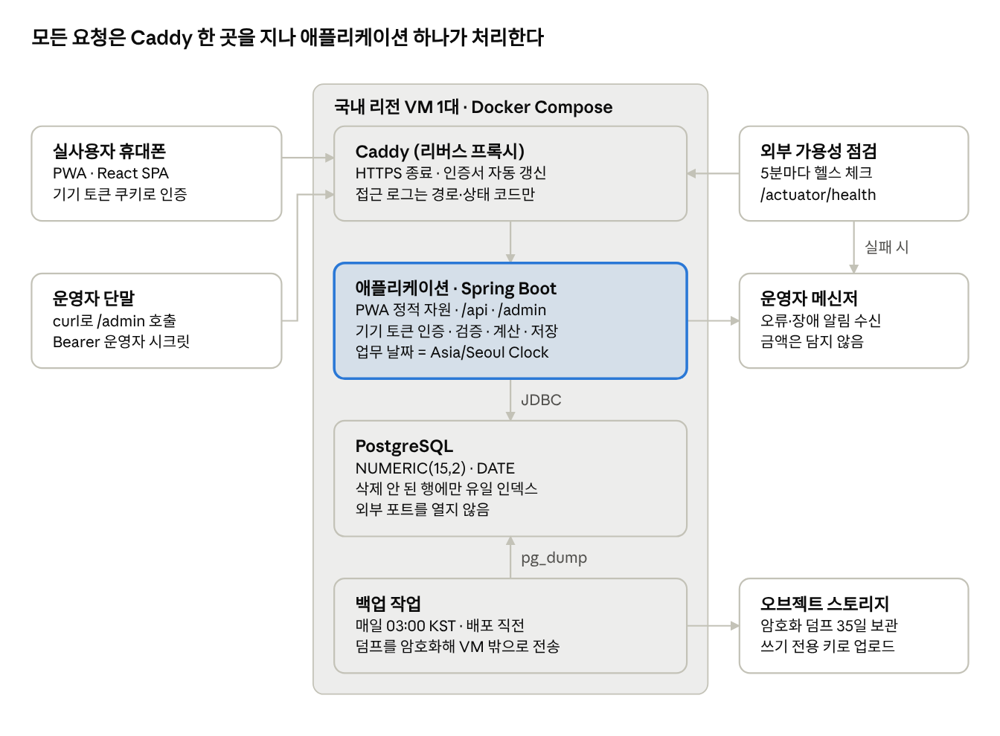
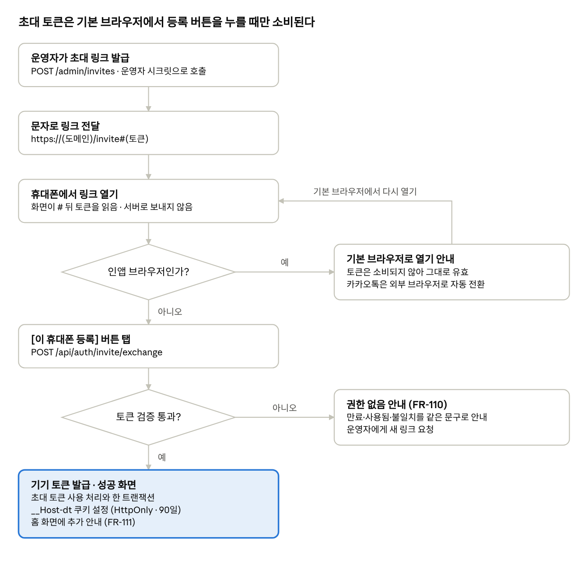

# 일일 정산 기록 서비스 — 시스템 아키텍처 설계서

Sep 28, 2026 · @최승혁

| 항목 | 내용 |
| --- | --- |
| 문서명 | 일일 정산 기록 서비스 시스템 아키텍처 설계서 |
| 버전 | v0.6 |
| 작성일 | 2026-10-06 |
| 작성자 | (본인) |
| 기준 문서 | 요구사항명세서 v1.3 (2026-10-06), 프로젝트 기획서 v0.8 (2026-10-06) |
| 상태 | 초안. 기획서 5.2의 결정 항목 11건에 대한 설계안 수록. DB 설계서 v0.1의 변경 7건과 API 명세서 v0.3의 9장 관련 변경 반영. 설계 해석 10건의 처리 확정 (15.1). 확인 사항 1건 남음 (15.2) |

> **문서의 역할** — 이 문서는 SRS의 요구사항을 어떤 구성과 기술로 구현할지 정한다. 무엇을 만들지는 SRS가, 언제·어떻게 오픈·운영할지는 기획서가 기준이다. 세 문서가 어긋나면 SRS, 기획서, 이 문서 순으로 따르고 이 문서를 고친다.

> **근거 표기** — 설계 결정은 AD-xx로 번호를 매기고, 근거가 된 요구사항 ID(FR, NFR, CAL, VAL, CON)나 기획서 항목(5.2, R-xx)을 붙였다. SRS 문구만으로 동작이 하나로 정해지지 않아 이 문서가 해석을 정한 곳은 DI-xx, 착수 전에 확인이 필요한 곳은 Q-xx로 표기하고 15장에 모았다.

## 1. 개요

국내 리전 VM 1대에서 Spring Boot 애플리케이션 하나가 React PWA 화면과 API를 같은 출처로 제공하고, PostgreSQL 하나에 기록을 저장하는 구성으로 정한다.

### 1.1 목적

기획서 5.2가 설계 단계로 넘긴 결정 항목을 확정하고, 구현 중에 추가 판단 없이 코드를 쓸 수 있는 수준으로 시스템 구성, 데이터 구조, API, 계산 방식, 배포·운영 구성을 정의한다.

### 1.2 설계 범위

기획서 5.2의 결정 항목 11건과 이 문서의 대응은 다음과 같다.

| 기획서 5.2 항목 | 결정 | 결정 ID | 절 |
| --- | --- | --- | --- |
| 클라이언트 | React SPA를 PWA로 빌드해 서버와 같은 출처에서 제공한다 | AD-02, AD-03 | 10 |
| 인증 처리 | 256비트 난수 토큰의 SHA-256 해시만 저장하고, 기기 토큰은 `__Host-` 쿠키로만 다룬다. 초대 토큰은 사용자가 등록 버튼을 누를 때만 교환한다 | AD-06, AD-07 | 5 |
| 데이터베이스 | PostgreSQL. 금액 NUMERIC(15,2), 날짜 DATE, 삭제되지 않은 행에만 걸리는 유일 인덱스 | AD-04 | 6 |
| 금액 연산 | 서버 BigDecimal, API 문자열, 클라이언트 정수 센트. 수수료 제안은 버림, 수익률은 반올림 | AD-09 | 8.1, 8.2 |
| 누적 순수익 | 조회 구간 전체에 윈도 함수로 누적한 뒤 커서 방식으로 나눈다. 같은 날짜는 계정 id 순 | AD-11 | 8.5 |
| 기록 삭제 방식 | 논리 삭제 | AD-05 | 6.3 |
| 날짜 기준 | Asia/Seoul로 고정한 `Clock`을 주입하고, 클라이언트는 서버가 준 날짜만 쓴다 | AD-08 | 7 |
| 호스팅·배포 | 국내 리전 VM 1대 + Docker Compose + Caddy. 06\~09시에는 배포 스크립트가 실행을 거부한다 | AD-12 | 12.1, 12.2 |
| 백업 | 매일 03:00 덤프를 VM 밖 오브젝트 스토리지에 저장하고 35일 보관한다 | AD-13 | 12.3 |
| 로그 | 요청·응답 본문을 기록하지 않고, 오류는 금액 없이 운영자 메신저로 알린다 | AD-14 | 12.4 |
| 환경변수 | 비밀값은 서버의 `.env`로만 주입하고 저장소에는 예시 파일만 둔다 | — | 12.5 |

### 1.3 설계 동인

사용자 1명, 5년치 약 5,000건 규모에서 성능과 확장성은 설계를 제약하지 않는다. 설계 판단이 갈리면 아래 순서를 따른다.

| 순위 | 품질 속성 | 이 서비스에서의 의미 | 근거 |
| --- | --- | --- | --- |
| 1 | 계산 정확성 | 금액·합계·수익률이 규칙대로 나오고, 날짜가 한국 시간으로 판정된다. 틀린 숫자는 서비스를 쓸 이유를 없앤다 | CAL-01\~13, CON-11 |
| 2 | 아침 사용의 확실성 | 06\~09시에 별도 절차 없이 열리고 저장된다. 인증 실패나 장애는 곧 그날 기록 누락이다 | NFR-501, FR-108, R-02, R-03 |
| 3 | 운영 단순성 | 1명이 개발·배포·백업·장애 대응을 모두 맡는다. 구성 요소 수를 최소로 유지한다 | CON-06, NFR-502 |
| 4 | 성능 | 1초 기준은 캐시나 비동기 처리 없이도 여유 있게 만족한다. 이를 위한 구조를 따로 두지 않는다 | NFR-201, NFR-202 |

## 2. 아키텍처 결정 요약

결정은 14건이다. 금액과 날짜가 어느 구간에서도 변형되지 않게 하고, 1명이 운영할 수 있는 구성 요소만 두는 것이 공통 방향이다.

| ID | 결정 | 이유 | 근거 |
| --- | --- | --- | --- |
| AD-01 | 애플리케이션 1개와 데이터베이스 1개로 구성한다(모놀리스) | 사용자 1명·운영자 1명 규모에서 서비스를 나누면 배포·장애 지점만 늘어난다 | CON-06 |
| AD-02 | 화면은 React + TypeScript SPA로 만들고, 빌드 결과를 애플리케이션이 같은 출처에서 정적 자원으로 제공한다 | 수수료 제안·순수익 미리보기·천 단위 표시가 입력 중에 즉시 반응해야 한다. 같은 출처면 CORS 없이 쿠키 인증이 단순해진다 | FR-303, FR-303-1, NFR-103, NFR-305 |
| AD-03 | PWA는 매니페스트와 최소 서비스 워커로 구성하고, HTML과 API 응답은 캐시하지 않는다 | 설치 요건만 충족하면 되고 오프라인 요구는 없다. 캐시된 화면이 지난 금액이나 인증 상태를 보여 주는 일을 막는다 | NFR-105 |
| AD-04 | 데이터베이스는 PostgreSQL을 쓴다 | 십진 고정소수점, 시간대 없는 날짜 타입, 조건부(부분) 유일 인덱스, 윈도 함수를 모두 기본 제공한다 | SRS 4.1, CAL-04 |
| AD-05 | 정산 기록 삭제는 논리 삭제로 하고, (계정 id, 정산일자) 유일 제약은 삭제되지 않은 행에만 건다 | 물리 삭제 금지를 지키면서 삭제한 날짜에 다시 입력할 수 있다 | FR-304, FR-308, NFR-404 |
| AD-06 | 초대 토큰과 기기 토큰은 32바이트 난수로 만들고 SHA-256 해시만 저장한다 | 256비트 난수는 추측할 수 없어 느린 해시가 필요 없고, 해시 값으로 바로 조회할 수 있다 | FR-104, NFR-302 |
| AD-07 | 초대 토큰은 URL 조각(`#` 뒤)에 담고, 사용자가 등록 버튼을 누를 때 POST로만 교환한다 | 문자·메신저의 링크 미리보기 수집기가 링크를 먼저 열어도 토큰이 소비되지 않는다. 조각은 서버·프록시 로그에 남지 않는다 | FR-105, FR-107, R-02 |
| AD-08 | 업무 날짜는 Asia/Seoul로 고정한 `Clock`에서만 얻고, SQL의 현재 날짜 함수를 쓰지 않는다 | 서버·DB·JVM 기본 시간대와 무관하게 판정하고, 테스트에서 기준 시각을 바꿔 넣을 수 있다 | CON-11, R-01 |
| AD-09 | 금액은 서버 BigDecimal, DB NUMERIC(15,2), API 문자열, 클라이언트 정수 센트(BigInt)로 다룬다 | 어느 구간에서도 부동소수점을 거치지 않는다. JSON 숫자는 브라우저에서 부동소수점으로 읽힌다 | CAL-04, CAL-13, VAL-13 |
| AD-10 | 쓰기는 JPA 엔티티로, 목록·집계 조회는 SQL(JdbcClient)로 처리한다 | 누적 합계와 시드 구간 분할은 윈도 함수·CTE로 쓰는 편이 짧고 검증하기 쉽다 | FR-401, FR-507\~509 |
| AD-11 | 누적 순수익은 조회 구간 전체를 (정산일자, 계정 id) 순으로 누적한 뒤 커서 방식으로 나눠 보낸다 | 페이지 이동·정렬 전환과 무관하게 같은 기록은 항상 같은 누적값을 갖는다 | SRS 1.3, FR-402, FR-408 |
| AD-12 | 국내 리전 소형 VM 1대에 Docker Compose로 Caddy·애플리케이션·DB를 올린다 | 상시 구동이라 아침 첫 요청에 콜드 스타트가 없고, HTTPS 인증서가 자동 갱신된다 | NFR-202, NFR-301, NFR-501 |
| AD-13 | 백업은 VM 밖 오브젝트 스토리지에 매일 저장하고 35일 뒤 자동 삭제한다 | VM이 통째로 사라져도 복구할 수 있어야 하고, 30일 보관 요건에 여유를 둔다 | NFR-401, NFR-402 |
| AD-14 | 요청·응답 본문은 로그에 남기지 않고, 오류는 금액 없이 운영자 메신저로 알린다 | 금액 원문 기록 금지를 구조로 지키면서 장애를 바로 알아챈다 | NFR-304, NFR-503 |

## 3. 시스템 구성

사용자·운영자·가용성 점검의 요청은 모두 Caddy의 HTTPS를 거쳐 애플리케이션 하나로 들어가고, DB와 백업 작업은 VM 안에만 있다.

### 3.1 구성도



*시스템 구성 · VM 안 4개, VM 밖 5개 구성 요소와 호출 방향*

화면(PWA)도 애플리케이션이 같은 출처에서 내려주므로 CORS 설정이 없다. DB는 VM 밖으로 포트를 열지 않으며, VM 밖으로 나가는 데이터는 암호화된 백업과 금액 없는 알림뿐이다.

### 3.2 구성 요소와 책임

| 구성 요소 | 책임 | 맡기지 않는 것 |
| --- | --- | --- |
| PWA 클라이언트 | 화면 표시, 입력 중 계산(수수료 제안·순수익 미리보기), 입력 사전 검증 | 저장 여부 판정, 최종 금액 계산, 업무 날짜 계산 |
| Caddy | HTTPS 종료, 인증서 자동 발급·갱신, HSTS 헤더 | 요청 본문·쿼리 문자열 기록 |
| 애플리케이션 | 정적 자원 제공, 인증, 검증, 저장, 조회·집계 계산, 운영자 API | 로그인 세션 보관(매 요청 토큰으로 인증), 응답 캐시 |
| PostgreSQL | 저장, 유일·검사 제약으로 무결성의 마지막 방어선 | 업무 날짜 계산(`CURRENT_DATE` 등), 반올림 |
| 백업 작업 | 매일·배포 직전 덤프 생성, 암호화 후 외부 전송, 성공·실패 알림 | 애플리케이션에 대한 의존(애플리케이션이 멈춰도 동작) |
| 외부 가용성 점검 | 5분 간격 헬스 체크, 실패 시 알림 | 인증이 필요한 경로 호출 |

## 4. 기술 스택

서버는 Java와 Spring Boot, 화면은 React와 TypeScript, 저장소는 PostgreSQL로 정한다. 선택 기준은 1.3의 순서대로 계산 정확성과 운영 단순성이다.

### 4.1 선택 결과

| 영역 | 선택 | 선택 이유 | 관련 결정 |
| --- | --- | --- | --- |
| 서버 언어 | Java 21 이상의 LTS | `BigDecimal`은 연산마다 반올림 모드를 지정하게 해 버림(`RoundingMode.DOWN`)과 반올림(`HALF_UP`)을 규칙별로 그대로 옮길 수 있다. `java.time`의 `Clock`을 주입하면 기준 시각을 테스트에서 바꿔 넣을 수 있다 | AD-08, AD-09 |
| 서버 프레임워크 | Spring Boot | 필터 체인(Security), 입력 검증(Bean Validation), 스키마 이관(Flyway), 헬스 체크(Actuator)를 한 설정 체계로 쓴다 | AD-01 |
| 데이터 접근 | Spring Data JPA(쓰기) + JdbcClient(조회) | 쓰기 규칙은 엔티티에 모으고, 누적·구간 분할 조회는 윈도 함수와 CTE를 SQL 그대로 쓴다 | AD-10 |
| 스키마 관리 | Flyway | 테이블·인덱스·뷰를 버전 파일로 관리하고 배포 때 자동 적용한다. 운영 DB에 수동 DDL을 실행하지 않는다 | 12.2 |
| 데이터베이스 | PostgreSQL | NUMERIC, DATE, 부분 유일 인덱스, 윈도 함수를 기본 제공한다 | AD-04 |
| 화면 | React + TypeScript, Vite 빌드 | 입력 중 즉시 계산하는 화면이 많고, 금액·날짜 값을 타입으로 구분해 컴파일 단계에서 섞이지 않게 한다 | AD-02 |
| PWA | vite-plugin-pwa | 매니페스트와 서비스 워커를 빌드에서 생성하고, 캐시 대상을 설정으로 선언한다 | AD-03 |
| 리버스 프록시 | Caddy | 인증서 발급·갱신이 기본 동작이라 HTTPS 운영 작업이 따로 없다 | AD-12 |
| 실행 환경 | Docker Compose | VM 한 대의 컨테이너 3개(Caddy, 애플리케이션, DB)를 파일 하나로 올리고 내린다 | AD-12 |
| CI | GitHub Actions | 테스트를 통과한 커밋의 jar만 배포 산출물로 남긴다(레지스트리 없음, 12.1) | 12.2 |
| 테스트 | JUnit 5, Testcontainers(PostgreSQL), ArchUnit, Vitest | 제약·윈도 함수는 실제 PostgreSQL로 검증하고, 시간대 관련 금지 규칙은 ArchUnit으로 빌드에서 막는다 | 14 |

버전은 착수 시점에 지원 중인 최신 안정판으로 정해 빌드 파일과 이미지 태그에 고정한다. 이 문서는 메이저 버전에 의존하는 설계를 두지 않는다.

### 4.2 검토한 대안

| 대안 | 채택하지 않은 이유 |
| --- | --- |
| 서버 렌더링(Thymeleaf) + 부분 스크립트 | 수수료 제안·순수익 미리보기·천 단위 표시가 입력마다 반응해야 해서 화면 로직이 템플릿과 스크립트로 나뉜다 |
| 화면을 별도 출처(정적 호스팅)에 두기 | 교차 출처로 쿠키를 보내려면 CORS와 `SameSite=None`이 필요하고, 홈 화면 앱의 쿠키 유지(R-03)에 변수가 하나 더 생긴다 |
| SQLite | `DECIMAL(15,2)`로 선언해도 소수가 있는 값은 REAL(부동소수점)로 저장되어 CAL-04를 DB에서 보장하지 못한다 |
| MySQL | 부분 유일 인덱스가 없어 논리 삭제와 (계정 id, 정산일자) 유일 제약을 함께 두려면 생성 컬럼 같은 우회가 필요하다 |
| 요청이 없으면 0대로 줄어드는 서버리스 컨테이너 | 하루 한 번 아침에 쓰는 패턴에서는 매일 첫 요청이 콜드 스타트가 되어 NFR-202(1초)를 넘길 수 있다 |
| PaaS + 관리형 DB | 월 비용이 VM 한 대보다 크고, 소형 요금제는 백업 보관 기간이 30일(NFR-402)에 못 미칠 수 있다 |
| 토큰 해시에 bcrypt·Argon2 | 256비트 난수 토큰은 대입 공격이 불가능해 느린 해시의 이점이 없고, 솔트 때문에 해시 값으로 바로 조회할 수 없다 |

## 5. 인증 설계

초대 토큰은 실사용자가 기본 브라우저에서 등록 버튼을 누를 때 기기 토큰 쿠키로 교환된다. 이후 모든 API 요청은 그 쿠키의 해시 조회로 인증하며, 서버에 로그인 세션을 두지 않는다.

### 5.1 토큰 모델

| 구분 | 초대 토큰 | 기기 토큰 |
| --- | --- | --- |
| 생성 | `SecureRandom` 32바이트를 Base64URL(패딩 없음, 43자)로 인코딩 | 초대 토큰과 같음 |
| 서버 저장 | `invite_token.token_hash`에 SHA-256 해시(소문자 16진수 64자)만 | `device_token.token_hash`에 SHA-256 해시만 |
| 원문이 있는 곳 | 발급 응답 1회, 초대 URL의 조각(`#` 뒤) | 브라우저 쿠키 `__Host-dt` |
| 유효기간 | 발급 후 1시간. 1회 사용 즉시 만료 | 90일. 접속 시 갱신(5.3) |
| 무효화 | 사용 처리(`used_at`) 또는 만료 | 운영자 폐기, 로그아웃(FR-112, S), 만료 |
| 근거 | FR-103\~105, NFR-302 | FR-107\~109, NFR-302, NFR-305 |

기기 토큰 쿠키는 `__Host-dt=<원문>; HttpOnly; Secure; SameSite=Lax; Path=/; Max-Age=7776000`(90일)으로 내린다. `__Host-` 접두사는 Domain 속성이 없고 Secure·`Path=/`인 쿠키만 허용해 다른 하위 도메인이 덮어쓰지 못하게 한다. `Max-Age`를 빼면 브라우저를 닫을 때 지워지는 세션 쿠키가 되므로 반드시 넣는다.

### 5.2 초대 링크 등록 흐름



*초대 링크 등록 흐름 · 단계 6개, 분기 2개*

인앱 브라우저에서는 토큰을 소비하지 않고 안내만 하므로, 기본 브라우저로 다시 열면 같은 링크로 등록할 수 있다. 단계별 구현 규칙은 다음과 같다.

| 단계 | 구현 규칙 | 근거 |
| --- | --- | --- |
| 발급 | `POST /admin/invites` 응답에 `inviteUrl`과 `expiresAt`만 담는다. 원문은 다시 조회할 수 없다 | FR-103, FR-104 |
| 링크 | `https://{도메인}/invite#{토큰}` 형식. 조각은 HTTP 요청에 실리지 않아 Caddy·애플리케이션 로그와 링크 미리보기 수집기에 토큰이 전달되지 않는다 | AD-07 |
| 인앱 감지 | 사용자 에이전트에 `KAKAOTALK` 등 인앱 표식이 있으면 등록 버튼 대신 기본 브라우저 안내를 띄운다. 카카오톡은 `kakaotalk://web/openExternal?url=`로 외부 브라우저를 연다. 이 단계에서는 조각을 지우지 않는다 | FR-111, R-02 |
| 교환 | 등록 버튼이 `POST /api/auth/invite/exchange`로 토큰을 보낸다. 서버는 한 트랜잭션에서 초대 행을 잠그고(`SELECT … FOR UPDATE`) 검증·사용 처리·기기 토큰 생성을 끝낸다. 같은 토큰의 동시 요청은 1건만 성공한다 | FR-105, FR-107 |
| 성공 | `Set-Cookie`로 기기 토큰을 내리고, 성공 화면이 `history.replaceState`로 주소창의 조각을 지운다. 브라우저별 홈 화면 추가 방법을 보여 주고, `beforeinstallprompt`를 지원하는 브라우저에서는 설치 버튼도 보여 준다 | FR-107, FR-111 |
| 재방문 | 유효한 쿠키가 있는 상태로 `/invite`를 열면 홈으로 보낸다 | FR-108 |
| 실패 | 만료·사용됨·불일치를 구분하지 않고 FR-110 문구를 보여 준다. 원인은 서버 로그에만 남기고, 토큰 값은 남기지 않는다 | FR-110 |

> **해석 DI-01** — 요구사항명세서 v1.2의 FR-107은 링크를 여는 즉시 교환하는 흐름으로 읽혔다. 이 설계는 스크립트를 실행하는 미리보기 수집기가 먼저 열어 토큰을 소비하는 일을 막으려고 등록 버튼 탭 1회를 더하며, 요구사항명세서 v1.3에서 FR-107과 FR-111을 이 흐름으로 고쳤다(15.1).

### 5.3 요청 인증과 갱신

| 항목 | 동작 | 근거 |
| --- | --- | --- |
| 인증 확인 | 매 `/api/**` 요청에서 쿠키 원문의 SHA-256 해시로 `device_token`을 조회한다. 폐기·만료되지 않았으면 통과하며, 서버 세션은 만들지 않는다 | FR-101, NFR-303 |
| 갱신 | 마지막 갱신 후 하루가 지난 첫 요청에서만 만료 시각을 그 시점부터 90일 뒤로 늘리고, 같은 값의 쿠키를 새 `Max-Age`로 다시 내린다. 매 요청 쓰기를 피하고, 토큰 값을 바꾸지 않아 동시에 나간 요청이 옛 값으로 거부되지 않는다 | FR-108 |
| 실패 응답 | 401과 오류 코드 `DEVICE_UNAUTHORIZED`. 클라이언트는 이 코드일 때만 FR-110 안내로 전환한다(10.4) | FR-110 |
| 화면 경로 | `/`, `/entry` 같은 화면 경로는 인증과 무관하게 같은 앱 셸을 내려준다. 앱 셸이 `GET /api/session`으로 인증 여부를 판단한다 | AD-03 |
| CSRF | `SameSite=Lax` 쿠키, JSON 본문만 허용, `Origin` 헤더가 서비스 출처와 다르면 거부. CORS는 열지 않으며 이 조합을 CSRF 방어로 삼는다 | NFR-305 |

### 5.4 운영자 API

| 메서드·경로 | 용도 | 근거 |
| --- | --- | --- |
| `POST /admin/invites` | 초대 링크 발급. 응답: `inviteUrl`, `expiresAt` | FR-103, FR-104 |
| `GET /admin/devices` | 기기 목록. id, 표시명, 등록·마지막 사용·만료 시각, 폐기 여부 | FR-109 |
| `POST /admin/devices/{id}/revoke` | 해당 기기 토큰 폐기 | FR-109 |

`/admin/**`는 기기 토큰과 분리된 필터 체인에서 `Authorization: Bearer <ADMIN_SECRET>` 헤더로만 인증한다. 시크릿은 32바이트 이상 난수로 만들고, 두 값의 SHA-256을 `MessageDigest.isEqual`로 비교해 비교 시간으로 값이 드러나지 않게 한다. 같은 IP에서 5회 연속 실패하면 15분간 거부한다.

기기 표시명은 등록 시 사용자 에이전트에서 OS와 브라우저 이름만 뽑아 저장한다(예: Android · Samsung Internet). 분실 신고를 받으면 목록에서 해당 기기를 찾아 폐기한다(기획서 S7).

### 5.5 홈 화면 앱과 쿠키 (R-03)

안드로이드의 크롬·삼성 인터넷으로 설치한 앱은 설치한 브라우저와 쿠키 저장소를 함께 쓰므로, 교환한 브라우저에서 설치하면 인증이 유지된다. iOS의 홈 화면 웹 앱은 Safari와 분리된 저장소를 쓰고, 추가 시점에 쿠키를 넘겨받는지는 iOS 버전별로 보고가 엇갈린다. 그래서 1주차에 실사용자 기기(또는 같은 OS·브라우저)로 다음 순서를 검증한다.

1. 기본 브라우저에서 교환하고 홈 화면에 추가한다
2. 아이콘으로 실행해 권한 없음 안내 없이 홈이 뜨는지 본다
3. 앱을 완전히 종료한 뒤 다시 실행한다
4. 다음 날 아침 다시 실행한다

어느 단계든 실패하면, 브라우저에서는 토큰을 소비하지 않고 홈 화면 추가만 안내한 뒤 설치된 앱의 첫 실행에서 교환하는 흐름(예: 홈 화면에 추가되는 시작 주소에 초대 토큰을 싣는 방식)으로 바꾼다. 이 경우 FR-107·111의 순서가 달라지므로 SRS를 먼저 고친 뒤 구현한다(Q-03).

## 6. 데이터 설계

테이블은 6개이며 금액은 `NUMERIC(15,2)`, 날짜는 `DATE`로 저장한다. 정산 기록은 논리 삭제하고, (계정 id, 정산일자) 유일 제약은 삭제되지 않은 행에만 건다. 컬럼 정의, 제약 위반과 오류 코드의 연결, 조회 SQL 같은 상세는 DB 설계서 v0.2가 정한다.

### 6.1 테이블 목록

| 테이블 | 엔티티 | 역할 | 주요 제약 | 근거 |
| --- | --- | --- | --- | --- |
| `app_user` | `User` | 사용자 1건. Flyway V1이 생성한다 | `id = 1`만 허용 | FR-102 |
| `trading_account` | `TradingAccount` | 투자 계정 | 사용자 내 계정명 유일, 계정명 앞뒤 공백 금지, 수수료율 0\~1, 활성 여부와 비활성일자 일치 | FR-201\~206, VAL-04 |
| `account_seed` | `AccountSeed` | 기준 시드 이력 | 금액 > 0, (계정 id, 적용 시작일) 유일 | FR-207\~210, VAL-07, VAL-09 |
| `settlement` | `Settlement` | 정산 기록 | 금액 부호와 대소, 순수익 = 총수익 − 수수료, 삭제되지 않은 행 기준 (계정 id, 정산일자) 유일 | FR-301\~308, VAL-01, VAL-02, AD-05 |
| `invite_token` | `InviteToken` | 초대 토큰 해시 | 해시 유일, 소문자 16진수 64자 | FR-103\~105 |
| `device_token` | `DeviceToken` | 기기 토큰 해시 | 해시 유일, 소문자 16진수 64자, 초대 1건당 기기 1건 | FR-107\~109 |

엔티티 이름은 SRS 1.3의 용어 주의에 따라 투자 계정을 `TradingAccount`로 두어 인증 계층의 `User`와 구분한다.

### 6.2 DDL

생성·수정 시각은 애플리케이션이 `Clock`으로 채우며 DB 기본값을 두지 않는다. V1이 넣는 `app_user` 1행만 예외다.

DB는 인코딩 `UTF8`, 로캘 `C`로 만든다. DB 컨테이너의 `POSTGRES_INITDB_ARGS="--encoding=UTF8 --locale=C"`는 데이터 볼륨이 비어 있을 때만 적용되므로 볼륨을 만들기 전에 넣는다. 모든 제약에는 이름을 붙여, 로그에는 제약 이름만 남기고(12.4) 제약 위반을 이름으로 오류 코드에 연결한다.

```sql
-- V1__init.sql (Flyway)
-- 컬럼 설명과 조회 SQL은 DB 설계서 v0.2 (5장 테이블 정의서, 8.1 V1 스크립트)

CREATE TABLE app_user (
    id          BIGINT       NOT NULL,
    created_at  TIMESTAMPTZ  NOT NULL,
    CONSTRAINT pk_app_user PRIMARY KEY (id),
    CONSTRAINT ck_app_user_single CHECK (id = 1)                               -- FR-102
);

INSERT INTO app_user (id, created_at) VALUES (1, now());                       -- V1에서 DB 시각을 쓰는 유일한 행

CREATE TABLE trading_account (
    id                BIGINT        GENERATED ALWAYS AS IDENTITY,
    user_id           BIGINT        NOT NULL,
    name              VARCHAR(30)   NOT NULL,
    default_fee_rate  NUMERIC(5,4)  NOT NULL DEFAULT 0.2000,
    active            BOOLEAN       NOT NULL DEFAULT TRUE,
    deactivated_on    DATE,
    memo              VARCHAR(200),
    created_at        TIMESTAMPTZ   NOT NULL,
    updated_at        TIMESTAMPTZ   NOT NULL,
    CONSTRAINT pk_trading_account PRIMARY KEY (id),
    CONSTRAINT fk_account_user FOREIGN KEY (user_id) REFERENCES app_user (id),
    CONSTRAINT uq_account_user_name UNIQUE (user_id, name),                     -- Q-01
    CONSTRAINT ck_account_name CHECK (name <> '' AND name = btrim(name)),       -- VAL-04, 앞뒤 공백 금지
    CONSTRAINT ck_account_fee_rate CHECK (default_fee_rate BETWEEN 0 AND 1),
    CONSTRAINT ck_account_deactivation CHECK (active = (deactivated_on IS NULL)) -- FR-204
);

CREATE TABLE account_seed (
    id          BIGINT         GENERATED ALWAYS AS IDENTITY,
    account_id  BIGINT         NOT NULL,
    amount      NUMERIC(15,2)  NOT NULL,
    start_date  DATE           NOT NULL,
    memo        VARCHAR(200),
    created_at  TIMESTAMPTZ    NOT NULL,
    CONSTRAINT pk_account_seed PRIMARY KEY (id),
    CONSTRAINT fk_seed_account FOREIGN KEY (account_id) REFERENCES trading_account (id),
    CONSTRAINT uq_seed_account_start UNIQUE (account_id, start_date),          -- VAL-09
    CONSTRAINT ck_seed_amount CHECK (amount > 0)                                -- VAL-07
);

CREATE TABLE settlement (
    id               BIGINT         GENERATED ALWAYS AS IDENTITY,
    account_id       BIGINT         NOT NULL,
    settlement_date  DATE           NOT NULL,
    gross_profit     NUMERIC(15,2)  NOT NULL,
    fee              NUMERIC(15,2)  NOT NULL,
    net_profit       NUMERIC(15,2)  NOT NULL,
    memo             VARCHAR(200),
    created_at       TIMESTAMPTZ    NOT NULL,
    updated_at       TIMESTAMPTZ    NOT NULL,
    deleted_at       TIMESTAMPTZ,
    CONSTRAINT pk_settlement PRIMARY KEY (id),
    CONSTRAINT fk_settlement_account FOREIGN KEY (account_id) REFERENCES trading_account (id),
    CONSTRAINT ck_settlement_gross CHECK (gross_profit > 0),                    -- VAL-01
    CONSTRAINT ck_settlement_fee CHECK (fee >= 0 AND fee < gross_profit),       -- VAL-02
    CONSTRAINT ck_settlement_net CHECK (net_profit = gross_profit - fee)        -- CAL-02, CON-09
);

-- 삭제되지 않은 행에만 거는 유일 제약 (FR-304, AD-05)
CREATE UNIQUE INDEX uq_settlement_account_date
    ON settlement (account_id, settlement_date) WHERE deleted_at IS NULL;

-- 기간 조회와 누적 정렬 (NFR-203, AD-11)
CREATE INDEX ix_settlement_date_account
    ON settlement (settlement_date, account_id) WHERE deleted_at IS NULL;

-- 조회 SQL은 이 뷰만 읽는다 (6.3)
CREATE VIEW v_settlement AS
SELECT id, account_id, settlement_date, gross_profit, fee, net_profit,
       memo, created_at, updated_at
FROM settlement
WHERE deleted_at IS NULL;

CREATE TABLE invite_token (
    id          BIGINT       GENERATED ALWAYS AS IDENTITY,
    token_hash  VARCHAR(64)  NOT NULL,
    expires_at  TIMESTAMPTZ  NOT NULL,
    used_at     TIMESTAMPTZ,
    created_at  TIMESTAMPTZ  NOT NULL,
    CONSTRAINT pk_invite_token PRIMARY KEY (id),
    CONSTRAINT uq_invite_token_hash UNIQUE (token_hash),
    CONSTRAINT ck_invite_token_hash CHECK (token_hash ~ '^[0-9a-f]{64}$')      -- SHA-256 소문자 16진수 (5.1)
);

CREATE TABLE device_token (
    id            BIGINT        GENERATED ALWAYS AS IDENTITY,
    user_id       BIGINT        NOT NULL,
    invite_id     BIGINT        NOT NULL,
    token_hash    VARCHAR(64)   NOT NULL,
    device_label  VARCHAR(100)  NOT NULL,
    expires_at    TIMESTAMPTZ   NOT NULL,
    last_used_at  TIMESTAMPTZ   NOT NULL,   -- expires_at과 함께 하루 1회만 갱신 (5.3)
    revoked_at    TIMESTAMPTZ,
    created_at    TIMESTAMPTZ   NOT NULL,
    CONSTRAINT pk_device_token PRIMARY KEY (id),
    CONSTRAINT fk_device_user FOREIGN KEY (user_id) REFERENCES app_user (id),
    CONSTRAINT fk_device_invite FOREIGN KEY (invite_id) REFERENCES invite_token (id),
    CONSTRAINT uq_device_invite UNIQUE (invite_id),
    CONSTRAINT uq_device_token_hash UNIQUE (token_hash),
    CONSTRAINT ck_device_token_hash CHECK (token_hash ~ '^[0-9a-f]{64}$')      -- SHA-256 소문자 16진수 (5.1)
);
```

`ck_settlement_net`은 차감 항목이 수수료뿐이라는 CON-09를 전제로 한다. CON-09가 바뀌면 이 제약을 마이그레이션으로 교체하되, 저장된 과거 순수익은 다시 계산하지 않는다(SRS 4.1).

### 6.3 논리 삭제

정산 기록 삭제는 `deleted_at`에 시각을 채우는 UPDATE이며 행은 남는다(NFR-404). 유일 인덱스가 삭제되지 않은 행에만 걸려 있어, 기록을 삭제한 날짜에 같은 계정으로 다시 입력할 수 있다.

삭제된 행이 합계·누적에 섞이면 화면 숫자가 틀어지므로 세 곳에서 막는다.

- 조회 SQL(JdbcClient)은 `settlement` 테이블 대신 `v_settlement` 뷰만 읽는다.
- `Settlement` 엔티티에 `@SQLRestriction("deleted_at IS NULL")`을 붙여 JPA 조회에서도 뺀다.
- 조회·집계 통합 테스트의 준비 데이터에는 삭제된 행을 항상 섞는다(T-08).

삭제된 기록을 기록으로 볼지는 판정마다 다르다.

| 판정 | 삭제된 기록 | 이유 |
| --- | --- | --- |
| 합계·누적·수익률 (CAL-05, 8장) | 제외 | 사용자가 없던 일로 만든 기록이다 |
| 중복 입력 (FR-304) | 제외 | 삭제한 날짜에 다시 입력할 수 있어야 한다 |
| 첫 시드 이전 기록 (VAL-10) | 제외 | 계산에 쓰이지 않는 행이다 |
| 계정 삭제 가능 여부 (FR-205) | 포함 | 삭제된 기록도 FK로 계정을 참조하고 물리 삭제하지 않는다(DI-08) |

### 6.4 무결성 규칙 구현 위치

사용자가 보는 오류 문구는 서버 검증이 만들고, DB 제약은 서버 검증이 뚫렸을 때의 마지막 방어선이다. DB 제약 위반 예외가 화면까지 가면 버그로 다룬다.

| 규칙 | 클라이언트 | 서버 | DB |
| --- | --- | --- | --- |
| VAL-01 총수익 > 0 | 입력 즉시 안내 | 검증 | CHECK |
| VAL-02 0 ≤ 수수료 < 총수익 | 입력 즉시 안내 | 검증 | CHECK |
| VAL-03 정산일자 ≤ 오늘 | 날짜 입력 상한 = 서버가 준 오늘 | `Clock` 기준 검증 | 없음 (현재 날짜 함수 금지, AD-08) |
| VAL-04 계정명 1\~30자 | 글자 수 제한 | 앞뒤 공백을 지운 뒤 검증 | VARCHAR(30), CHECK(빈 이름과 앞뒤 공백 거부) |
| VAL-05 메모 200자 이하 | 글자 수 제한 | 검증 | VARCHAR(200) |
| VAL-06 비활성 계정 신규 기록 금지 | 일괄 입력 대상에서 제외 | 계정 행을 잠근 뒤 검사 | 없음 |
| VAL-07 시드 금액 > 0 | 입력 즉시 안내 | 검증 | CHECK |
| VAL-09 (계정 id, 적용 시작일) 유일 | 없음 | 사전 조회 후 409 | UNIQUE |
| VAL-10 첫 시드 이전 기록 금지 | 없음 | 계정 행을 잠근 뒤 검사. 기록 입력과, 가장 이른 적용 시작일이 늦어지는 모든 시드 변경(첫 시드 시작일 변경, 첫 시드 삭제)에서 | 없음 |
| VAL-11 계정당 시드 1건 이상 | 없음 | 계정 생성과 첫 시드를 한 트랜잭션으로, 마지막 이력 삭제는 거부 | 없음 |
| VAL-12 적용 시작일 ≤ 오늘, 비활성 계정은 ≤ 비활성일자 | 날짜 입력 상한 = 오늘과 비활성일자 중 이른 날 | `Clock` 기준 검증. 비활성일자는 계정 행을 잠근 뒤 검사 | 없음 |
| VAL-13 소수 2자리 초과 거부 | 셋째 자리 입력 차단 | 문자열 형식 검사로 거부(8.1) | 없음. NUMERIC은 초과 자리를 조용히 반올림한다 |
| FR-304 (계정 id, 정산일자) 중복 금지 | 없음 | 사전 조회 후 409 | 부분 유일 인덱스 |
| CAL-02 순수익 | 미리보기만 | 계산해 저장 | CHECK |

VAL-06과 VAL-10은 요청 두 개가 엇갈리면(비활성 처리와 입력, 첫 시드 시작일 변경과 소급 입력) 각자 검사를 통과한 뒤 규칙이 깨질 수 있다. 두 검사는 해당 계정 행을 `SELECT … FOR UPDATE`로 잠근 트랜잭션 안에서 한다. 일괄 저장처럼 여러 계정을 잠글 때는 id 오름차순으로 잠가, 두 요청이 서로 반대 순서로 잠가 교착되는 일을 막는다.

## 7. 날짜와 시간대

업무상 "오늘"은 서버의 Asia/Seoul 고정 `Clock` 한 곳에서만 나오고, 클라이언트와 DB는 그 값을 받아 쓴다. 서버·DB·JVM의 기본 시간대가 무엇이든 결과는 같아야 한다(CON-11, R-01).

### 7.1 기준 날짜의 출처

| 위치 | 규칙 |
| --- | --- |
| 서버 | `Clock` 빈을 `Clock.system(ZoneId.of("Asia/Seoul"))`로 등록하고, 업무 날짜는 `BusinessCalendar.today()`(내부는 `LocalDate.now(clock)`)로만 얻는다. 테스트는 `Clock.fixed(…)`로 바꿔 넣는다 |
| DB | `CURRENT_DATE`, `now()::date` 같은 현재 날짜 식을 쿼리에 쓰지 않는다. 날짜 조건은 서버가 계산한 값을 파라미터로 넘기므로 DB의 `timezone` 설정은 결과에 영향이 없다 |
| 클라이언트 | `GET /api/session`이 준 `today`와 `presets`만 쓰고 기기 시계로 날짜를 계산하지 않는다. 앱이 다시 보일 때(`visibilitychange`)와 입력 화면에 들어올 때 다시 받아, 밤에 열어 둔 화면이 아침에 전날 날짜로 저장하는 일을 막는다 |

### 7.2 값 종류별 처리

| 값 | DB 타입 | Java 타입 | API 형식 | 시간대 변환 |
| --- | --- | --- | --- | --- |
| 정산일자, 적용 시작일, 비활성일자, 오늘 | `DATE` | `LocalDate` | `2026-09-28` | 하지 않는다 |
| 생성·수정·삭제 시각, 토큰 만료 시각 | `TIMESTAMPTZ` | `Instant` | `2026-09-28T06:31:05+09:00` | 응답 직렬화 때 Asia/Seoul 오프셋을 붙인다 |

클라이언트는 오프셋이 붙은 시각 문자열의 날짜·시각 부분을 그대로 표시하고 기기 시간대로 바꾸지 않는다. 서버 코드는 `java.time` 타입만 쓰며 `java.util.Date`, `java.sql.Timestamp`, `Calendar`를 매핑에 쓰지 않는다.

### 7.3 기간 프리셋과 전월 동기

SRS는 프리셋 이름만 정하므로 경계는 이 문서가 정한다(DI-02). 모든 프리셋의 종료일은 오늘(T)이며 지난달만 예외다.

| 프리셋 | 시작일 | 종료일 | 2026-09-28 기준 |
| --- | --- | --- | --- |
| 이번 달 | T가 속한 달의 1일 | T | 2026-09-01 \~ 2026-09-28 |
| 지난달 | 전월 1일 | 전월 말일 | 2026-08-01 \~ 2026-08-31 |
| 최근 7일 | T − 6일 | T | 2026-09-22 \~ 2026-09-28 |
| 최근 30일 | T − 29일 | T | 2026-08-30 \~ 2026-09-28 |
| 올해 | T가 속한 해의 1월 1일 | T | 2026-01-01 \~ 2026-09-28 |

홈의 전월 동기 대비(FR-501)는 이번 달 1일\~T의 순수익 합계를 전월 1일\~전월의 같은 날짜 합계와 비교한다(DI-03). 전월에 같은 날짜가 없으면 전월 말일까지로 한다. 예를 들어 T가 2026-03-31이면 비교 구간은 2026-02-01\~2026-02-28이다.

증감은 금액 차이(이번 달 − 전월)로 표시하고, 전월 합계가 0보다 클 때만 비율(%)을 함께 보인다. 비율은 CAL-07과 같이 소수 둘째 자리까지 반올림한다.

### 7.4 시간대 의존 차단

| 장치 | 내용 |
| --- | --- |
| 기본 시간대를 UTC로 고정 | 운영 컨테이너와 테스트 JVM을 `TZ=UTC`, `-Duser.timezone=UTC`로 띄운다. 기본 시간대에 기대는 코드가 있으면 개발 중에 바로 틀린 날짜가 나오게 하려는 설정이다 |
| ArchUnit 금지 규칙 | 인자 없는 `LocalDate.now()`, `LocalDateTime.now()`, `ZonedDateTime.now()`와 `ZoneId.systemDefault()`, `TimeZone.getDefault()` 호출이 있으면 빌드가 실패한다 |
| 기준 테스트 시각 | 날짜가 걸린 테스트는 KST 06:30(UTC 전날 21:30)에 고정한다. 기준 시간대를 빠뜨린 코드는 이 시각에 "오늘"이 하루 밀려 실패한다(T-06) |

## 8. 금액과 수익률 계산

금액은 입력부터 저장·응답까지 부동소수점을 한 번도 거치지 않고, 반올림은 규칙이 정한 자리에서 한 번만 한다. 수익률은 저장하지 않고 조회할 때 정산일자에 유효했던 시드로 계산한다(CAL-06, CAL-11).

### 8.1 금액 표현

| 구간 | 표현 | 규칙 |
| --- | --- | --- |
| 화면 입력 | 문자열 | 천 단위 쉼표를 뺀 값이 `^\d{1,13}(\.\d{1,2})?$`에 맞아야 한다 |
| API 요청 | JSON 문자열 `"1234.56"` | DTO의 금액 필드를 `String`으로 받아 같은 정규식으로 검사한다. JSON 숫자로 온 금액은 클라이언트가 부동소수점을 거쳤다는 뜻이므로 400으로 거부한다 |
| 서버 연산 | `BigDecimal` | `new BigDecimal(String)`으로만 만든다. `new BigDecimal(double)`과 `BigDecimal.valueOf(double)`은 쓰지 않는다 |
| DB | `NUMERIC(15,2)` | 서버가 소수 2자리로 맞춘 값만 넣는다 |
| API 응답 | JSON 문자열, 항상 소수 2자리 | `setScale(2)` 뒤 `toPlainString()`으로 직렬화해 `1E+3` 같은 지수 표기를 막는다 |
| 클라이언트 연산 | 정수 센트 `BigInt` | 금액 문자열과 센트의 변환은 `money` 모듈에만 둔다. 센트에 만분율 수수료율을 곱한 값은 `2^53`을 넘을 수 있어 `Number`로는 정확성이 보장되지 않는다 |

`new BigDecimal(5.80)`은 5.7999…로 만들어져 제안값이 1.15가 되지만, `new BigDecimal("5.80")`은 1.16이 된다. 문자열 생성자만 쓰는 이유다.

### 8.2 연산 규칙

| 계산 | 서버 (`BigDecimal`) | 클라이언트 (`BigInt` 센트) | 반올림 | 근거 |
| --- | --- | --- | --- | --- |
| 수수료 제안값 | `gross.multiply(rate).setScale(2, RoundingMode.DOWN)` | `grossCents * rateBp / 10000n` (0.2000 → `2000n`) | 버림 | CAL-03 |
| 순수익 | `gross.subtract(fee)` | 미리보기용 `grossCents - feeCents` | 없음 | CAL-02 |
| 구간 합계 | 저장된 값의 `SUM` | 서버 값을 표시만 | 없음 | CAL-05, CAL-13 |
| 수익률 | 나눗셈은 소수 12자리 `HALF_UP`, 100을 곱한 뒤 `setScale(2, HALF_UP)` | 서버 값을 표시만 | 반올림, 마지막에 1회 | CAL-07 |

`BigInt` 나눗셈은 0 쪽으로 버리고 금액은 항상 양수이므로 CAL-03의 버림과 결과가 같다. 서버의 제안값 함수는 이상치 경고(FR-303-2)와 테스트 벡터 검증에 쓴다.

서버와 클라이언트는 `shared-test-vectors/money.json`의 같은 벡터로 테스트한다(T-01, T-02).

| 총수익 | 제안값 (수수료율 0.2000) | 이 벡터가 잡는 오류 |
| --- | --- | --- |
| 1234.56 | 246.91 | SRS 4.2 예시. 수수료 246.90을 입력하면 순수익 987.66 |
| 5.80 | 1.16 | 부동소수점 버림(`Math.floor(x * 0.2 * 100) / 100`)과 `new BigDecimal(5.80)`은 1.15 |
| 0.35 | 0.07 | 부동소수점 버림은 0.06 |
| 0.01 | 0.00 | 제안값이 0.00이어도 그대로 채운다. 수수료 0은 허용된다(VAL-02) |

### 8.3 계정별 수익률

계정별 수익률은 조회 구간을 그 계정의 시드 구간으로 잘라 행마다 따로 계산한다(CAL-08, FR-508). 행의 적용 기간은 시드 구간과 조회 구간의 교집합이고, 비활성 계정은 비활성일자에서 끝난다(DI-05).

```sql
-- 계정별 시드 구간과 구간 합계. :fromDate, :toDate는 조회 구간
WITH seg AS (
    SELECT s.account_id,
           s.amount,
           s.start_date,
           LEAD(s.start_date) OVER (PARTITION BY s.account_id
                                    ORDER BY s.start_date) - 1 AS end_date
    FROM account_seed s
),
clipped AS (
    SELECT seg.account_id,
           seg.amount,
           GREATEST(seg.start_date, :fromDate) AS seg_from,
           LEAST(COALESCE(seg.end_date, :toDate), :toDate,
                 COALESCE(a.deactivated_on, :toDate)) AS seg_to
    FROM seg
    JOIN trading_account a ON a.id = seg.account_id
)
SELECT c.account_id, c.amount, c.seg_from, c.seg_to,
       COALESCE(SUM(v.gross_profit), 0) AS gross_sum,
       COALESCE(SUM(v.fee), 0)          AS fee_sum,
       COALESCE(SUM(v.net_profit), 0)   AS net_sum
FROM clipped c
LEFT JOIN v_settlement v
       ON v.account_id = c.account_id
      AND v.settlement_date BETWEEN c.seg_from AND c.seg_to
WHERE c.seg_from <= c.seg_to
GROUP BY c.account_id, c.amount, c.seg_from, c.seg_to
ORDER BY c.account_id, c.seg_from;
```

수익률은 SQL이 아니라 Java에서 `net_sum ÷ amount`로 계산해 반올림 규칙을 8.2 한 곳에 둔다. SRS 4.2의 시드 변경 예시는 두 행(10.00%, 5.00%)으로 나와야 한다(T-03).

계정별 집계 화면(FR-503)은 계정 행 아래에 시드 구간 행을 두는 2단 구조다. 계정 행에는 계정명, 총수익·수수료·순수익 합계, 전체 대비 비중을 두고, 구간 행에는 적용 기간, 적용 시드, 순수익, 수익률을 둔다. 시드 구간이 하나인 계정은 한 줄로 합친다.

비중은 계정 순수익 ÷ 전체 순수익 × 100을 소수 둘째 자리까지 반올림한 값이며, 합이 100.00%가 되도록 보정하지 않는다(DI-10). 전체 순수익이 0이면 비중을 표시하지 않는다. 여러 시드 구간에 걸친 계정의 단일 대표값(CAL-09)이 필요한 화면은 MVP에 없다.

### 8.4 통합 수익률

통합 수익률은 유효 시드 합계가 바뀌는 날짜로 조회 구간을 나눠 (구간 순수익 합계 ÷ 구간 유효 시드 합계)를 더한다. 합계는 시드 적용 시작일과 비활성일자 다음 날에만 바뀌므로, 날짜마다 계산하는 CAL-10과 결과가 같다(SRS 4.2).

1. 경계 날짜를 모은다: 조회 시작일, 조회 시작일 이후부터 종료일까지의 시드 적용 시작일, 같은 범위의 (비활성일자 + 1일).
2. 경계를 정렬해 \[경계, 다음 경계 − 1일\] 구간을 만든다. 마지막 구간은 조회 종료일에서 끝난다.
3. 구간마다 유효 시드 합계를 구한다. 구간 시작일에 운용 중인(비활성일자가 없거나 그날 이상인) 계정의, 그날 적용되는 시드(CAL-06)를 더하고, 적용되는 시드가 없는 계정은 뺀다.
4. 합계가 0인 구간은 건너뛴다.
5. 통합 수익률 = Σ(구간 순수익 합계 ÷ 구간 유효 시드 합계) × 100. 각 비율은 소수 12자리로 두고 마지막에 한 번만 반올림한다.

경계 계산과 합산은 순수 함수 `CombinedRateCalculator`가 맡고, SQL은 조회 구간의 날짜별 순수익 합계만 넘긴다. 5년치도 2천 행이 안 된다. 무작위 데이터로 날짜 단위 정의와 결과가 같은지 속성 기반 테스트로 확인한다(T-05).

SRS 4.2 예시(A 10,000.00, B 5,000.00, B는 2026-03-31 비활성, 조회 2026-01-01\~04-30)는 경계가 2026-04-01 하나라 10.00%와 3.00%를 더한 13.00%가 나온다. 현재 활성 계정의 시드로 나눈 18.00%가 나오면 구현 오류다(T-04).

기준 시드 표시(FR-507)는 응답의 `seedBasis`로 내려준다. 인접 구간의 합계가 같으면 합친 뒤, 구간이 하나면 `FIXED`, 둘 이상이면 `DAILY_SUM`이다. 합계가 0인 구간도 변화로 센다.

| 경우 | `seedBasis` | 화면 표시 |
| --- | --- | --- |
| 유효 시드 합계가 한 번도 바뀌지 않음 | `{"type": "FIXED", "amount": "15000.00"}` | 유효 시드 합계 15,000.00 기준 |
| 한 번이라도 바뀜 | `{"type": "DAILY_SUM", "fromAmount": "15000.00", "toAmount": "10000.00"}` | 일자별 합산 · 시드 합계 15,000.00(시작일) → 10,000.00(종료일) |

### 8.5 누적 순수익

누적 순수익은 조회 구간 전체를 (정산일자, 계정 id) 오름차순으로 누적한 값이며, 페이지와 정렬 방향이 바뀌어도 같은 기록은 같은 값을 가진다(AD-11).

```sql
WITH ranged AS (
    SELECT v.id, v.account_id, v.settlement_date,
           v.gross_profit, v.fee, v.net_profit, v.memo,
           SUM(v.net_profit) OVER (
               ORDER BY v.settlement_date, v.account_id
               ROWS UNBOUNDED PRECEDING
           ) AS cumulative_net
    FROM v_settlement v
    WHERE v.settlement_date BETWEEN :fromDate AND :toDate
    -- 계정을 골랐을 때만: AND v.account_id = :accountId
)
SELECT *
FROM ranged
-- 두 번째 페이지부터: 직전 페이지 마지막 행 기준 (내림차순)
WHERE (settlement_date, account_id) < (:cursorDate, :cursorAccountId)
ORDER BY settlement_date DESC, account_id DESC
LIMIT :size + 1;  -- 한 건 더 읽어 다음 페이지가 있는지 판단
```

- 커서 조건은 반드시 누적 계산 바깥에 둔다. 안쪽 `WHERE`에 넣으면 페이지마다 누적이 0부터 다시 시작한다.
- 오름차순 조회는 비교를 `>`로, 정렬을 `ASC`로 바꾼다. 커서는 마지막 행의 (정산일자, 계정 id)를 인코딩한 불투명 문자열로 내려준다.
- 같은 날짜의 기록은 계정 id 순이다. 계정명은 바뀔 수 있어(FR-203) 순서 기준으로 쓰지 않는다.
- 계정을 하나 고르면 그 계정의 기록만으로 누적하므로, 통합 조회의 누적값과 다른 것이 정상이다.
- 목록 상단 합계(FR-407)는 같은 조건의 `GET /api/settlements/summary`가 따로 준다. 오름차순 마지막 행의 누적값은 순수익 합계와 같아야 한다(T-09, T-10).

## 9. API 설계

API는 같은 출처의 `/api/**` JSON 엔드포인트이며, 금액은 소수 2자리 문자열, 날짜는 `YYYY-MM-DD`로 주고받는다. 오류는 한 가지 형식에 한국어 문구를 담아 돌려주고, 화면은 그 문구를 그대로 보여 준다(NFR-106). 이 장은 구성과 공통 규약을 정하고, 엔드포인트별 요청과 응답의 필드 단위 정의는 API 명세서가 정한다.

### 9.1 공통 규약

| 항목 | 규약 |
| --- | --- |
| 형식 | 요청·응답 본문은 `application/json; charset=utf-8`. 쓰기 요청의 형식이 다르면 415 |
| 금액·날짜 | 금액 `"1234.56"`(8.1), 날짜 `"2026-09-28"`, 시각 `"2026-09-28T06:31:05+09:00"`(7.2) |
| 상태 코드 | 200 조회·수정, 201 생성, 204 삭제, 400 검증 실패, 401 인증 실패, 403 출처 불일치, 404 없음, 409 중복·상태 충돌, 415 형식 오류, 429 운영자 인증 잠금, 500 서버 오류 |
| 오류 본문 | `code`, `message`, `fieldErrors`, `details`. `message`는 원인과 다음 행동을 담은 한국어 문장이다 |
| 목록 분할 | 커서 방식. `size` 기본 30, 최대 100. 응답에 `nextCursor`가 없으면 마지막 페이지다 |

| 오류 코드 | 상태 | 상황 | 근거 |
| --- | --- | --- | --- |
| `VALIDATION_FAILED` | 400 | 형식·범위 위반. 입력란별 사유는 `fieldErrors` | VAL-01\~05, VAL-07, VAL-12, VAL-13 |
| `DEVICE_UNAUTHORIZED` | 401 | 기기 토큰 없음·만료·폐기 | FR-110 |
| `INVITE_INVALID` | 401 | 초대 토큰 불일치, 사용됨, 만료. 원인을 구분하지 않는다 | FR-110, 5.2 |
| `ADMIN_UNAUTHORIZED` | 401 | 운영자 시크릿 없음, 불일치 | FR-103, 5.4 |
| `ORIGIN_REJECTED` | 403 | 쓰기 요청의 `Origin`이 서비스 출처와 다르거나 없음 | 5.3 |
| `NOT_FOUND` | 404 | 경로, 본문, 쿼리의 id에 해당하는 리소스가 없음. 삭제된 정산 기록 포함 | AD-05 |
| `SETTLEMENT_DUPLICATE` | 409 | 같은 계정·정산일자의 기록이 있음 | FR-304 |
| `ACCOUNT_INACTIVE` | 409 | 비활성 계정에 신규 기록, 이미 비활성인 계정의 비활성 처리 | VAL-06 |
| `SEED_NOT_APPLICABLE` | 409 | 첫 시드 적용 시작일보다 앞선 정산일자, 또는 기존 기록보다 늦은 첫 시드 시작일 | VAL-10 |
| `SEED_DUPLICATE` | 409 | 같은 적용 시작일의 시드 이력 | VAL-09 |
| `SEED_LAST_ONE` | 409 | 하나 남은 시드 이력 삭제 | VAL-11, FR-210 |
| `ACCOUNT_NAME_DUPLICATE` | 409 | 이미 쓰는 계정명 | VAL-04, Q-01 |
| `ACCOUNT_HAS_SETTLEMENTS` | 409 | 기록이 있는 계정 삭제 | FR-205, DI-08 |
| `UNSUPPORTED_MEDIA_TYPE` | 415 | 본문이 있는데 형식이 JSON이 아님 | 9.1 |
| `ADMIN_LOCKED` | 429 | 운영자 인증 연속 실패로 잠김. `Retry-After` 헤더에 남은 초 | 5.4 |
| `INTERNAL_ERROR` | 500 | 처리하지 못한 예외. 운영자 메신저로 알린다 | NFR-503, 12.4 |

제약 위반을 오류 코드로 바꾸는 연결은 DB 설계서 6.3이, 코드별 `details`와 문구 예는 API 명세서 3장이 정한다.

### 9.2 엔드포인트

| 메서드·경로 | 용도 | 요구사항 |
| --- | --- | --- |
| `GET /api/session` | 인증 여부, 오늘, 기간 프리셋. 미인증이면 `authenticated: false`만 준다 | FR-108, FR-302, FR-404 |
| `POST /api/auth/invite/exchange` | 초대 토큰을 기기 토큰 쿠키로 교환 | FR-107 |
| `POST /api/auth/logout` | 현재 기기 토큰 폐기 (S) | FR-112 |
| `GET /api/accounts` | 계정 목록. `status`는 active(기본) 또는 all. 운용 중인 계정을 먼저 두고 계정마다 삭제 가능 여부를 함께 준다 | FR-202, FR-205 |
| `POST /api/accounts` | 계정 등록. 최초 시드를 같은 요청으로 받는다 | FR-201, VAL-11 |
| `PATCH /api/accounts/{id}` | 계정명·메모 수정 | FR-203 |
| `POST /api/accounts/{id}/deactivate` | 비활성 처리. 비활성일자는 서버의 오늘 | FR-204 |
| `DELETE /api/accounts/{id}` | 기록이 한 건도 없는 계정만 시드 이력과 함께 삭제 | FR-205, DI-08 |
| `GET /api/accounts/{id}/seeds` | 시드 이력, 적용 시작일 최신순. 이력마다 적용 종료일을 함께 준다 | FR-209 |
| `POST /api/accounts/{id}/seeds` | 시드 변경 등록. 적용 시작일은 필수이며, 화면이 오늘(비활성 계정은 비활성일자)로 미리 채운다 | FR-207, FR-208 |
| `PATCH`, `DELETE /api/accounts/{id}/seeds/{seedId}` | 시드 이력 수정·삭제 (S) | FR-210 |
| `GET /api/daily-entry?date=` | 일괄 입력 화면 데이터. `date` 기본값은 오늘 | FR-309, FR-310-1 |
| `POST /api/daily-entry` | 일괄 저장 | FR-309, FR-310 |
| `POST /api/settlements` | 단건 등록(소급 입력) | FR-305, FR-311 |
| `GET`, `PUT`, `DELETE /api/settlements/{id}` | 단건 조회, 수정(총수익·수수료·메모), 논리 삭제 | FR-307, FR-308, DI-07 |
| `GET /api/settlements` | 목록. `from`, `to`, `accountId`, `order`, `cursor`, `size` | FR-401\~406, FR-408 |
| `GET /api/settlements/summary` | 목록과 같은 조건의 합계·건수 | FR-407 |
| `GET /api/stats/home` | 이번 달 순수익, 전월 동기 대비 | FR-501 |
| `GET /api/stats/monthly?year=` | 월별 집계. 그해 기록이 있는 달만 최신순으로 준다. 기록 일수는 기록이 있는 서로 다른 정산일자의 수 | FR-502, DI-04 |
| `GET /api/stats/accounts` | 계정별 집계, 시드 구간별 수익률, 통합 수익률 | FR-503, FR-507\~509 |
| `/admin/**` | 운영자 API (5.4) | FR-103, FR-109 |
| `GET /actuator/health` | 외부 가용성 점검. 상태만 반환 | NFR-503 |

### 9.3 요청·응답 예

`GET /api/session`은 `{"authenticated": true, "today": "2026-09-28", "presets": {"THIS_MONTH": {"from": "2026-09-01", "to": "2026-09-28"}, …}}` 형태이며 프리셋 값은 7.3과 같다.

`GET /api/daily-entry` → 200. A계정은 이미 입력되어 완료 상태이고 B계정만 입력 대상이다(FR-310-1).

```json
{
  "date": "2026-09-28",
  "accounts": [
    {
      "accountId": 1, "name": "A계정", "defaultFeeRate": "0.2000", "status": "DONE",
      "settlement": { "id": 1532, "grossProfit": "1234.56", "fee": "246.90", "netProfit": "987.66" }
    },
    { "accountId": 2, "name": "B계정", "defaultFeeRate": "0.2000", "status": "OPEN", "settlement": null }
  ]
}
```

`status`는 `OPEN`(입력 대상), `DONE`(기록 있음, 입력 대상에서 제외), `UNAVAILABLE`(그 날짜에 적용되는 시드가 없음, VAL-10) 중 하나다. 활성 계정만 나열한다.

`POST /api/daily-entry` 요청과 201 응답. 빈칸으로 둔 계정은 `entries`에 넣지 않는다.

```json
{
  "date": "2026-09-28",
  "entries": [
    { "accountId": 2, "grossProfit": "845.20", "fee": "169.04", "memo": null }
  ]
}
```

```json
{
  "date": "2026-09-28",
  "created": [
    { "id": 1533, "accountId": 2, "grossProfit": "845.20", "fee": "169.04", "netProfit": "676.16" }
  ]
}
```

`POST /api/settlements`로 이미 있는 2026-08-03 A계정 기록을 다시 넣으면 409. 화면은 `details.settlementId`로 단건 수정 화면 이동 버튼을 보여 준다(FR-304).

```json
{
  "code": "SETTLEMENT_DUPLICATE",
  "message": "8월 3일 A계정 기록이 이미 있습니다. 수정하시겠습니까?",
  "fieldErrors": [],
  "details": { "settlementId": 1187, "accountId": 1, "settlementDate": "2026-08-03" }
}
```

검증 실패 → 400.

```json
{
  "code": "VALIDATION_FAILED",
  "message": "입력값을 확인해 주세요.",
  "fieldErrors": [
    { "field": "entries[0].fee", "message": "수수료는 총수익보다 작아야 합니다. 정산 내역의 수수료를 다시 확인해 주세요." }
  ],
  "details": {}
}
```

### 9.4 일괄 저장 규칙

- 일괄 저장은 한 트랜잭션이다. 한 계정이라도 검증에 실패하면 아무 기록도 만들지 않고 400에 계정별 `fieldErrors`를 담는다(DI-06).
- 빈칸인 계정은 `entries`에 넣지 않는다. 빈칸은 건너뛰기이고 0은 검증 오류다(FR-310).
- 다른 탭이나 기기에서 같은 계정·날짜 기록이 먼저 생기면 409 `SETTLEMENT_DUPLICATE`를 돌려준다. 화면은 일괄 입력 데이터를 다시 받아 그 계정을 완료 상태로 바꾼다.
- 저장 버튼은 응답이 올 때까지 비활성화한다. 그래도 두 번째 요청이 가면 부분 유일 인덱스가 막는다.
- 단건 수정은 총수익·수수료·메모만 바꾼다. 계정이나 정산일자가 틀렸으면 삭제한 뒤 다시 입력한다(DI-07).

### 9.5 MVP 이후 항목의 수용

| 항목 | 수용 방식 |
| --- | --- |
| FR-303-2 수수료 이상치 경고 | 제안값과 입력값의 차이로 클라이언트가 확인 창을 띄운다. 저장 API는 바뀌지 않는다 |
| FR-312 미입력 계정 표시 | `GET /api/stats/home` 응답에 활성 계정 전체의 오늘 입력 여부(`todayStatus`)를 더한다. 화면 시안이 입력 완료 계정도 함께 보인다 |
| FR-409, FR-410 금액·메모 검색 | `GET /api/settlements`와 `…/summary`에 검색 파라미터를 더한다 |
| FR-411, NFR-403 CSV | CSV 엔드포인트를 더한다. UTF-8 BOM, `YYYY-MM-DD`, 쉼표 없는 소수 2자리, 계정명으로 계정 식별(SRS 5.4) |
| FR-504 일평균 순수익 | `GET /api/stats/accounts` 응답에 조회 구간의 일평균 순수익을 더한다. 통계 화면이 통합 수익률 아래에 보인다 |
| FR-505 월별 추이 그래프 | `GET /api/stats/monthly` 응답을 그대로 그린다 |
| FR-313 수정·삭제 이력 | 수정·삭제 직전 값을 남기는 이력 테이블을 더한다 |

## 10. 클라이언트 설계

화면은 React SPA 하나이며, 모든 경로가 같은 앱 셸에서 시작해 `GET /api/session`으로 인증 상태와 오늘 날짜를 받는다. 홈에서 \[오늘 입력\]을 누르고 금액을 넣은 뒤 \[저장\]을 누르면 끝나므로, 금액 입력을 빼면 탭 2번이다(NFR-102).

### 10.1 화면과 경로

| 화면 | 경로 | 주요 API | 비고 |
| --- | --- | --- | --- |
| SCR-01 초대 링크 진입 | `/invite` | `POST /api/auth/invite/exchange` | 5.2 |
| SCR-02 홈 | `/` | `GET /api/stats/home` | 이번 달 순수익, 전월 동기 대비, \[오늘 입력\] 버튼 |
| SCR-03 일일 일괄 입력 | `/entry` | `GET`, `POST /api/daily-entry` | 완료된 계정은 저장값과 함께 잠금 표시 |
| SCR-03-1 단건 입력·수정 | `/settlements/new`, `/settlements/:id` | `/api/settlements` | 소급 입력, 수정·삭제 |
| SCR-04 거래내역 | `/transactions` | `GET /api/settlements`, `…/summary` | 기간·계정·정렬을 URL 쿼리에 둬 뒤로 가기 뒤에도 유지 |
| SCR-05 통계 | `/stats` | `GET /api/stats/monthly`, `…/accounts` | 계정별 집계는 8.3의 2단 표 |
| SCR-06 계정 관리 | `/accounts` | `/api/accounts` | 목록·수정·비활성 (MVP 최소 구현) |
| SCR-06-1 시드 이력 | `/accounts/:id/seeds` | `/api/accounts/{id}/seeds` | 변경 등록, 이력 목록 |

### 10.2 PWA와 캐시

매니페스트는 `display: standalone`, `start_url: /`, `scope: /`, `lang: ko`로 두고, 192px·512px 아이콘과 maskable 아이콘, iOS용 `apple-touch-icon`을 넣는다(NFR-105).

| 대상 | 서비스 워커 전략 | 이유 |
| --- | --- | --- |
| 해시가 붙은 JS·CSS·아이콘 | 빌드 때 미리 캐시, 캐시 우선 | 내용이 바뀌면 파일 이름도 바뀌어 옛 파일이 쓰일 일이 없다 |
| HTML(앱 셸) | 캐시하지 않음. 연결이 없으면 미리 캐시한 오프라인 안내 페이지 | 앱을 다시 열면 항상 새 배포의 화면을 받는다 |
| `/api/**`, `/admin/**` | 캐시하지 않음 | 지난 금액이나 지난 인증 상태를 보여 주지 않는다(AD-03) |

HTML을 캐시하지 않으므로 배포 반영은 다음 실행 때 저절로 된다. 입력 도중 화면을 새로 고치는 자동 갱신은 쓰지 않는다.

### 10.3 금액 입력

| 항목 | 규칙 | 근거 |
| --- | --- | --- |
| 입력란 | `type="text"`, `inputmode="decimal"`. `type="number"`는 쉼표를 표시할 수 없고 브라우저마다 소수점 처리가 달라 쓰지 않는다 | NFR-103 |
| 천 단위 쉼표 | 입력하는 동안 자동으로 넣고, 쉼표가 늘어나도 커서가 입력하던 자리에 남도록 보정한다 | NFR-103 |
| 소수 자릿수 | 소수 셋째 자리는 입력되지 않게 막는다. 붙여 넣은 값이 규칙에 어긋나면 입력란 아래에 안내한다 | VAL-13 |
| 수수료 제안 | 총수익을 입력하면 수수료 칸을 제안값으로 채운다. 사용자가 수수료를 직접 고친 뒤에는 총수익을 바꿔도 덮어쓰지 않고, 옆에 \[제안값으로 되돌리기\]를 보여 준다 | FR-303, DI-09 |
| 순수익 미리보기 | 두 칸이 모두 유효할 때만 표시한다 | FR-303-1 |
| 글자 크기 | 입력란 16px 이상. iOS Safari는 16px 미만 입력란에 초점이 가면 화면을 확대한다 | NFR-104 |
| 날짜 입력 | `type="date"`, `max`는 서버가 준 오늘 | VAL-03 |

### 10.4 오류 구분

| 상황 | 판별 | 화면 |
| --- | --- | --- |
| 인증 없음 | 401 + `DEVICE_UNAUTHORIZED` | 전체 화면에 FR-110 문구: 접속 권한이 없습니다. 운영자에게 연락해 새 링크를 받으세요 |
| 검증 실패·충돌 | 400, 409 | 서버의 `message`와 `fieldErrors`를 해당 입력란 옆에 그대로 표시 |
| 연결 실패·서버 오류 | 네트워크 오류, 시간 초과, 5xx | 서버에 연결할 수 없습니다. 잠시 후 다시 시도해 주세요. 입력한 값은 지우지 않는다 |

연결 실패를 권한 없음으로 보여 주면 실사용자는 멀쩡한 기기로 운영자에게 새 링크를 요청하게 된다. 두 문구는 반드시 달라야 하며, 401이면서 `DEVICE_UNAUTHORIZED`일 때만 권한 없음 화면으로 간다.

## 11. 코드 구조

저장소 하나에 백엔드·프론트엔드·배포 파일을 두고, 빌드 결과는 프론트엔드를 포함한 jar 하나다. 계산 규칙(CAL)은 프레임워크에 의존하지 않는 순수 함수로 모은다.

### 11.1 저장소

```text
settlement-tracker/
├── backend/              Spring Boot (Gradle)
├── frontend/             React + TypeScript (Vite)
├── deploy/               compose.yaml, Caddyfile, deploy.sh, backup.sh, .env.example
├── shared-test-vectors/  백엔드와 프론트엔드가 함께 읽는 계산 테스트 벡터(JSON)
└── docs/                 운영 절차서(초대 링크 발급, 기기 토큰 폐기, 백업 복구)
```

Gradle 빌드가 프론트엔드를 빌드해 정적 리소스로 넣으므로 배포 이미지는 하나다. 프론트엔드는 화면(`pages`), API 호출(`api`), 금액(`money`), 날짜 표시(`date`)로 나누고, 금액 문자열과 센트의 변환은 `money`에만 둔다.

### 11.2 백엔드 패키지

| 패키지 | 책임 | 관련 절 |
| --- | --- | --- |
| `common.time` | `Clock` 빈, `BusinessCalendar`, 기간 프리셋과 전월 동기 구간 | 7 |
| `common.money` | 금액 파싱·검증, 수수료 제안값, 수익률 반올림 | 8.1, 8.2 |
| `common.web` | 오류 응답 형식, 예외와 상태 코드 변환 | 9.1 |
| `auth` | 초대·기기 토큰, 필터 체인, 운영자 API | 5 |
| `account` | 계정과 시드 이력 쓰기 | 6, 9.2 |
| `settlement` | 정산 기록 쓰기(일괄·단건·수정·삭제) | 6.3, 9.4 |
| `query` | 거래내역 목록·합계·누적 조회 | 8.5 |
| `stats` | 홈·월별·계정별 집계, 시드 구간별·통합 수익률 | 8.3, 8.4 |

### 11.3 쓰기와 조회의 분리

- 쓰기(`account`, `settlement`)는 JPA 엔티티와 트랜잭션 서비스로, 조회(`query`, `stats`)는 JdbcClient SQL과 응답 전용 레코드로 만든다(AD-10). 조회 쪽은 엔티티를 쓰지 않는다.
- 제안값, 순수익, 수익률, 시드 구간 분할, 통합 수익률은 `common.money`와 `stats`의 순수 함수에 두고 단위 테스트한다. SQL과 컨트롤러에서는 반올림하지 않는다.
- ArchUnit으로 의존 방향(쓰기·조회 → 공통, 쓰기와 조회 사이는 서로 참조 금지)과 7.4의 금지 규칙을 검사한다.

## 12. 배포와 운영

국내 리전 VM 한 대에서 컨테이너 3개가 돌고, 배포 스크립트는 KST 06\~09시에 실행을 거부하며 직전 덤프를 남긴 뒤 진행한다. 백업은 매일 03:00에 암호화해 VM 밖에 35일 보관한다(AD-12, AD-13).

### 12.1 배포 구성

| 구성 | 내용 |
| --- | --- |
| VM | Oracle Cloud 무료 티어. 홈 리전은 서울 또는 춘천으로 정하고 A1(Arm) 2 OCPU·메모리 4GB로 만든다. 무료 인스턴스는 홈 리전에서만 만들 수 있고 용량 부족으로 생성이 거절될 수 있어 착수 전에 만들어 둔다. 호스트 시간대는 UTC(7.4), JVM 최대 힙은 512MB |
| 무료 티어 유지 | 유휴 회수 기준(7일간 CPU·네트워크·메모리 사용률이 모두 20% 미만)에 걸리지 않도록 메모리를 4GB로만 잡아 사용률을 20% 위로 두고, 배포 후 콘솔에서 확인한다. 계정은 종량제로 전환하되 쿼터와 1달러 예산 알림으로 무료 한도를 넘지 않게 하고, 체험 기간에도 무료 한도 안에서만 만든다 |
| 컨테이너 | `caddy`(80·443 공개), `app`(내부 8080), `db`(내부 5432, 외부 비공개). DB 데이터는 호스트 볼륨에 둔다 |
| 도메인·HTTPS | 무료 서브도메인 1개. 공개 접미사 목록(PSL)에 오른 도메인 아래에서 받아, 인증서 발급 한도를 다른 이용자와 나눠 쓰지 않고 다른 이용자가 상위 도메인에 쿠키를 심지 못하게 한다. IP가 바뀌면 VM의 갱신 작업이 A 레코드를 고친다. Caddy가 인증서를 자동 발급·갱신하고, Caddyfile에서 HSTS와 13장의 보안 헤더를 붙인다 |
| 이미지 | 레지스트리를 쓰지 않는다. CI가 테스트를 통과한 jar를 산출물로 남기면, 배포 때 그 jar를 VM으로 옮겨 커밋 해시 태그로 `app` 이미지를 만든다. Dockerfile은 jar를 멀티 아키텍처 JRE 이미지에 복사만 하므로 arm64 VM에서도 가볍게 빌드된다 |
| 방화벽 | 인바운드는 80·443과 운영자 SSH(키 인증)만 허용한다 |

### 12.2 배포 절차

1. main에 병합하면 CI가 테스트(14장)를 돌리고, 통과하면 jar를 산출물로 남긴다.
2. 운영자가 VM에서 `deploy.sh <태그>`를 실행한다. 스크립트는 호스트 시간대(UTC)가 아니라 `TZ=Asia/Seoul`로 시각을 판정해 06:00\~08:59이면 거부한다(NFR-501).
3. 배포 직전 덤프를 만들어 백업 저장소에 올린다.
4. 해당 커밋의 jar로 이미지를 만든 뒤 `app`을 교체하며, 시작할 때 Flyway가 마이그레이션을 적용한다.
5. `/actuator/health`가 정해진 시간 안에 정상이 되지 않으면 이전 태그로 되돌린다. 마이그레이션 때문에 되돌릴 수 없으면 3의 덤프로 복구한다.

이전 버전 코드가 새 스키마에서도 돌아야 되돌리기가 가능하다. 그래서 열 이름 변경·삭제 같은 호환되지 않는 변경은 두 번에 나눠 배포한다(새 구조 추가와 코드 전환 → 옛 구조 제거).

### 12.3 백업과 복구

| 항목 | 내용 | 근거 |
| --- | --- | --- |
| 방식 | `pg_dump -Fc` 전체 덤프 | NFR-401 |
| 주기 | 매일 03:00 KST와 배포 직전. 타이머에 시간대를 명시한다(`OnCalendar=*-*-* 03:00:00 Asia/Seoul`) | NFR-401, NFR-501 |
| 저장 위치 | 같은 Oracle 계정의 Object Storage를 무료 한도 안에서 쓴다(S3 호환 API). VM에 두는 키는 객체 생성 권한만 가진 사용자의 키라 VM이 털려도 백업을 읽거나 지울 수 없다 | AD-13 |
| 암호화 | 운영자 공개키로 암호화해 올린다(age 또는 gpg). 개인키는 서버 밖 운영자 기기에만 둔다 | AD-13 |
| 보관 | 버킷 수명 주기 규칙으로 35일 뒤 자동 삭제 | NFR-402 |
| 외부 사본 | 한 달에 한 번 최신 암호화 백업을 운영자 PC로 받아 둔다. Oracle 계정이 막혀 VM과 백업을 함께 잃는 경우에 대비한다 | NFR-401 |
| 결과 확인 | 성공·실패를 운영자 메신저로 알린다. 아침에 전날 성공 알림이 없으면 운영자가 확인한다 | NFR-503 |
| 복구 리허설 | 오픈 전 1회(기획서 7.1), 이후 분기마다 1회. 새 DB에 복구해 기록 건수와 합계를 대조한다 | NFR-401 |

### 12.4 로그와 알림

| 항목 | 내용 | 근거 |
| --- | --- | --- |
| 출력 | 애플리케이션은 표준 출력으로만 쓰고, Docker 로그 드라이버의 크기 제한으로 순환한다 | NFR-503 |
| 접근 로그 | 메서드, 경로(쿼리 문자열 제외), 상태 코드, 처리 시간만 남긴다. Caddy의 접근 로그는 끄고 애플리케이션이 이 형식으로 남긴다 | NFR-304 |
| 본문·파라미터 | 요청·응답 본문과 SQL 파라미터를 남기지 않는다 | NFR-304, AD-14 |
| DB 예외 | 제약 이름과 오류 코드만 남긴다. PostgreSQL 제약 위반 오류는 DETAIL에 행 값(금액 포함)을 담는다 | NFR-304 |
| 오류 알림 | ERROR 로그는 10분 단위로 묶어 운영자 메신저로 보낸다. 오류 코드와 경로만 보내고 금액·토큰은 넣지 않는다 | NFR-503 |
| 인증 이벤트 | 초대 발급, 교환 성공과 실패 원인, 기기 폐기, 운영자 인증 실패를 남긴다. 토큰 값은 남기지 않는다 | FR-109, FR-110 |
| 가용성 | 외부 점검 서비스가 5분마다 `/actuator/health`를 호출하고 실패하면 알린다 | NFR-501, NFR-503 |

### 12.5 비밀값과 환경변수

| 변수 | 용도 |
| --- | --- |
| `ADMIN_SECRET` | 운영자 API 인증. 32바이트 이상 난수 |
| `DB_URL`, `DB_USER`, `DB_PASSWORD` | DB 접속 |
| `APP_BASE_URL` | 초대 URL 생성, `Origin` 검사 기준 |
| `ALERT_WEBHOOK_URL` | 운영자 메신저 알림 |
| `BACKUP_ENDPOINT`, `BACKUP_BUCKET`, `BACKUP_ACCESS_KEY`, `BACKUP_SECRET_KEY` | 백업 업로드. 엔드포인트는 Object Storage의 S3 호환 주소, 키는 객체 생성 권한만 가진 사용자의 키 |
| `BACKUP_ENCRYPTION_PUBLIC_KEY` | 백업 암호화 공개키 |
| `DDNS_TOKEN` | 무료 서브도메인의 A 레코드 갱신 |

값은 VM의 `.env`(권한 600)에만 두고, 저장소에는 `.env.example`만 커밋하며 `.env`는 `.gitignore`에 넣는다(NFR-306). 기준 시간대는 바꿀 수 있는 설정이 아니므로 환경변수로 두지 않고 코드 상수로 고정한다.

### 12.6 초기 데이터

운용 계정 2건과 계정별 최초 시드(금액, 적용 시작일)는 기획서 CHK-05로 받는다. 실제 금액이 담긴 적재 스크립트는 저장소 밖에서 1회 실행하고 Flyway 마이그레이션에 넣지 않는다. 최초 적용 시작일은 소급 입력이 필요한 가장 이른 날짜 이하로 정한다(VAL-10).

## 13. 보안 요구사항 대응

NFR-301\~306은 모두 구성과 코드 규칙으로 대응하며, 추가로 응답 보안 헤더 3종을 붙인다.

| 요구사항 | 대응 | 절 |
| --- | --- | --- |
| NFR-301 HTTPS | Caddy 자동 인증서, HTTP 요청은 HTTPS로 전환, HSTS | 12.1 |
| NFR-302 토큰 해시 저장 | 32바이트 난수의 SHA-256만 저장. 원문은 발급 응답, URL 조각, 쿠키에만 있다 | 5.1 |
| NFR-303 미인증 차단 | `/api/**`는 기기 토큰 필터, `/admin/**`는 운영자 시크릿 필터. 예외는 `GET /api/session`(인증 여부만 응답), 초대 교환, 헬스 체크뿐이다 | 5.3, 5.4 |
| NFR-304 금액 로그 금지 | 본문·SQL 파라미터·쿼리 문자열 미기록, DB 예외는 제약 이름만 | 12.4 |
| NFR-305 쿠키 속성 | `__Host-dt` 쿠키에 HttpOnly·Secure·SameSite=Lax. 스크립트가 읽는 저장소에 토큰을 두지 않는다 | 5.1 |
| NFR-306 비밀값 미커밋 | `.env`는 서버에만, 저장소에는 `.env.example`만 | 12.5 |

| 추가 헤더 | 값 | 목적 |
| --- | --- | --- |
| `Content-Security-Policy` | `default-src 'self'; frame-ancestors 'none'` | 외부 스크립트 실행과 다른 사이트의 프레임 삽입을 막는다 |
| `Referrer-Policy` | `no-referrer` | 외부 링크로 이동할 때 주소가 전달되지 않게 한다 |
| `X-Content-Type-Options` | `nosniff` | 응답 형식 추측을 막는다 |

CSP가 화면을 깨지 않도록 빌드 결과에 인라인 스크립트·스타일이 생기지 않게 설정하고, 1주차에 헤더를 켠 상태로 전 화면을 확인한다.

## 14. 테스트 전략

SRS 4.2의 두 계산 예시와 한국 시간 새벽의 날짜 경계를 자동 테스트로 고정하고(R-04, R-01), 초대 링크 인증은 1주차에 실기기로 검증한다(R-03).

### 14.1 테스트 계층

| 계층 | 도구 | 대상 |
| --- | --- | --- |
| 단위 | JUnit 5, Vitest | 금액·수익률 순수 함수, 시드 구간 분할, 통합 수익률, 프리셋, 금액 입력 서식 |
| 공유 벡터 | JUnit 5와 Vitest가 같은 JSON을 읽음 | 서버와 클라이언트의 제안값·순수익이 같은지 |
| 통합 | Spring Boot Test + Testcontainers(PostgreSQL) | 제약, 부분 유일 인덱스, 윈도 함수, 트랜잭션과 잠금 |
| API | MockMvc | 상태 코드, 오류 형식, 쿠키 속성 |
| 구조 | ArchUnit | 시간대 금지 규칙(7.4), 의존 방향(11.3) |

### 14.2 필수 검증 사례

| ID | 검증 | 기대 결과 | 근거 |
| --- | --- | --- | --- |
| T-01 | 총수익 1,234.56의 제안값, 수수료 246.90 입력 시 순수익 | 246.91, 987.66 | SRS 4.2, CAL-03 |
| T-02 | 총수익 5.80, 0.35의 제안값을 서버와 클라이언트에서 | 1.16, 0.07 (부동소수점이면 1.15, 0.06) | CAL-03, CAL-04 |
| T-03 | 시드 5,000,000에서 7월 1일 10,000,000으로 증액, 1\~12월 조회 | 두 행, 10.00%와 5.00% | SRS 4.2, FR-508 |
| T-04 | A 10,000.00, B 5,000.00(2026-03-31 비활성), 2026-01-01\~04-30 통합 수익률 | 13.00% (18.00%면 실패) | SRS 4.2, CAL-10 |
| T-05 | 무작위 계정·시드·비활성일자·기록으로 구간 방식과 날짜 단위 정의를 비교 | 모든 경우 같은 값 | CAL-10 |
| T-06 | 기준 시각 KST 06:30(UTC 전날 21:30)에서 오늘, 기본 정산일자, 미래 날짜 판정 | 모두 한국 날짜 기준 | CON-11, R-01 |
| T-07 | 오늘이 2026-03-31일 때 전월 동기 구간 | 2026-02-01 \~ 2026-02-28 | DI-03 |
| T-08 | 삭제된 기록을 섞은 데이터로 목록·합계·누적·수익률 조회 | 삭제된 기록이 어디에도 반영되지 않음 | AD-05 |
| T-09 | 같은 날짜에 두 계정 기록이 있는 데이터를 페이지 크기 1\~3, 오름·내림차순으로 조회 | 같은 기록은 항상 같은 누적값 | AD-11 |
| T-10 | 목록 개별 금액의 합과 합계 API 비교 | 항상 일치 | CAL-13, FR-407 |
| T-11 | 초대 토큰 재사용, 1시간 경과 후 사용, 같은 토큰 동시 교환 2건 | 재사용·만료 거부, 동시 요청은 1건만 성공 | FR-105 |
| T-12 | 일괄 저장 중 한 계정만 검증 실패, 같은 계정·날짜 동시 저장 | 아무것도 저장되지 않음, 한쪽은 409 | DI-06, FR-304 |
| T-13 | 소수 셋째 자리 금액, JSON 숫자로 보낸 금액 | 둘 다 400 | VAL-13, 8.1 |

### 14.3 성능 측정

계정 2개 × 2,500일(약 5,000건)과 시드 변경 몇 건을 넣은 DB로, 운영과 같은 사양의 VM에서 응답 시간을 잰다(NFR-201, NFR-202). 대상은 목록 첫 페이지와 마지막 페이지, 합계, 계정별·통합 수익률, 일괄 저장이며 기준은 각 1초 이내다.

배포 직후 첫 요청도 따로 잰다. 막 뜬 JVM의 첫 요청이 아침 첫 사용과 겹칠 수 있으므로, 애플리케이션은 시작 직후 대표 조회를 한 번 실행해 예열한다.

### 14.4 실기기 점검 (1주차)

| 항목 | 확인 내용 | 근거 |
| --- | --- | --- |
| 링크 열기 | 실제 전달 수단(문자 등)으로 보낸 링크가 열리고, 링크 미리보기가 토큰을 소비하지 않는다. 무료 서브도메인 링크도 차단이나 경고 없이 열린다 | R-02, AD-07 |
| 인앱 안내 | 카카오톡 등 인앱 브라우저에서 기본 브라우저 안내가 뜨고 전환된다 | FR-111 |
| 쿠키 유지 | 5.5의 네 단계를 모두 통과한다 | R-03 |
| 앱 실행 | 홈 화면 아이콘으로 열면 주소창이 없다 | NFR-105 |
| 키패드 | 금액 입력란에서 소수점이 있는 숫자 키패드가 뜬다 | NFR-103 |
| 날짜 상한 | 날짜 입력에서 내일을 고를 수 없다 | VAL-03 |
| 화면 폭 | 360px 폭에서 가로 스크롤이 없고, 입력란에 초점이 가도 화면이 확대되지 않는다 | NFR-101, NFR-104 |

## 15. 설계 해석과 확인 사항

SRS 문구만으로 동작이 하나로 정해지지 않는 10곳은 이 문서가 해석을 정했고(DI), 착수 전 확인 사항 3건 중 Q-01·Q-02는 확정되어 Q-03 1건이 남았다(Q). DI 가운데 SRS 문구와 어긋나던 DI-01, DI-08은 요구사항명세서 v1.3에 반영했고, SRS가 정하지 않은 부분을 채운 나머지 8건은 이 문서를 근거로 유지한다.

### 15.1 설계 해석 (DI)

| ID | 요구사항 | 해석 | 절 | 처리 |
| --- | --- | --- | --- | --- |
| DI-01 | FR-107 초대 링크 교환 | 링크를 여는 즉시가 아니라 \[이 휴대폰 등록\] 버튼을 누를 때 교환한다. 스크립트를 실행하는 링크 미리보기 수집기가 토큰을 소비하는 일을 막는다 | 5.2 | SRS v1.3 반영 (FR-107, FR-111) |
| DI-02 | FR-404 기간 프리셋 | 종료일은 오늘이며 지난달만 전월 말일까지다. 최근 7일·30일은 오늘을 포함한 달력 일수다 | 7.3 | 설계서 유지 |
| DI-03 | FR-501 전월 동기 | 전월 1일\~전월의 같은 날짜(없으면 말일)와 비교한다. 증감은 금액 차이로 보이고, 전월 값이 0보다 클 때만 비율을 함께 보인다 | 7.3 | 설계서 유지 |
| DI-04 | FR-502 기록 일수 | 기록이 있는 서로 다른 정산일자의 수다. 같은 날 두 계정의 기록은 1일로 센다 | 9.2 | 설계서 유지 |
| DI-05 | FR-508 적용 기간 | 행의 적용 기간은 시드 구간과 조회 구간의 교집합이며, 비활성 계정은 비활성일자에서 끝난다 | 8.3 | 설계서 유지 |
| DI-06 | FR-309 일괄 저장 | 전부 저장하거나 전부 저장하지 않는다 | 9.4 | 설계서 유지 |
| DI-07 | FR-307 수정 범위 | 총수익·수수료·메모만 수정한다. 계정이나 정산일자가 틀렸으면 삭제 후 다시 입력한다 | 9.4 | 설계서 유지 |
| DI-08 | FR-204, FR-205 계정 삭제 | 기록이 한 건도 없는(삭제된 기록 포함) 계정만 시드 이력과 함께 물리 삭제할 수 있고, 기록이 있으면 비활성만 가능하다 | 6.3, 9.2 | SRS v1.3 반영 (FR-204, FR-205) |
| DI-09 | FR-303 수수료 제안 | 사용자가 수수료를 직접 고친 뒤에는 총수익을 바꿔도 제안값으로 덮어쓰지 않는다 | 10.3 | 설계서 유지 |
| DI-10 | FR-503 비중 | 소수 둘째 자리까지 반올림한 값을 그대로 보이며, 합이 100.00%가 되도록 보정하지 않는다 | 8.3 | 설계서 유지 |

### 15.2 확인 필요 사항 (Q)

| ID | 항목 | 확인할 내용 | 영향 |
| --- | --- | --- | --- |
| Q-01 | 계정명 유일성 | 확정(2026-09-28). 계정명은 비활성 계정을 포함해 전체에서 유일하다. CSV가 계정을 계정명으로 식별하기 때문이다(NFR-403). 같은 계정을 다시 운용할 때(FR-204) 새 계정이 옛 이름을 쓰려면, 비활성 계정의 이름을 먼저 바꾸도록 오류 문구로 안내한다. 쉬었다 다시 쓰는 계정은 드물 것으로 보고 재활성화는 지원하지 않으며, 그런 계정이 생기면 비활성일자 대신 운용 기간 이력을 두어 재활성화를 지원한다 | FR-204, NFR-403, 6.2 |
| Q-02 | 호스팅 사업자·도메인 | 확정(2026-09-28). 월 비용 0원을 우선해 Oracle Cloud 무료 티어(서울 또는 춘천 홈 리전, A1 2 OCPU·4GB)와 같은 계정의 Object Storage를 쓰고, 도메인은 공개 접미사 목록에 오른 무료 서브도메인을 쓴다. 유휴 회수와 계정 문제에 대한 대책은 12.1과 12.3에 둔다 | 12.1, 12.3, 12.5 |
| Q-03 | 인증 흐름 유지 여부 | 1주차 실기기 검증(5.5) 결과로 현재 흐름을 유지할지, 설치된 앱의 첫 실행에서 교환하는 흐름으로 바꿀지 정한다. 바꾸면 SRS FR-107·111을 먼저 갱신한다. 실사용자 기기는 안드로이드로 확인했다(2026-09-28). 안드로이드의 크롬·삼성 인터넷은 설치한 앱이 브라우저 쿠키를 함께 쓰므로 현재 흐름 유지를 기본으로 하고, 검증 때 등록한 브라우저와 홈 화면에 추가한 브라우저가 같은지도 본다 | FR-107, FR-111, R-03 |

## 부록 A. 변경 이력

| 버전 | 일자 | 변경 내용 |
| --- | --- | --- |
| v0.1 | 2026-09-28 | 최초 작성. 요구사항명세서 v1.1, 프로젝트 기획서 v0.5 기준 |
| v0.2 | 2026-09-28 | Q-01 확정 — 계정명은 비활성 계정을 포함해 전체 유일로 유지하고, 재활성화는 지원하지 않는다. 문서 정보와 15장의 남은 확인 사항을 2건으로 갱신 |
| v0.3 | 2026-09-28 | Q-02 확정 — Oracle Cloud 무료 티어와 무료 서브도메인으로 월 비용 0원 구성. 12.1(무료 티어 유지 방안, 레지스트리 없이 VM에서 이미지 빌드), 12.2, 12.3(외부 사본), 12.5, 14.4 갱신. Q-03에 실사용자 기기(안드로이드) 반영 |
| v0.4 | 2026-09-30 | DB 설계서 v0.1 반영 — 모든 제약에 이름 부여(DB-01), 토큰 해시를 `VARCHAR(64)`와 소문자 16진수 검사로 변경(DB-02), 계정명 앞뒤 공백 금지(DB-03), VAL-10 검사 시점 확대(DB-04), 여러 계정 잠금 순서(DB-05), DB 생성 옵션 `UTF8`과 로캘 `C`(DB-06), VAL-12 상한에 비활성일자 추가(DB-07). 5.1, 6장 도입부, 6.1, 6.2, 6.4 갱신. 기준 문서를 요구사항명세서 v1.2, 기획서 v0.6으로 갱신 |
| v0.5 | 2026-10-06 | API 명세서 v0.3 반영 — 9장 도입부에 필드 단위 정의는 API 명세서가 정한다고 명시. 9.1 상태 코드에 403, 429를 더하고 오류 코드 8개(`INVITE_INVALID`, `ADMIN_UNAUTHORIZED`, `ORIGIN_REJECTED`, `NOT_FOUND`, `SEED_LAST_ONE`, `UNSUPPORTED_MEDIA_TYPE`, `ADMIN_LOCKED`, `INTERNAL_ERROR`) 추가, `ACCOUNT_INACTIVE`를 재비활성 요청에도 적용. 9.2에 계정 목록의 정렬과 삭제 가능 여부, 시드 이력 최신순과 적용 종료일, 시드 등록의 적용 시작일 필수, 월별 집계의 연도 단위 조회 반영. 9.5 FR-312 수용 방식 변경, FR-504 추가. 문서 정보 갱신 |
| v0.6 | 2026-10-06 | 설계 해석 처리 확정 — SRS 문구와 어긋나던 DI-01(FR-107, FR-111)과 DI-08(FR-204, FR-205)은 요구사항명세서 v1.3에 반영하고 나머지 8건은 이 문서를 근거로 유지. 15장 도입부, 15.1 처리 열, 5.2 해석 DI-01 주석, 문서 정보의 기준 문서와 상태 갱신. 6장 도입부와 DDL 주석의 DB 설계서 참조를 v0.2로, 기준 문서의 기획서를 v0.8로 갱신 |
