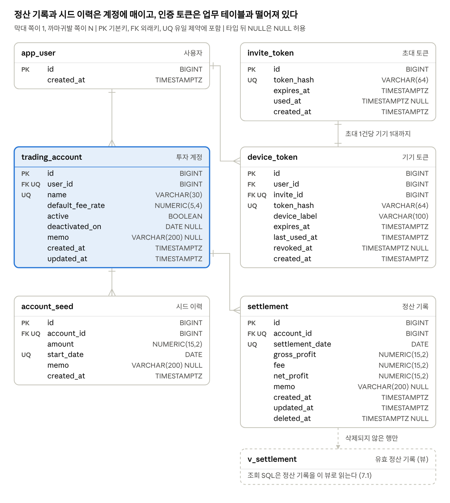

# 금 투자 수익 정산 기록 서비스 DB 설계서

Sep 30, 2026 | @최승혁

## 1. 문서 개요

V1 마이그레이션으로 만들 PostgreSQL 스키마는 테이블 6개와 뷰 1개이며, 이 문서가 그 컬럼, 제약, 인덱스, 조회 SQL을 정한다. 시스템 아키텍처 설계서(이하 설계서) v0.3의 6장을 상세화했고, 8장의 DDL을 그대로 Flyway V1 파일로 쓴다.

### 1.1 문서 정보

| 항목 | 내용 |
| --- | --- |
| 문서명 | 일일 정산 기록 서비스 DB 설계서 |
| 버전 | v0.2 |
| 작성일 | 2026-10-06 |
| 기준 문서 | 요구사항명세서(이하 SRS) v1.3, 프로젝트 기획서 v0.8, 설계서 v0.6, 화면 설계서 v0.2, API 명세서 v0.3 |
| 상태 | 초안. 설계서 대비 변경 7건(1.2, 설계서 v0.4에 반영), 미결 사항 1건(9장) |

> **문서의 역할** — 무엇을 저장할지는 SRS 4장이, 어떤 DB와 구조로 저장할지는 설계서 6장이 정하고, 이 문서는 그 결정을 실행할 수 있는 스키마로 옮긴다. 문서가 서로 어긋나면 SRS, 기획서, 설계서, 이 문서 순으로 따른다.

### 1.2 설계서 6장 대비 변경

설계서 v0.3과 달라지는 곳은 7건이며, 모두 저장하는 값의 의미는 그대로 두고 방어선을 보강한다. 확정되면 설계서 6장에 반영하고, DB-07은 SRS VAL-12도 고친다.

| ID | 대상 | 설계서 v0.3 | 이 문서 | 이유 |
| --- | --- | --- | --- | --- |
| DB-01 | 제약 이름 | FK, CHECK와 일부 UNIQUE를 컬럼에 붙여 선언해 이름이 자동으로 생긴다 | 모든 제약에 `pk_`, `fk_`, `uq_`, `ck_` 이름을 붙인다 | 로그에는 제약 이름만 남기고(설계서 12.4), 제약 위반을 이름으로 오류 코드에 연결한다(6.3) |
| DB-02 | 토큰 해시 타입 | `CHAR(64)` | `VARCHAR(64)`와 소문자 16진수 형식 검사 | 대문자로 만든 해시가 조회에서 빠지는 일을 막는다. `CHAR`는 `bpchar`로 읽혀 JPA 스키마 검증에서 `String` 매핑과 어긋날 수 있다 |
| DB-03 | 계정명 검사 | `btrim(name) <> ''` | `name <> '' AND name = btrim(name)` | 앞뒤 공백만 다른 이름이 따로 저장되면 계정명 유일(설계서 Q-01)과 CSV의 계정 식별(NFR-403)이 무너진다 |
| DB-04 | VAL-10 검사 시점 | 기록 입력, 첫 시드 시작일 변경 | 가장 이른 적용 시작일이 늦어지는 모든 변경. 첫 시드 삭제(FR-210)를 더한다 | 첫 이력을 지우면 두 번째 이력이 첫 시드가 되어, 두 시작일 사이 기록의 적용 시드가 사라진다 |
| DB-05 | 잠금 순서 | 계정 행을 잠근다(설계서 6.4) | 여러 계정은 id 오름차순으로 잠근다 | 일괄 저장 두 건이 계정을 서로 반대 순서로 잠가 교착되는 일을 막는다 |
| DB-06 | DB 생성 옵션 | 정하지 않음 | 인코딩 `UTF8`, 로캘 `C` | OS의 glibc 버전이 바뀌어 정렬 규칙이 달라지면 문자열 인덱스를 다시 만들어야 한다. `C`는 바이트 순서라 바뀌지 않는다 |
| DB-07 | VAL-12 적용 시작일 상한 | 오늘 | 오늘과 비활성일자 중 이른 날. 넘으면 400 `VALIDATION_FAILED`로 거부하고, 화면의 날짜 입력 상한도 같은 값으로 둔다 | 비활성일자 뒤의 이력은 수익률에 쓰이지 않고 계정 목록의 현재 시드 표시만 헷갈리게 만든다. 운용하던 구간의 오기 수정은 막지 않는다(DQ-01). SRS VAL-12도 고친다 |

## 2. 설계 원칙

금액은 `NUMERIC(15,2)`, 업무 날짜는 `DATE`, 시각은 `TIMESTAMPTZ`로만 저장한다. DB는 계산하지 않고 저장과 무결성의 마지막 방어선만 맡는다(설계서 3.2).

### 2.1 DBMS와 생성 옵션

| 항목 | 값 | 이유 |
| --- | --- | --- |
| DBMS | PostgreSQL. 착수 시점 최신 안정판을 이미지 태그로 고정 | 십진 고정소수점, 시간대 없는 날짜, 부분 유일 인덱스, 윈도 함수를 기본 제공한다(설계서 AD-04) |
| 인코딩과 로캘 | `POSTGRES_INITDB_ARGS="--encoding=UTF8 --locale=C"` | 한글 계정명과 메모를 담는다. 정렬이 바이트 순서라 이미지를 올려도 인덱스가 어긋나지 않고, 한글은 코드 순서가 곧 가나다 순이다(DB-06) |
| 스키마 | `public` 하나 | 사용자 1명, 애플리케이션 1개 |
| DB 계정 | 애플리케이션과 Flyway가 같은 계정을 쓴다 | DB 포트를 VM 밖에 열지 않아(설계서 12.1) 권한을 나눌 이득이 작다 |
| DB 시간대 설정 | 결과에 영향 없음 | 현재 날짜 함수를 쓰지 않고 날짜는 파라미터로만 받는다(설계서 7.1) |

`POSTGRES_INITDB_ARGS`는 데이터 볼륨이 비어 있을 때 한 번만 적용된다. 볼륨을 이미 만들었다면 비우고 다시 띄워야 한다.

### 2.2 명명 규칙

| 대상 | 규칙 | 예 |
| --- | --- | --- |
| 테이블 | 소문자 snake\_case 단수형. 예약어와 겹치면 앞에 말을 붙인다 | `app_user`(`user`는 예약어), `trading_account` |
| 컬럼 | snake\_case. 업무 날짜는 `_date` 또는 `_on`, 시각은 `_at` | `settlement_date`, `deactivated_on`, `created_at` |
| 외래키 컬럼 | 대상 테이블 + `_id`. 투자 계정만 `account_id`로 줄인다 | `user_id`, `account_id`, `invite_id` |
| 기본키 제약 | `pk_<테이블>` | `pk_settlement` |
| 외래키 제약 | `fk_<약칭>_<대상>` | `fk_settlement_account` |
| 유일 제약, 유일 인덱스 | `uq_<약칭>_<컬럼 요지>` | `uq_seed_account_start` |
| 검사 제약 | `ck_<약칭>_<의미>` | `ck_settlement_fee` |
| 일반 인덱스 | `ix_<테이블>_<컬럼 요지>` | `ix_settlement_date_account` |
| 뷰 | `v_<테이블>` | `v_settlement` |

약칭은 `account`(trading\_account), `seed`(account\_seed), `settlement`, `invite`, `device`다. 도메인 엔티티는 SRS 1.3의 용어 주의에 따라 `TradingAccount`로 두어 인증의 `User`와 구분한다.

### 2.3 값 종류별 타입

| 값 | DB 타입 | Java 타입 | 규칙 | 근거 |
| --- | --- | --- | --- | --- |
| 금액 (총수익, 수수료, 순수익, 시드) | `NUMERIC(15,2)` | `BigDecimal` | 정수부 13자리, 소수 2자리. 문자열 생성자로만 만든다 | CON-04, CAL-04, AD-09 |
| 수수료율 | `NUMERIC(5,4)` | `BigDecimal` | 0.0000 이상 1.0000 이하 | SRS 4.1 |
| 업무 날짜 (정산일자, 적용 시작일, 비활성일자) | `DATE` | `LocalDate` | 시간대 변환 없음. 오늘은 서버 `Clock`(Asia/Seoul)에서만 얻는다 | CON-11, AD-08 |
| 시각 (생성, 수정, 삭제, 만료, 사용, 폐기) | `TIMESTAMPTZ` | `Instant` | 애플리케이션이 `Clock`으로 채운다. 응답에서 +09:00을 붙인다 | 설계서 7.2 |
| 식별자 | `BIGINT GENERATED ALWAYS AS IDENTITY` | `Long` | `app_user`만 1로 고정 | FR-102 |
| 문자열 | `VARCHAR(n)` | `String` | n은 글자 수라 한글 1자가 1이다 | VAL-04, VAL-05 |
| 토큰 해시 | `VARCHAR(64)` | `String` | SHA-256을 `HexFormat.of()`로 만든 소문자 16진수 64자 | NFR-302, DB-02 |
| 상태 | `BOOLEAN` | `boolean` | 활성 여부 하나뿐 | FR-204 |

> **자릿수 주의** — `NUMERIC(15,2)`는 소수 셋째 자리 이하를 거부하지 않고 조용히 반올림해 저장한다. VAL-13은 DB가 지켜 주지 않으므로 서버가 문자열 단계에서 `^\d{1,13}(\.\d{1,2})?$`로 검사한다(설계서 8.1).

### 2.4 공통 컬럼과 DB에 두지 않는 것

- `created_at`은 모든 테이블에, `updated_at`은 수정할 수 있는 `trading_account`와 `settlement`에 둔다. 값은 애플리케이션이 `Clock`으로 채우며 DB 기본값을 두지 않는다. 예외는 V1이 넣는 `app_user` 1행과 초기 데이터 적재 스크립트(8.2)뿐이다.
- Hibernate의 `@CreationTimestamp`, `@UpdateTimestamp`는 쓰지 않는다. 주입한 `Clock`을 거치지 않아 테스트에서 시각을 고정할 수 없다. Spring Data JPA 감사 기능에 `Clock` 기반 `DateTimeProvider`를 연결하거나 서비스에서 직접 채운다.
- 논리 삭제는 `settlement`에만 둔다(AD-05). 계정은 비활성 처리하고(FR-204), 시드 이력은 물리 삭제하며(FR-210), 토큰은 만료와 폐기 시각으로 무효화한다.
- DB에 두지 않는 것은 현재 날짜 함수(`CURRENT_DATE`, `now()::date`), 반올림과 수익률 계산, 트리거, 저장 프로시저다. 계산 규칙은 Java 순수 함수 한 곳에 모은다(설계서 11.3).

## 3. ERD



*ERD, 테이블 6개와 뷰 1개*

외래키 5개는 모두 NO ACTION이고, 정산 기록과 시드 이력 사이에는 FK가 없어 적용 시드는 정산일자로 찾는다(5.3).

## 4. 테이블 목록

업무 테이블 3개, 인증 테이블 2개, 사용자 테이블 1개와 조회용 뷰 1개다. 5년을 운영해도 가장 큰 `settlement`가 약 5,000행이라 파티션이나 캐시 같은 성능 구조는 두지 않는다(설계서 1.3).

| 테이블 | 논리명 | 엔티티 | 역할 | 5년 뒤 행 수 | 근거 |
| --- | --- | --- | --- | --- | --- |
| `app_user` | 사용자 | `User` | 사용자 1건. 계정과 기기 토큰의 소유자 | 1 | FR-102 |
| `trading_account` | 투자 계정 | `TradingAccount` | 정산 단위. 기본 수수료율, 활성 여부, 비활성일자를 가진다 | 10 미만 | FR-201\~206, CON-07 |
| `account_seed` | 시드 이력 | `AccountSeed` | 적용 시작일별 기준 시드. 수익률의 분모 | 수십 | FR-207\~210, CAL-06 |
| `settlement` | 정산 기록 | `Settlement` | 계정별 일일 총수익, 수수료, 순수익. 논리 삭제 | 약 5,000 | FR-301\~308, NFR-201 |
| `v_settlement` | 유효 정산 기록 (뷰) | 없음 | `settlement`에서 삭제되지 않은 행만 보여 준다. 조회 SQL의 유일한 입구 | `settlement`와 같음 | 설계서 6.3 |
| `invite_token` | 초대 토큰 | `InviteToken` | 1회용 초대 토큰의 해시, 만료와 사용 시각 | 수십 | FR-103\~105 |
| `device_token` | 기기 토큰 | `DeviceToken` | 등록한 기기의 토큰 해시, 만료와 폐기 시각 | 수십 | FR-107\~109 |

`settlement`의 5,000행은 계정 2개 × 365일 × 5년 = 3,650행에 계정이 늘어날 여유를 더한 SRS 기준값이다(NFR-201).

## 5. 테이블 정의서

V1이 만드는 테이블 6개의 컬럼 41개와 뷰 1개다. 컬럼 순서, 타입, 제약 이름은 8.1의 DDL과 같고, 제약 이름을 오류 코드로 바꾸는 규칙은 6.3에 있다.

NULL 열의 N은 NOT NULL, Y는 NULL 허용이다. IDENTITY는 `GENERATED ALWAYS AS IDENTITY`라서 id를 직접 넣으면 DB가 거부한다.

### 5.1 app\_user (사용자)

| 컬럼 | 논리명 | 타입 | NULL | 제약 | 설명 |
| --- | --- | --- | --- | --- | --- |
| `id` | 사용자 id | `BIGINT` | N | PK `pk_app_user`, CHECK `ck_app_user_single` | 1만 허용한다. IDENTITY가 아니다 |
| `created_at` | 생성일시 | `TIMESTAMPTZ` | N |  | V1을 실행한 DB 시각 |

V1이 1행을 넣고 애플리케이션은 이 테이블에 쓰지 않는다(FR-102). 계정과 기기 토큰의 `user_id`는 항상 1이다.

### 5.2 trading\_account (투자 계정)

| 컬럼 | 논리명 | 타입 | NULL | 제약 | 설명 |
| --- | --- | --- | --- | --- | --- |
| `id` | 계정 id | `BIGINT` | N | PK `pk_trading_account`, IDENTITY | 같은 날짜 기록의 정렬 기준(설계서 8.5) |
| `user_id` | 사용자 id | `BIGINT` | N | FK `fk_account_user` → `app_user` | 항상 1 |
| `name` | 계정명 | `VARCHAR(30)` | N | UQ `uq_account_user_name`, CHECK `ck_account_name` | 1\~30자, 앞뒤 공백 없음(VAL-04). 비활성 계정을 포함해 유일하다(설계서 Q-01). 기록에 복사하지 않는 현재 라벨이다(FR-203) |
| `default_fee_rate` | 기본 수수료율 | `NUMERIC(5,4)` | N | DEFAULT 0.2000, CHECK `ck_account_fee_rate` | 0 이상 1 이하. 수수료 제안값 계산에만 쓰고 화면에서 입력받지 않는다(FR-206, CAL-03) |
| `active` | 활성 여부 | `BOOLEAN` | N | DEFAULT TRUE, CHECK `ck_account_deactivation` | 한 번 false가 되면 true로 되돌리지 않는다(FR-204) |
| `deactivated_on` | 비활성일자 | `DATE` | Y | CHECK `ck_account_deactivation` | 비활성 처리한 날의 서버 오늘. 활성이면 NULL이다. 통합 수익률 분모 판정에 쓴다(CAL-10) |
| `memo` | 메모 | `VARCHAR(200)` | Y |  | 200자 이하(VAL-05) |
| `created_at` | 생성일시 | `TIMESTAMPTZ` | N |  |  |
| `updated_at` | 수정일시 | `TIMESTAMPTZ` | N |  | 계정명, 메모, 활성 상태를 바꿀 때 갱신 |

`ck_account_deactivation`은 활성 여부와 비활성일자가 어긋나지 않게 묶는다. 비활성 계정에는 새 기록이 생기지 않으므로(VAL-06) 모든 기록의 정산일자는 비활성일자 이하다(SRS 4.1). DB는 이 불변식을 검사하지 않으며, 서버가 계정 행을 잠근 뒤 VAL-06을 검사한다(6.4).

### 5.3 account\_seed (시드 이력)

| 컬럼 | 논리명 | 타입 | NULL | 제약 | 설명 |
| --- | --- | --- | --- | --- | --- |
| `id` | 시드 이력 id | `BIGINT` | N | PK `pk_account_seed`, IDENTITY |  |
| `account_id` | 계정 id | `BIGINT` | N | FK `fk_seed_account` → `trading_account` |  |
| `amount` | 시드 금액 | `NUMERIC(15,2)` | N | CHECK `ck_seed_amount` | 0 초과 USD. 수익률의 분모라 0을 막는다(VAL-07) |
| `start_date` | 적용 시작일 | `DATE` | N | UQ `uq_seed_account_start` | 오늘과 비활성일자 중 이른 날 이하(VAL-12, DB-07, 서버 검사). 계정 안에서 유일하다(VAL-09) |
| `memo` | 사유 메모 | `VARCHAR(200)` | Y |  |  |
| `created_at` | 생성일시 | `TIMESTAMPTZ` | N |  |  |

- 적용 종료일은 저장하지 않고 다음 이력의 적용 시작일 전날로 유도한다. 이력을 더할 때 한 행만 쓰면 된다(SRS 4.1).
- 어떤 날짜의 적용 시드는 적용 시작일이 그 날짜 이하인 이력 중 가장 늦은 1건이다(CAL-06). 정산 기록은 시드 이력을 FK로 가리키지 않고 조회할 때 정산일자로 찾는다.
- 계정 생성과 첫 시드는 한 트랜잭션에서 넣고, 계정의 마지막 이력은 삭제를 거부한다(VAL-11). 첫 이력을 지우거나 시작일을 늦출 때는 VAL-10도 검사한다(DB-04).
- 수정일시는 SRS 4.1에 없어 두지 않았다. 이력 수정(FR-210, S)을 만들 때 더할지 정한다(8.4).

### 5.4 settlement (정산 기록)

| 컬럼 | 논리명 | 타입 | NULL | 제약 | 설명 |
| --- | --- | --- | --- | --- | --- |
| `id` | 정산 기록 id | `BIGINT` | N | PK `pk_settlement`, IDENTITY | 단건 조회, 수정, 삭제 API의 식별자 |
| `account_id` | 계정 id | `BIGINT` | N | FK `fk_settlement_account` → `trading_account` | 등록 후 바꾸지 않는다(DI-07) |
| `settlement_date` | 정산일자 | `DATE` | N | 부분 유일 인덱스 `uq_settlement_account_date` | 오늘 이하(VAL-03), 첫 시드 적용 시작일 이상(VAL-10). 둘 다 서버가 검사하며 등록 후 바꾸지 않는다(DI-07) |
| `gross_profit` | 총수익 | `NUMERIC(15,2)` | N | CHECK `ck_settlement_gross` | 0 초과. 사용자 입력값(VAL-01, CAL-01) |
| `fee` | 수수료 | `NUMERIC(15,2)` | N | CHECK `ck_settlement_fee` | 0 이상 총수익 미만. 제안값이 아니라 사용자가 확정한 값(VAL-02, CAL-03) |
| `net_profit` | 순수익 | `NUMERIC(15,2)` | N | CHECK `ck_settlement_net` | 총수익 − 수수료. 서버가 계산해 저장하고 조회 때 다시 계산하지 않는다(CAL-02, VAL-08) |
| `memo` | 메모 | `VARCHAR(200)` | Y |  |  |
| `created_at` | 생성일시 | `TIMESTAMPTZ` | N |  |  |
| `updated_at` | 수정일시 | `TIMESTAMPTZ` | N |  | 행을 바꿀 때마다 갱신. 논리 삭제도 포함 |
| `deleted_at` | 삭제일시 | `TIMESTAMPTZ` | Y |  | NULL이면 유효한 기록. 삭제는 이 값만 채우고 행은 남긴다(NFR-404) |

- 같은 계정과 정산일자에 삭제된 행은 여러 개일 수 있고, 삭제되지 않은 행은 1개까지다(FR-304, AD-05).
- 삭제를 되돌리는 기능은 없다. 되살린 행이 그사이 같은 날짜로 다시 입력한 기록과 `uq_settlement_account_date`에서 부딪힌다.
- `ck_settlement_net`은 차감 항목이 수수료뿐이라는 CON-09가 유지되는 동안의 불변식이다. CON-09가 바뀌면 제약만 교체하고 저장된 순수익은 다시 계산하지 않는다(SRS 4.1).
- 수수료율 컬럼은 두지 않는다. 필요하면 수수료 ÷ 총수익으로 구한다(SRS 4.1).

### 5.5 v\_settlement (유효 정산 기록 뷰)

`settlement`에서 `deleted_at IS NULL`인 행만, `deleted_at`을 뺀 컬럼 9개로 보여 준다. 조회 SQL은 모두 이 뷰를 읽고, 삭제된 행까지 봐야 하는 검증용 조회만 테이블을 직접 읽는다(7.3).

단순 뷰라 PostgreSQL이 쿼리 안에 풀어 넣으므로 뷰를 거쳐도 부분 인덱스를 그대로 쓴다. PostgreSQL 16의 실행 계획으로 확인했다.

### 5.6 invite\_token (초대 토큰)

| 컬럼 | 논리명 | 타입 | NULL | 제약 | 설명 |
| --- | --- | --- | --- | --- | --- |
| `id` | 초대 id | `BIGINT` | N | PK `pk_invite_token`, IDENTITY |  |
| `token_hash` | 토큰 해시 | `VARCHAR(64)` | N | UQ `uq_invite_token_hash`, CHECK `ck_invite_token_hash` | 원문의 SHA-256, 소문자 16진수 64자. 원문은 저장하지 않는다(FR-104, NFR-302) |
| `expires_at` | 만료일시 | `TIMESTAMPTZ` | N |  | 발급 후 1시간(FR-105) |
| `used_at` | 사용일시 | `TIMESTAMPTZ` | Y |  | 교환에 성공한 시각. 채워지면 다시 쓸 수 없다 |
| `created_at` | 발급일시 | `TIMESTAMPTZ` | N |  |  |

유효한 초대는 `used_at`이 NULL이고 `expires_at`이 서버 `Clock`의 현재 시각보다 뒤인 행이다. 교환은 이 행을 `SELECT … FOR UPDATE`로 잠근 트랜잭션에서 검증, 사용 처리, 기기 토큰 생성을 끝낸다(설계서 5.2). 사용한 행은 기기 토큰이 FK로 가리키므로 초대 행은 지우지 않는다.

### 5.7 device\_token (기기 토큰)

| 컬럼 | 논리명 | 타입 | NULL | 제약 | 설명 |
| --- | --- | --- | --- | --- | --- |
| `id` | 기기 id | `BIGINT` | N | PK `pk_device_token`, IDENTITY | 운영자 폐기 API의 경로 값(설계서 5.4) |
| `user_id` | 사용자 id | `BIGINT` | N | FK `fk_device_user` → `app_user` | 항상 1 |
| `invite_id` | 초대 id | `BIGINT` | N | FK `fk_device_invite` → `invite_token`, UQ `uq_device_invite` | 이 기기를 등록한 초대. 초대 1건당 기기 1건 |
| `token_hash` | 토큰 해시 | `VARCHAR(64)` | N | UQ `uq_device_token_hash`, CHECK `ck_device_token_hash` | 쿠키 원문의 SHA-256. 매 요청 이 값으로 조회한다(설계서 5.3) |
| `device_label` | 기기 표시명 | `VARCHAR(100)` | N |  | 등록 때 사용자 에이전트에서 뽑은 OS와 브라우저 이름 |
| `expires_at` | 만료일시 | `TIMESTAMPTZ` | N |  | 마지막 갱신에서 90일 뒤(FR-108) |
| `last_used_at` | 마지막 사용일시 | `TIMESTAMPTZ` | N |  | `expires_at`과 함께 하루 1회만 갱신하므로 최대 하루 늦다 |
| `revoked_at` | 폐기일시 | `TIMESTAMPTZ` | Y |  | 운영자 폐기나 로그아웃 시각(FR-109, FR-112) |
| `created_at` | 등록일시 | `TIMESTAMPTZ` | N |  |  |

유효한 기기 토큰은 `revoked_at`이 NULL이고 `expires_at`이 현재 시각보다 뒤인 행이다. 폐기되거나 만료된 행도 남겨 운영자 기기 목록에 보인다(설계서 5.4).

## 6. 인덱스와 제약조건

기본키와 유일 제약이 만드는 인덱스 외에는 부분 인덱스 2개만 둔다. 제약 위반은 제약 이름으로 오류 코드를 고르고, DB가 표현하지 못하는 규칙은 서버가 계정 행을 잠근 트랜잭션에서 검사한다.

### 6.1 인덱스

| 인덱스 | 테이블 | 컬럼 | 종류 | 용도 | 근거 |
| --- | --- | --- | --- | --- | --- |
| `uq_settlement_account_date` | `settlement` | `account_id`, `settlement_date` | 부분 유일 (`deleted_at IS NULL`) | 같은 계정, 같은 날의 기록 1건. 계정별 기간 합계(SQL-07) | FR-304, AD-05 |
| `ix_settlement_date_account` | `settlement` | `settlement_date`, `account_id` | 부분 (`deleted_at IS NULL`) | 기간 조회, 누적 정렬, 합계, 월별 집계(SQL-02\~06, SQL-08) | NFR-203, AD-11 |
| `uq_seed_account_start` | `account_seed` | `account_id`, `start_date` | 유일 | 날짜별 적용 시드 찾기(SQL-01, SQL-02), 시드 구간(SQL-07) | VAL-09, CAL-06 |
| `uq_account_user_name` | `trading_account` | `user_id`, `name` | 유일 | 계정명 중복 차단 | Q-01 |
| `uq_invite_token_hash` | `invite_token` | `token_hash` | 유일 | 초대 교환 때 해시로 조회 | FR-107 |
| `uq_device_token_hash` | `device_token` | `token_hash` | 유일 | 매 요청 인증 때 해시로 조회 | FR-101 |
| `uq_device_invite` | `device_token` | `invite_id` | 유일 | 초대 1건당 기기 1건 | FR-107 |
| `pk_`로 시작하는 6개 | 각 테이블 | `id` | 유일 | 단건 조회, FK 대상 |  |

일부러 만들지 않은 인덱스는 다음과 같다.

- `settlement.account_id` 전체 인덱스: 삭제된 행까지 보는 검사(계정 삭제의 FK 검사, DI-08)는 테이블을 끝까지 읽는다. 5,000행에서 0.3ms였다. 계정 목록의 deletable(SQL-01)도 같은 검사를 계정마다 하지만, EXISTS는 첫 행에서 멈추고 계정이 몇 개뿐이라 인덱스를 두지 않는다.
- `account_seed.account_id`, `device_token.invite_id` 단독 인덱스: 유일 인덱스의 앞 컬럼이라 따로 두지 않는다.
- `user_id` 컬럼 인덱스: `app_user` 행은 지우지 않으므로 FK 검사가 일어나지 않는다.
- 메모, 금액 검색(FR-409, FR-410, S): 기간 인덱스로 좁힌 뒤 거르면 된다. 검색 기능을 만들 때 측정하고 정한다.

### 6.2 외래키

| 외래키 | 컬럼 → 참조 | 막는 일 |
| --- | --- | --- |
| `fk_account_user` | `trading_account.user_id` → `app_user.id` | 없는 사용자의 계정 |
| `fk_seed_account` | `account_seed.account_id` → `trading_account.id` | 시드 이력이 남은 계정의 삭제 |
| `fk_settlement_account` | `settlement.account_id` → `trading_account.id` | 기록이 남은 계정의 삭제. 삭제된 기록도 포함한다(DI-08) |
| `fk_device_user` | `device_token.user_id` → `app_user.id` | 없는 사용자의 기기 |
| `fk_device_invite` | `device_token.invite_id` → `invite_token.id` | 기기를 등록한 초대의 삭제 |

모두 `ON DELETE NO ACTION`(기본값)이다. `CASCADE`를 쓰지 않아 계정을 지워도 기록이나 시드 이력이 딸려 지워지지 않으며, 계정 삭제 API는 시드 이력을 먼저 지운 뒤 계정을 지운다(설계서 9.2). CHECK 10개는 5장에 컬럼별로 적었고, 모두 서버 검증 뒤의 마지막 방어선이다(설계서 6.4).

### 6.3 제약 위반과 오류 코드

409로 바꾸는 제약은 4개다. 모두 서버가 먼저 검사하지만, 동시 요청이 사전 검사를 함께 통과하면 DB가 먼저 막으므로 같은 오류 코드로 돌려준다.

| 제약 | SQLSTATE | 응답 | 이 제약이 먼저 막는 경우 |
| --- | --- | --- | --- |
| `uq_settlement_account_date` | 23505 | 409 `SETTLEMENT_DUPLICATE` | 다른 탭이나 기기가 같은 계정, 같은 날 기록을 먼저 넣음(설계서 9.4, T-12) |
| `uq_seed_account_start` | 23505 | 409 `SEED_DUPLICATE` | 같은 적용 시작일 이력의 동시 등록 |
| `uq_account_user_name` | 23505 | 409 `ACCOUNT_NAME_DUPLICATE` | 같은 이름의 계정 등록이나 이름 변경이 동시에 들어옴. 잠글 행이 없어 이 제약이 유일한 방어선이다 |
| `fk_settlement_account` | 23503 | 409 `ACCOUNT_HAS_SETTLEMENTS` | 계정 삭제와 기록 등록이 엇갈림 |
| 그 밖의 모든 위반 | 23으로 시작 | 500 서버 오류 | 서버 검증을 빠져나간 버그. 이름이 없는 NOT NULL 위반도 여기에 든다 |

- 변환 위치: `@RestControllerAdvice`에서 `DataIntegrityViolationException`을 받아, 원인 체인의 `PSQLException`에서 `getServerErrorMessage().getConstraint()`와 `getSQLState()`로 고른다. 메시지 문자열은 파싱하지 않는다.
- UPDATE는 커밋할 때 DB로 나가 위반 예외가 서비스 밖에서 날 수 있다. 그래서 서비스의 try-catch가 아니라 advice 한 곳에서 바꾼다.
- 로그에는 제약 이름과 SQLSTATE만 남긴다. PostgreSQL 오류의 DETAIL에는 금액이 든 행 값이 들어 있다(예: CHECK 위반의 `Failing row contains (…)`).
- JDBC URL에 `logServerErrorDetail=false`를 붙인다. 예외 메시지에서 DETAIL이 빠져 Hibernate가 남기는 SQL 예외 로그에도 금액이 찍히지 않고, 제약 이름은 그대로 얻는다. pgjdbc 42.7.7로 확인했다(NFR-304).

### 6.4 DB 밖에서 지키는 규칙과 잠금

DB 제약으로 표현하지 못하는 규칙은 서버가 해당 행을 먼저 잠근 뒤 검사한다. 기본 격리 수준(READ COMMITTED)에서 잠그지 않으면 두 요청이 모두 검사를 통과한 뒤 규칙이 깨진다(설계서 6.4).

| 작업 | API | 먼저 잠그는 행 | 잠근 뒤 검사 | 근거 |
| --- | --- | --- | --- | --- |
| 일괄 저장 | `POST /api/daily-entry` | 요청에 든 계정 행 전부, id 오름차순 | 계정마다 활성(VAL-06), 적용 시드 있음(VAL-10), 같은 날 기록 없음(FR-304). 하나라도 실패하면 전부 되돌린다 | DI-06, DB-05 |
| 단건 등록 | `POST /api/settlements` | 그 계정 행 | 일괄 저장과 같다 | FR-305 |
| 비활성 처리 | `POST /api/accounts/{id}/deactivate` | 그 계정 행 | 이미 비활성인지. 비활성일자는 서버의 오늘 | FR-204 |
| 시드 등록, 수정, 삭제 | `/api/accounts/{id}/seeds` 아래 | 그 계정 행 | 같은 적용 시작일 없음(VAL-09), 마지막 이력 삭제 금지(VAL-11), 가장 이른 적용 시작일이 늦어지면 그 앞의 기록 없음(VAL-10, DB-04). 비활성 계정은 적용 시작일이 비활성일자 이하(DB-07) | FR-207\~210 |
| 계정 삭제 | `DELETE /api/accounts/{id}` | 그 계정 행 | 삭제된 기록을 포함해 기록이 없음. 시드 이력을 지운 뒤 계정을 지운다 | FR-205, DI-08 |
| 계정 등록, 이름 변경 | `POST /api/accounts`, `PATCH /api/accounts/{id}` | 없음 | 이름 중복은 사전 조회 후 409, 경합은 `uq_account_user_name`이 막는다. 등록은 첫 시드와 한 트랜잭션 | FR-201, VAL-11 |
| 초대 교환 | `POST /api/auth/invite/exchange` | 해시로 찾은 초대 행 | 미사용, 미만료. 사용 처리와 기기 토큰 생성까지 같은 트랜잭션 | FR-105, T-11 |
| 기록 수정, 삭제 | `PUT`, `DELETE /api/settlements/{id}` | 없음 | 삭제되지 않은 기록인지. 사용자 1명이라 동시 수정은 나중 저장이 남는다 | DI-07 |

- 잠금은 리포지토리 조회 메서드에 `@Lock(LockModeType.PESSIMISTIC_WRITE)`를 붙여 건다.
- 여러 계정은 `ORDER BY id`를 붙인 한 번의 조회로 잠근다. PostgreSQL은 정렬한 뒤 잠그므로 id 순서가 지켜진다(실행 계획으로 확인, DB-05).
- 사전 조회는 잠금을 얻은 뒤에 한다. READ COMMITTED는 문장마다 새 스냅숏을 보므로, 먼저 끝난 요청이 커밋한 행이 이때 보인다.

## 7. 주요 조회 SQL

화면 조회는 SQL 8개가 받치며, 정산 기록은 모두 `v_settlement`로 읽고 날짜는 서버가 넘긴 파라미터로만 받는다. 5,000행(계정 2개 × 2,500일)으로 채운 DB에서 가장 느린 SQL-03도 실행 7ms였고, 운영 VM 측정은 설계서 14.3대로 따로 한다.

### 7.1 작성 규칙

- 정산 기록은 `v_settlement`로만 읽는다. 삭제된 행까지 봐야 하는 검사(7.3과 SQL-01의 deletable)만 테이블을 읽는다.
- `CURRENT_DATE`, `now()` 같은 현재 시각 식을 쓰지 않는다. 오늘과 기간 경계는 서버 `Clock`이 계산해 넘긴다(AD-08).
- 날짜 파라미터는 `CAST(:x AS date)`로 받는다. 문자열로 바인딩된 날짜를 DATE 컬럼과 비교하면 42883 오류가 나지만, CAST가 있으면 `LocalDate`든 문자열이든 같게 동작한다.
- `date_trunc`에는 `settlement_date::timestamp`를 넘기고 결과를 `::date`로 되돌린다. DATE를 그대로 넘기면 세션 시간대를 거치는 `timestamptz`로 계산된다(설계서 7.4).
- 합계는 `COALESCE(SUM(…), 0.00)`으로 감싼다. 기록이 없는 구간의 `SUM`은 NULL이다.
- 계정 선택이나 커서 같은 선택 조건은 SQL에 조건을 덧붙여 만든다. `:accountId IS NULL OR …` 형태는 null을 넘기면 PostgreSQL이 파라미터 타입을 정하지 못해 42P18 오류가 난다.
- 반올림과 수익률은 SQL에서 계산하지 않는다. SQL은 저장된 값의 합만 돌려주고 나눗셈은 Java 순수 함수가 한다(설계서 8.2, 11.3).

42883과 42P18 오류는 pgjdbc 42.7.7과 PostgreSQL 16으로 재현했다.

### 7.2 SQL 목록

| ID | API | 내용 | 받치는 인덱스 | 근거 |
| --- | --- | --- | --- | --- |
| SQL-01 | `GET /api/accounts` | 계정 목록, 오늘의 적용 시드, 삭제 가능 여부 | `uq_seed_account_start` | FR-202, CAL-06 |
| SQL-02 | `GET /api/daily-entry` | 활성 계정별 그날 기록과 적용 시드 유무 | `ix_settlement_date_account`, `uq_seed_account_start` | FR-309, FR-310-1 |
| SQL-03 | `GET /api/settlements` | 기록 목록과 누적 순수익, 커서 분할 | `ix_settlement_date_account` | FR-401\~406, FR-408, AD-11 |
| SQL-04 | `GET /api/settlements/summary` | 목록과 같은 조건의 합계와 건수 | `ix_settlement_date_account` | FR-407, CAL-05 |
| SQL-05 | `GET /api/stats/home` | 이번 달과 전월 동기의 순수익 | `ix_settlement_date_account` | FR-501, DI-03 |
| SQL-06 | `GET /api/stats/monthly` | 월별 합계와 기록 일수 | `ix_settlement_date_account` | FR-502, DI-04 |
| SQL-07 | `GET /api/stats/accounts` | 계정별 시드 구간과 구간 합계 | `uq_seed_account_start`, `uq_settlement_account_date` | FR-503, FR-508, CAL-08 |
| SQL-08 | `GET /api/stats/accounts` | 통합 수익률의 입력값 | `ix_settlement_date_account` | FR-509, CAL-10 |

#### SQL-01 계정 목록과 현재 시드

```sql
SELECT a.id, a.name, a.default_fee_rate, a.active, a.deactivated_on, a.memo,
       a.created_at, a.updated_at,
       cur.id         AS current_seed_id,
       cur.amount     AS current_seed,
       cur.start_date AS current_seed_start,
       NOT EXISTS (
           SELECT 1 FROM settlement st          -- 삭제된 기록도 센다(DI-08)
           WHERE st.account_id = a.id
       ) AS deletable
FROM trading_account a
LEFT JOIN LATERAL (
    SELECT s.id, s.amount, s.start_date
    FROM account_seed s
    WHERE s.account_id = a.id
      AND s.start_date <= CAST(:today AS date)
    ORDER BY s.start_date DESC
    LIMIT 1
) cur ON TRUE
-- 기본(status=active)일 때만: WHERE a.active
ORDER BY a.active DESC, a.id
```

`status=active`(기본)면 주석 자리에 `WHERE a.active`를 붙인다. 현재 시드와 적용 시작일은 계정 관리 화면의 현재 시드 표시에, `deletable`은 \[삭제\] 표시에 쓴다(SCR-06). `deletable`은 삭제된 기록까지 세야 하므로 7.3의 DI-08 검사처럼 `v_settlement`가 아니라 `settlement`를 읽는다. 운용 중인 계정을 먼저 두는 정렬은 API 명세서 SD-06을 따른다.

#### SQL-02 일괄 입력 화면

```sql
SELECT a.id, a.name, a.default_fee_rate,
       v.id AS settlement_id, v.gross_profit, v.fee, v.net_profit,
       EXISTS (
           SELECT 1
           FROM account_seed s
           WHERE s.account_id = a.id
             AND s.start_date <= CAST(:date AS date)
       ) AS seed_applicable
FROM trading_account a
LEFT JOIN v_settlement v
       ON v.account_id = a.id
      AND v.settlement_date = CAST(:date AS date)
WHERE a.active
ORDER BY a.id
```

화면 상태는 Java가 정한다. `settlement_id`가 있으면 `DONE`, 없고 `seed_applicable`이 거짓이면 `UNAVAILABLE`, 나머지는 `OPEN`이다(설계서 9.3).

#### SQL-03 거래내역 목록과 누적 순수익

```sql
WITH ranged AS (
    SELECT v.id, v.account_id, a.name AS account_name, v.settlement_date,
           v.gross_profit, v.fee, v.net_profit, v.memo,
           SUM(v.net_profit) OVER (
               ORDER BY v.settlement_date, v.account_id
               ROWS UNBOUNDED PRECEDING
           ) AS cumulative_net
    FROM v_settlement v
    JOIN trading_account a ON a.id = v.account_id
    WHERE v.settlement_date BETWEEN CAST(:fromDate AS date) AND CAST(:toDate AS date)
    -- 계정을 골랐을 때만: AND v.account_id = :accountId
)
SELECT *
FROM ranged
-- 두 번째 페이지부터(내림차순일 때): WHERE (settlement_date, account_id) < (CAST(:cursorDate AS date), :cursorAccountId)
ORDER BY settlement_date DESC, account_id DESC
LIMIT :size + 1
```

누적은 조회 구간 전체로 먼저 계산하고 커서는 바깥에서 건다. 커서를 CTE 안에 넣으면 페이지마다 누적이 0부터 다시 시작한다. 오름차순은 비교를 `>`, 정렬을 `ASC`로 바꾸며, 페이지 크기 1\~3과 두 정렬 방향에서 같은 기록의 누적값이 모두 같았다(T-09).

#### SQL-04 구간 합계

```sql
SELECT COALESCE(SUM(gross_profit), 0.00) AS gross_sum,
       COALESCE(SUM(fee), 0.00)          AS fee_sum,
       COALESCE(SUM(net_profit), 0.00)   AS net_sum,
       COUNT(*)                          AS record_count
FROM v_settlement
WHERE settlement_date BETWEEN CAST(:fromDate AS date) AND CAST(:toDate AS date)
-- 계정을 골랐을 때만: AND account_id = :accountId
```

기록이 없는 구간은 0.00과 0건을 돌려준다. 오름차순 목록 마지막 행의 누적값과 `net_sum`은 같아야 하며, 검증 데이터에서 둘 다 1,800.00이었다(T-10).

#### SQL-05 홈의 이번 달과 전월 동기

```sql
SELECT COALESCE(SUM(net_profit) FILTER (
           WHERE settlement_date BETWEEN CAST(:curFrom AS date) AND CAST(:curTo AS date)
       ), 0.00) AS current_net,
       COALESCE(SUM(net_profit) FILTER (
           WHERE settlement_date BETWEEN CAST(:prevFrom AS date) AND CAST(:prevTo AS date)
       ), 0.00) AS previous_net
FROM v_settlement
WHERE settlement_date BETWEEN CAST(:prevFrom AS date) AND CAST(:curTo AS date)
```

구간 날짜 4개는 서버가 계산해 넘기며, 전월에 같은 날짜가 없으면 전월 말일까지다(DI-03). 두 구간을 한 번에 읽고 `FILTER`로 나눈다.

#### SQL-06 월별 집계

```sql
SELECT date_trunc('month', settlement_date::timestamp)::date AS month,
       SUM(gross_profit)               AS gross_sum,
       SUM(fee)                        AS fee_sum,
       SUM(net_profit)                 AS net_sum,
       COUNT(DISTINCT settlement_date) AS record_days
FROM v_settlement
WHERE settlement_date BETWEEN CAST(:fromDate AS date) AND CAST(:toDate AS date)
GROUP BY 1
ORDER BY 1 DESC
```

`record_days`는 기록이 있는 서로 다른 정산일자의 수라서 같은 날 두 계정의 기록은 1일로 센다(DI-04). API는 `year`를 받아 서버가 그해 1월 1일과 12월 31일을 넘기고, 기록이 있는 달만 최신 달부터 돌려준다. 진행 중인 달의 끝 날짜(오늘)는 Java가 채운다(API 명세서 SD-11).

#### SQL-07 계정별 시드 구간과 구간 합계

```sql
WITH seg AS (
    SELECT s.account_id,
           s.amount,
           s.start_date,
           LEAD(s.start_date) OVER (PARTITION BY s.account_id
                                    ORDER BY s.start_date) - 1 AS end_date
    FROM account_seed s
),
clipped AS (
    SELECT seg.account_id,
           seg.amount,
           GREATEST(seg.start_date, CAST(:fromDate AS date)) AS seg_from,
           LEAST(COALESCE(seg.end_date, CAST(:toDate AS date)),
                 CAST(:toDate AS date),
                 COALESCE(a.deactivated_on, CAST(:toDate AS date))) AS seg_to
    FROM seg
    JOIN trading_account a ON a.id = seg.account_id
)
SELECT c.account_id, c.amount, c.seg_from, c.seg_to,
       COALESCE(SUM(v.gross_profit), 0.00) AS gross_sum,
       COALESCE(SUM(v.fee), 0.00)          AS fee_sum,
       COALESCE(SUM(v.net_profit), 0.00)   AS net_sum
FROM clipped c
LEFT JOIN v_settlement v
       ON v.account_id = c.account_id
      AND v.settlement_date BETWEEN c.seg_from AND c.seg_to
WHERE c.seg_from <= c.seg_to
GROUP BY c.account_id, c.amount, c.seg_from, c.seg_to
ORDER BY c.account_id, c.seg_from
```

시드 이력마다 끝을 다음 이력 시작일 전날로 잡고, 조회 구간과 비활성일자로 자른다(DI-05). 수익률은 Java가 `net_sum ÷ amount`로 계산한다(설계서 8.3). SRS 4.2 시드 변경 예시는 두 행으로 나뉘어 10.00%와 5.00%가 된다(T-03).

#### SQL-08 통합 수익률의 입력값

```sql
-- 08a 날짜별 순수익 합계
SELECT settlement_date, SUM(net_profit) AS net_sum
FROM v_settlement
WHERE settlement_date BETWEEN CAST(:fromDate AS date) AND CAST(:toDate AS date)
GROUP BY settlement_date
ORDER BY settlement_date
```

```sql
-- 08b 계정별 비활성일자와 조회 종료일까지의 시드 이력
SELECT a.id AS account_id, a.deactivated_on, s.start_date, s.amount
FROM trading_account a
JOIN account_seed s ON s.account_id = a.id
WHERE s.start_date <= CAST(:toDate AS date)
ORDER BY a.id, s.start_date
```

`CombinedRateCalculator`가 08b로 경계 날짜와 구간별 유효 시드 합계를 만들고, 08a의 날짜별 순수익을 구간에 더한다(설계서 8.4). SRS 4.2 통합 수익률 예시를 날짜 단위로 계산하면 13.00%였다(T-04).

### 7.3 검증용 조회

삭제된 기록을 셀지는 검사마다 다르다(설계서 6.3). 계정 삭제 가능 여부만 삭제된 기록을 포함하므로 테이블을 직접 읽는다.

| 검사 | 삭제된 기록 | 읽는 곳 | 근거 |
| --- | --- | --- | --- |
| 같은 날 기록 중복(사전 조회) | 제외 | `v_settlement` | FR-304 |
| 정산일자에 적용되는 시드가 있음 | 해당 없음 | `account_seed` | VAL-10 |
| 가장 이른 적용 시작일을 늦출 때 그 앞의 기록이 없음 | 제외 | `v_settlement` | VAL-10, DB-04 |
| 계정을 지울 수 있음 | 포함 | `settlement` | DI-08 |

```sql
-- FR-304: 있으면 그 id를 409 응답의 details.settlementId로 준다
SELECT id FROM v_settlement
WHERE account_id = :accountId AND settlement_date = CAST(:date AS date);

-- VAL-10 기록 입력: 그 날짜에 적용되는 시드가 있는가
SELECT EXISTS (SELECT 1 FROM account_seed
               WHERE account_id = :accountId AND start_date <= CAST(:date AS date));

-- VAL-10 첫 시드 변경, 삭제: 바뀐 뒤의 가장 이른 적용 시작일보다 앞선 기록이 있는가
SELECT EXISTS (SELECT 1 FROM v_settlement
               WHERE account_id = :accountId AND settlement_date < CAST(:newFirstStart AS date));

-- DI-08 계정 삭제: 삭제된 기록까지 포함해 하나라도 있는가
SELECT EXISTS (SELECT 1 FROM settlement WHERE account_id = :accountId);
```

DI-08 검사를 JPA 파생 쿼리(`existsByAccountId`)로 만들면 안 된다. `Settlement` 엔티티의 `@SQLRestriction`이 삭제된 행을 숨겨, 삭제된 기록만 남은 계정을 지울 수 있다고 잘못 판단한다. 네이티브 쿼리나 JdbcClient로 테이블을 읽는다.

## 8. DDL과 마이그레이션

V1 마이그레이션 파일 하나가 테이블 6개, 뷰 1개, 부분 인덱스 2개와 `app_user` 1행을 만들고, 운용 계정과 최초 시드는 저장소 밖 스크립트로 한 번 넣는다. 두 파일 모두 PostgreSQL 16의 빈 DB에서 실행해 확인했다.

### 8.1 V1\_\_init.sql

경로는 `backend/src/main/resources/db/migration/V1__init.sql`이다. Flyway는 파일 하나를 한 트랜잭션으로 적용하므로 중간에 실패하면 전부 되돌아간다. DB 생성 옵션(2.1, DB-06)은 마이그레이션이 아니라 DB 컨테이너의 `POSTGRES_INITDB_ARGS`가 정한다.

```sql
-- V1__init.sql (Flyway)
-- 설계서 6.2 대비 변경: DB-01 제약 이름, DB-02 토큰 해시 타입, DB-03 계정명 검사

CREATE TABLE app_user (
    id          BIGINT       NOT NULL,
    created_at  TIMESTAMPTZ  NOT NULL,
    CONSTRAINT pk_app_user PRIMARY KEY (id),
    CONSTRAINT ck_app_user_single CHECK (id = 1)                               -- FR-102
);

INSERT INTO app_user (id, created_at) VALUES (1, now());                       -- V1에서 DB 시각을 쓰는 유일한 행

CREATE TABLE trading_account (
    id                BIGINT        GENERATED ALWAYS AS IDENTITY,
    user_id           BIGINT        NOT NULL,
    name              VARCHAR(30)   NOT NULL,
    default_fee_rate  NUMERIC(5,4)  NOT NULL DEFAULT 0.2000,
    active            BOOLEAN       NOT NULL DEFAULT TRUE,
    deactivated_on    DATE,
    memo              VARCHAR(200),
    created_at        TIMESTAMPTZ   NOT NULL,
    updated_at        TIMESTAMPTZ   NOT NULL,
    CONSTRAINT pk_trading_account PRIMARY KEY (id),
    CONSTRAINT fk_account_user FOREIGN KEY (user_id) REFERENCES app_user (id),
    CONSTRAINT uq_account_user_name UNIQUE (user_id, name),                     -- 설계서 Q-01
    CONSTRAINT ck_account_name CHECK (name <> '' AND name = btrim(name)),       -- VAL-04, DB-03
    CONSTRAINT ck_account_fee_rate CHECK (default_fee_rate BETWEEN 0 AND 1),
    CONSTRAINT ck_account_deactivation CHECK (active = (deactivated_on IS NULL)) -- FR-204
);

CREATE TABLE account_seed (
    id          BIGINT         GENERATED ALWAYS AS IDENTITY,
    account_id  BIGINT         NOT NULL,
    amount      NUMERIC(15,2)  NOT NULL,
    start_date  DATE           NOT NULL,
    memo        VARCHAR(200),
    created_at  TIMESTAMPTZ    NOT NULL,
    CONSTRAINT pk_account_seed PRIMARY KEY (id),
    CONSTRAINT fk_seed_account FOREIGN KEY (account_id) REFERENCES trading_account (id),
    CONSTRAINT uq_seed_account_start UNIQUE (account_id, start_date),          -- VAL-09
    CONSTRAINT ck_seed_amount CHECK (amount > 0)                                -- VAL-07
);

CREATE TABLE settlement (
    id               BIGINT         GENERATED ALWAYS AS IDENTITY,
    account_id       BIGINT         NOT NULL,
    settlement_date  DATE           NOT NULL,
    gross_profit     NUMERIC(15,2)  NOT NULL,
    fee              NUMERIC(15,2)  NOT NULL,
    net_profit       NUMERIC(15,2)  NOT NULL,
    memo             VARCHAR(200),
    created_at       TIMESTAMPTZ    NOT NULL,
    updated_at       TIMESTAMPTZ    NOT NULL,
    deleted_at       TIMESTAMPTZ,
    CONSTRAINT pk_settlement PRIMARY KEY (id),
    CONSTRAINT fk_settlement_account FOREIGN KEY (account_id) REFERENCES trading_account (id),
    CONSTRAINT ck_settlement_gross CHECK (gross_profit > 0),                    -- VAL-01
    CONSTRAINT ck_settlement_fee CHECK (fee >= 0 AND fee < gross_profit),       -- VAL-02
    CONSTRAINT ck_settlement_net CHECK (net_profit = gross_profit - fee)        -- CAL-02, CON-09
);

-- 삭제되지 않은 행에만 거는 유일 제약 (FR-304, AD-05)
CREATE UNIQUE INDEX uq_settlement_account_date
    ON settlement (account_id, settlement_date) WHERE deleted_at IS NULL;

-- 기간 조회와 누적 정렬 (NFR-203, AD-11)
CREATE INDEX ix_settlement_date_account
    ON settlement (settlement_date, account_id) WHERE deleted_at IS NULL;

-- 조회 SQL은 이 뷰로 읽는다 (7.1)
CREATE VIEW v_settlement AS
SELECT id, account_id, settlement_date, gross_profit, fee, net_profit,
       memo, created_at, updated_at
FROM settlement
WHERE deleted_at IS NULL;

CREATE TABLE invite_token (
    id          BIGINT       GENERATED ALWAYS AS IDENTITY,
    token_hash  VARCHAR(64)  NOT NULL,
    expires_at  TIMESTAMPTZ  NOT NULL,
    used_at     TIMESTAMPTZ,
    created_at  TIMESTAMPTZ  NOT NULL,
    CONSTRAINT pk_invite_token PRIMARY KEY (id),
    CONSTRAINT uq_invite_token_hash UNIQUE (token_hash),
    CONSTRAINT ck_invite_token_hash CHECK (token_hash ~ '^[0-9a-f]{64}$')      -- DB-02
);

CREATE TABLE device_token (
    id            BIGINT        GENERATED ALWAYS AS IDENTITY,
    user_id       BIGINT        NOT NULL,
    invite_id     BIGINT        NOT NULL,
    token_hash    VARCHAR(64)   NOT NULL,
    device_label  VARCHAR(100)  NOT NULL,
    expires_at    TIMESTAMPTZ   NOT NULL,
    last_used_at  TIMESTAMPTZ   NOT NULL,   -- expires_at과 함께 하루 1회만 갱신 (설계서 5.3)
    revoked_at    TIMESTAMPTZ,
    created_at    TIMESTAMPTZ   NOT NULL,
    CONSTRAINT pk_device_token PRIMARY KEY (id),
    CONSTRAINT fk_device_user FOREIGN KEY (user_id) REFERENCES app_user (id),
    CONSTRAINT fk_device_invite FOREIGN KEY (invite_id) REFERENCES invite_token (id),
    CONSTRAINT uq_device_invite UNIQUE (invite_id),
    CONSTRAINT uq_device_token_hash UNIQUE (token_hash),
    CONSTRAINT ck_device_token_hash CHECK (token_hash ~ '^[0-9a-f]{64}$')      -- DB-02
);
```

### 8.2 초기 데이터 적재

운용 계정 2건과 최초 시드는 CHK-05로 받은 값을 채워 저장소 밖에서 한 번 실행한다(설계서 12.6). V1이 적용된 뒤, 곧 애플리케이션을 한 번 띄운 뒤에 실행한다.

```sql
-- load_initial_accounts.sql
-- 저장소 밖에서 1회 실행한다. <...> 자리는 CHK-05로 받은 값으로 채운다.
BEGIN;

WITH acc AS (
    INSERT INTO trading_account (user_id, name, memo, created_at, updated_at)
    VALUES (1, '<계정명 1>', NULL, now(), now())
    RETURNING id
)
INSERT INTO account_seed (account_id, amount, start_date, memo, created_at)
SELECT id, <최초 시드 1>, DATE '<적용 시작일 1>', '최초 시드', now()
FROM acc;

WITH acc AS (
    INSERT INTO trading_account (user_id, name, memo, created_at, updated_at)
    VALUES (1, '<계정명 2>', NULL, now(), now())
    RETURNING id
)
INSERT INTO account_seed (account_id, amount, start_date, memo, created_at)
SELECT id, <최초 시드 2>, DATE '<적용 시작일 2>', '최초 시드', now()
FROM acc;

-- 확인: 계정 2건, 계정마다 시드 1건, 기본 수수료율 0.2000, 활성
SELECT a.id, a.name, a.default_fee_rate, a.active, s.amount, s.start_date
FROM trading_account a
JOIN account_seed s ON s.account_id = a.id
ORDER BY a.id;

COMMIT;
```

- 실행: `docker compose exec -T db psql -U <DB 사용자> -d <DB 이름> -v ON_ERROR_STOP=1 < load_initial_accounts.sql`
- `<...>` 자리를 채우지 않으면 문법 오류로 멈추고 아무것도 들어가지 않는다. 두 번 실행하면 `uq_account_user_name`에 걸려 전부 되돌아간다. 두 경우 모두 확인했다.
- 적용 시작일은 소급 입력할 가장 이른 날짜 이하로 정한다. 늦게 잡으면 그 앞의 기록을 넣을 수 없다(VAL-10).
- 서버 검증을 거치지 않으므로 적용 시작일이 오늘 이하인지(VAL-12), 금액이 소수 2자리 이하인지(VAL-13) 실행 전에 확인한다. 셋째 자리는 오류 없이 반올림된다(2.3).
- 시각은 `now()`로 채운다. 애플리케이션 밖의 1회 작업이라 2.4의 `Clock` 규칙에서 뺀다. 값을 채운 파일에는 실제 금액이 들어가므로 저장소에 커밋하지 않는다.

### 8.3 JPA 매핑 규칙

엔티티는 스키마를 만들지 않고 검증만 한다. 오류 없이 어긋나기 쉬운 곳은 DB 기본값과 삭제 두 군데다.

| 항목 | 규칙 | 이유 |
| --- | --- | --- |
| 스키마 | `spring.jpa.hibernate.ddl-auto=validate` | 스키마는 Flyway만 만든다. 엔티티와 어긋나면 기동이 멈춘다 |
| 식별자 | `@GeneratedValue(strategy = GenerationType.IDENTITY)`. `app_user`에는 쓰지 않는다 | `GENERATED ALWAYS`라 id를 직접 넣으면 거부된다 |
| DB 기본값 | 기본 수수료율 0.2000과 활성 true를 엔티티 생성자에서 채운다 | Hibernate는 null 필드도 INSERT에 넣으므로 DB의 DEFAULT가 쓰이지 않고 NOT NULL 위반이 난다 |
| 금액, 요율 | `BigDecimal`에 `@Column(precision = 15, scale = 2)`, 요율은 `precision = 5, scale = 4` | 2.3 |
| 날짜, 시각 | 업무 날짜는 `LocalDate`, 시각은 `Instant` | 설계서 7.2 |
| 토큰 해시 | `String`에 `@Column(length = 64)` | DB-02 |
| 논리 삭제 | `Settlement`에 `@SQLRestriction("deleted_at IS NULL")`. 삭제는 `deletedAt`을 채우는 엔티티 메서드로만 한다 | `repository.delete()`는 행을 물리 삭제한다(NFR-404) |
| 뷰 | `v_settlement`는 엔티티로 매핑하지 않는다 | 조회는 JdbcClient가 읽는다(AD-10) |

### 8.4 마이그레이션 규칙

- 파일 이름은 `V<번호>__<설명>.sql`이고 번호는 1씩 올린다.
- 의존성은 `flyway-core`와 `flyway-database-postgresql`이다. Flyway 10부터 PostgreSQL 지원이 별도 모듈이라 빠지면 기동이 실패한다.
- 적용된 파일은 고치지 않는다. 체크섬이 달라져 기동 때 검증이 실패하므로, 바꿀 것은 새 버전 파일로 낸다.
- 컬럼 이름 변경이나 삭제처럼 호환되지 않는 변경은 두 번에 나눠 배포한다. 새 구조를 더하고 코드를 옮긴 뒤, 다음 배포에서 옛 구조를 지운다(설계서 12.2).
- 운영 DB에 손으로 DDL을 실행하지 않는다. 되돌리기 스크립트는 두지 않고 배포 직전 덤프로 복구한다(설계서 12.2).

앞으로 예상하는 스키마 변경은 다음과 같다. 버전 번호는 적용하는 순서대로 매긴다.

| 변경 | 내용 | 계기 |
| --- | --- | --- |
| 시드 이력 수정일시 | `account_seed.updated_at` 추가. 기존 행은 `created_at`으로 채운 뒤 NOT NULL로 바꾼다 | 시드 이력 수정(FR-210, S)을 만들 때 필요하면 |
| 정산 기록 변경 이력 | `settlement_history` 추가. 기록 id(FK), 변경 종류(수정, 삭제), 바뀌기 전 총수익, 수수료, 순수익, 메모, 변경 시각 | 수정, 삭제 이력 보관(FR-313, C). 설계서 9.5 |
| 계정 운용 기간 | 비활성일자 대신 계정별 운용 기간 이력 | 비활성 계정을 다시 운용할 일이 생길 때(설계서 Q-01) |
| 업체 | 업체 테이블과 계정의 업체 FK | 다중 업체 지원(CON-02, 범위 외) |

금액과 메모 검색(FR-409, FR-410), CSV 내보내기(FR-411, NFR-403), 미입력 계정 표시(FR-312)는 조회만 더하므로 스키마를 바꾸지 않는다.

## 9. 미결 사항

남은 결정은 DQ-02 1건이며 스키마를 바꾸지 않는다. DQ-01은 2026-09-30에 확정해 1.2(DB-07), 5.3, 6.4에 반영했다.

| ID | 항목 | 확인할 내용 | 결정 또는 제안 | 상태 |
| --- | --- | --- | --- | --- |
| DQ-01 | 비활성 계정의 시드 이력 변경 | SRS는 비활성 계정의 신규 기록만 막고(VAL-06) 시드 이력 변경은 정하지 않았다. 비활성일자보다 늦은 이력은 수익률에 쓰이지 않고 계정 목록의 현재 시드 표시만 바꾼다(SQL-01, SQL-07) | 비활성일자까지만 허용한다. 적용 시작일 상한을 오늘과 비활성일자 중 이른 날로 넓히고(VAL-12), 넘으면 400 `VALIDATION_FAILED`로 거부한다. 화면의 날짜 입력 상한도 같은 값으로 둔다(DB-07) | 확정(2026-09-30) |
| DQ-02 | 초기 데이터 값 | 계정별로 받을 값: 계정명, 지금 들어가 있는 원금(잔고가 아니라 넣은 원금, USD), 그 원금이 된 날(마지막 입출금일), 서비스에 기록할 가장 이른 날(기획서 CHK-05) | 원금이 된 날을 적용 시작일로 쓴다. 가장 이른 기록일이 그보다 앞서면 그날 적용되던 이전 원금도 시드 이력으로 넣는다. 넣지 않으면 그 기간 기록은 입력이 막힌다(VAL-10) | 미정. 1주차 초기 데이터 적재 전까지 |

- [ ] DB-07의 VAL-12 개정을 SRS에 반영
- [ ] CHK-05 값을 받아 8.2 스크립트를 채우고 1주차에 적재
- [ ] DB-01\~DB-07을 설계서 6장에 반영(v0.4)

## 부록 A. 변경 이력

| 버전 | 일자 | 변경 내용 |
| --- | --- | --- |
| v0.1 | 2026-09-30 | 최초 작성. SRS v1.1, 기획서 v0.6, 설계서 v0.3, 화면 설계서 v0.1 기준 |
| v0.2 | 2026-10-06 | API 명세서 v0.3에 맞춤. SQL-01에 기본 수수료율, 생성과 수정 시각, 현재 시드 id, 삭제 가능 여부를 더하고 운용 중인 계정을 먼저 정렬(SD-06). SQL-06을 최신 달부터 정렬하고 연도 단위 호출을 적음(SD-11). 6.1과 7.1에 deletable 검사 반영. 기준 문서를 현재 버전으로 갱신. 같은 날 기준 문서의 SRS를 v1.3, 기획서를 v0.8, 설계서를 v0.6으로 다시 맞춤(버전 유지) |
