# 일일 정산 기록 서비스 화면 설계서

일일 정산 기록 서비스 MVP 화면 8개와 공통 규칙

| 항목 | 내용 |
| --- | --- |
| 버전 | v0.2 |
| 작성일 | 2026-10-06 |
| 작성자 | (본인) |
| 기준 폭 | 360px (NFR-101) |

> 원본은 Design 캔버스 "일일 정산 기록 서비스 화면 설계서"다. 이 파일은 캔버스의 보드를 화면 순서대로 옮겨, 설명은 표로, 화면 시안은 이미지로 담았다.

## 개요

### 화면 목록

| ID | 화면 | 경로 | 범위 |
| --- | --- | --- | --- |
| SCR-01 | 초대 링크 진입 | `/invite` | MVP |
| SCR-02 | 홈 | `/` | MVP |
| SCR-03 | 일일 일괄 입력 | `/entry` | MVP |
| SCR-03-1 | 단건 입력과 수정 | `/settlements/new`<br>`/settlements/:id` | MVP |
| SCR-04 | 거래내역 | `/transactions` | MVP |
| SCR-05 | 통계 | `/stats` | MVP |
| SCR-06 | 계정 관리 | `/accounts` | MVP 최소 |
| SCR-06-1 | 시드 이력 | `/accounts/:id/seeds` | MVP |
| SCR-07 | 설정 | 없음 | MVP 제외 |

### 화면 흐름

```text
초대 링크 진입
└─ 홈
   ├─ 일일 일괄 입력 → 단건 입력과 수정
   ├─ 거래내역 → 단건 입력과 수정
   ├─ 통계
   └─ 계정 관리 → 시드 이력
```

홈 아래 네 갈래 중 일괄 입력은 홈의 [오늘 입력] 버튼으로, 나머지는 하단 탭으로 들어갑니다. 권한 없음 화면은 어느 경로에서든 인증이 끊기면 나타납니다.

### 기준 문서

| 문서 | 버전 |
| --- | --- |
| 요구사항명세서 | v1.3 (2026-10-06) |
| 프로젝트 기획서 | v0.8 (2026-10-06) |
| 시스템 아키텍처 설계서 | 프로젝트 파일 v0.6 (2026-10-06) |
| DB 설계서 | v0.2 (2026-10-06) |
| API 명세서 | v0.3 (2026-10-06) |

### 읽는 법

행마다 왼쪽은 화면 시안, 오른쪽은 설명입니다. 시안의 금색 번호와 설명의 번호가 짝입니다. 점선 테두리는 MVP 이후 항목입니다. 시안의 금액은 SRS 4.2와 설계서 9.3의 예시값을 포함한 가상 데이터이고, 계정명 A계정과 B계정은 초기 데이터(CHK-05)가 정해지면 바꿉니다.

## 디자인 기준

모든 화면이 같이 쓰는 색, 글꼴, 표기, 컴포넌트

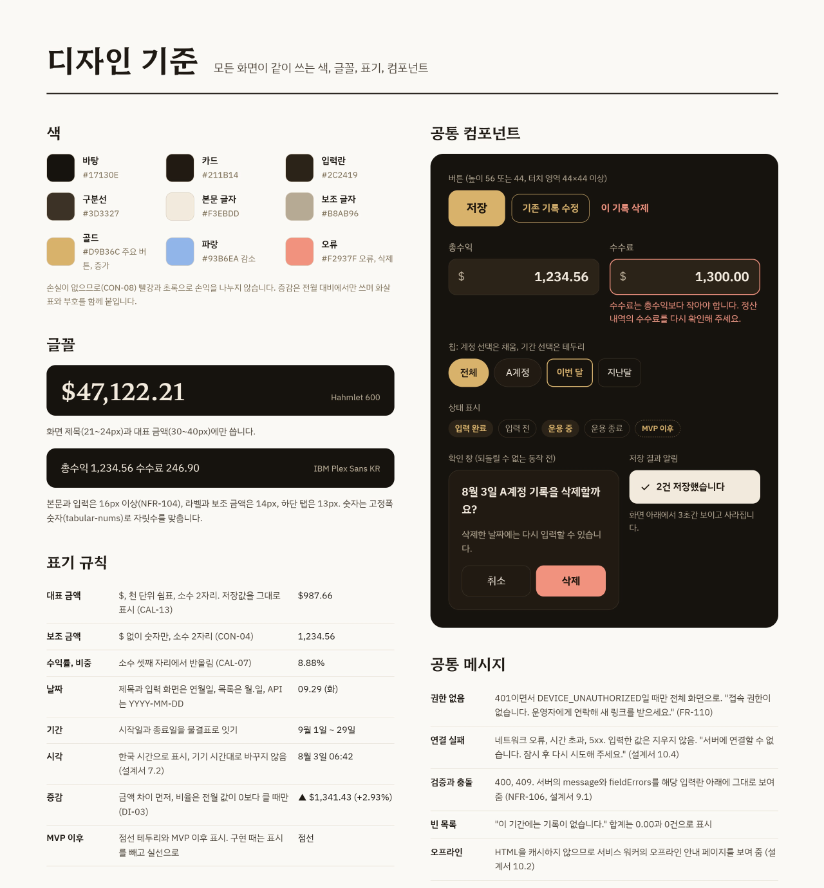

### 색

| 이름 | 값 | 쓰임 |
| --- | --- | --- |
| 바탕 | `#17130E` | |
| 카드 | `#211B14` | |
| 입력란 | `#2C2419` | |
| 구분선 | `#3D3327` | |
| 본문 글자 | `#F3EBDD` | |
| 보조 글자 | `#B8AB96` | |
| 골드 | `#D9B36C` | 주요 버튼, 증가 |
| 파랑 | `#93B6EA` | 감소 |
| 오류 | `#F2937F` | 오류, 삭제 |

손실이 없으므로(CON-08) 빨강과 초록으로 손익을 나누지 않습니다. 증감은 전월 대비에서만 쓰며 화살표와 부호를 함께 붙입니다.

### 글꼴

| 글꼴 | 쓰는 곳 |
| --- | --- |
| Hahmlet 600 | 화면 제목(21\~24px)과 대표 금액(30\~40px)에만 씁니다. |
| IBM Plex Sans KR | 본문과 입력은 16px 이상(NFR-104), 라벨과 보조 금액은 14px, 하단 탭은 13px. 숫자는 고정폭 숫자(tabular-nums)로 자릿수를 맞춥니다. |

### 표기 규칙

| 항목 | 규칙 | 예 |
| --- | --- | --- |
| 대표 금액 | \$, 천 단위 쉼표, 소수 2자리. 저장값을 그대로 표시 (CAL-13) | $987.66 |
| 보조 금액 | \$ 없이 숫자만, 소수 2자리 (CON-04) | 1,234.56 |
| 수익률, 비중 | 소수 셋째 자리에서 반올림 (CAL-07) | 8.88% |
| 날짜 | 제목과 입력 화면은 연월일, 목록은 월.일, API는 YYYY-MM-DD | 09.29 (화) |
| 기간 | 시작일과 종료일을 물결표로 잇기 | 9월 1일 \~ 29일 |
| 시각 | 한국 시간으로 표시, 기기 시간대로 바꾸지 않음 (설계서 7.2) | 8월 3일 06:42 |
| 증감 | 금액 차이 먼저, 비율은 전월 값이 0보다 클 때만 (DI-03) | ▲ $1,341.43 (+2.93%) |
| MVP 이후 | 점선 테두리와 MVP 이후 표시. 구현 때는 표시를 빼고 실선으로 | 점선 |

### 공통 컴포넌트

- 버튼 (높이 56 또는 44, 터치 영역 44×44 이상): 저장, 기존 기록 수정, 이 기록 삭제
- 입력란: 총수익과 수수료 예시. 오류 문구는 입력란 아래에 "수수료는 총수익보다 작아야 합니다. 정산 내역의 수수료를 다시 확인해 주세요."
- 칩: 계정 선택은 채움(전체, A계정), 기간 선택은 테두리(이번 달, 지난달)
- 상태 표시: 입력 완료, 입력 전, 운용 중, 운용 종료, MVP 이후
- 확인 창 (되돌릴 수 없는 동작 전): "8월 3일 A계정 기록을 삭제할까요?", "삭제한 날짜에는 다시 입력할 수 있습니다.", 취소와 삭제 버튼
- 저장 결과 알림: "2건 저장했습니다". 화면 아래에서 3초간 보이고 사라집니다.

### 공통 메시지

| 상황 | 처리 |
| --- | --- |
| 권한 없음 | 401이면서 DEVICE\_UNAUTHORIZED일 때만 전체 화면으로. "접속 권한이 없습니다. 운영자에게 연락해 새 링크를 받으세요." (FR-110) |
| 연결 실패 | 네트워크 오류, 시간 초과, 5xx. 입력한 값은 지우지 않음. "서버에 연결할 수 없습니다. 잠시 후 다시 시도해 주세요." (설계서 10.4) |
| 검증과 충돌 | 400, 409. 서버의 message와 fieldErrors를 해당 입력란 아래에 그대로 보여 줌 (NFR-106, 설계서 9.1) |
| 빈 목록 | "이 기간에는 기록이 없습니다." 합계는 0.00과 0건으로 표시 |
| 오프라인 | HTML을 캐시하지 않으므로 서비스 워커의 오프라인 안내 페이지를 보여 줌 (설계서 10.2) |

## 처음 접속과 권한

### SCR-01 초대 링크 진입

| 등록 대기 | 인앱 브라우저 | 등록 완료 | 권한 없음 (공통) |
| --- | --- | --- | --- |
| 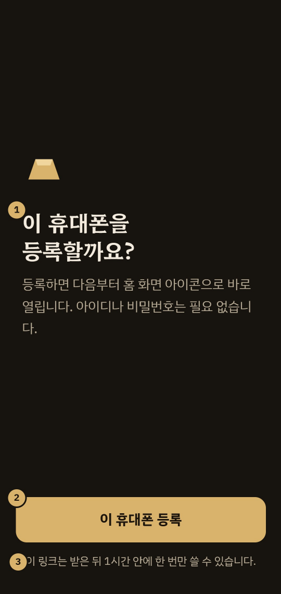 | 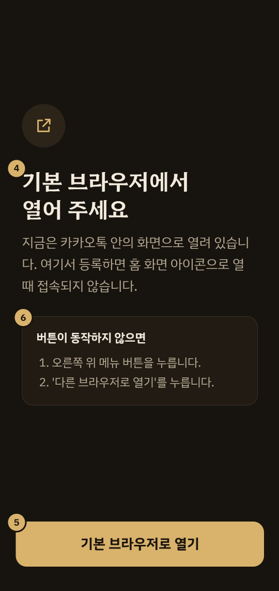 | 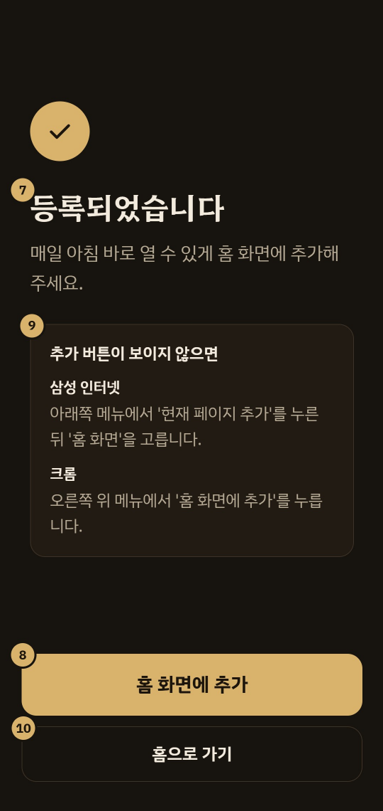 |  |

| 항목 | 내용 |
| --- | --- |
| 경로 | `/invite#{초대 토큰}` |
| 주요 API | `POST /api/auth/invite/exchange` |
| 진입 | 운영자가 문자로 보낸 링크 (FR-106) |
| 요구사항 | FR-105, FR-107, FR-108, FR-110, FR-111, DI-01, AD-07 |

**등록 대기**

| 번호 | 항목 | 설명 | 근거 |
| --- | --- | --- | --- |
| 1 | 등록 안내 | 링크를 열기만 해서는 토큰을 쓰지 않습니다. 문자 앱의 링크 미리보기가 먼저 열어도 토큰이 소비되지 않게 하려는 단계입니다. | DI-01, AD-07 |
| 2 | [이 휴대폰 등록] | 누르면 주소의 # 뒤 토큰을 교환 API로 보냅니다. 응답이 올 때까지 버튼을 비활성으로 두고, 성공하면 기기 토큰 쿠키를 받은 뒤 등록 완료 상태로 바뀝니다. | FR-107, 설계서 5.2 |
| 3 | 유효 기간 안내 | 초대 링크는 발급 후 1시간, 한 번만 유효합니다. | FR-105 |

**인앱 브라우저**

| 번호 | 항목 | 설명 | 근거 |
| --- | --- | --- | --- |
| 4 | 인앱 감지 시 안내 | 사용자 에이전트에 KAKAOTALK 같은 인앱 표식이 있으면 등록 버튼 대신 이 상태를 보입니다. 토큰은 쓰지 않고 주소의 # 뒤도 지우지 않아, 기본 브라우저에서 같은 링크로 등록할 수 있습니다. | FR-111, R-02 |
| 5 | [기본 브라우저로 열기] | 카카오톡은 kakaotalk://web/openExternal?url= 로 현재 주소를 기본 브라우저에서 엽니다. | 설계서 5.2 |
| 6 | 직접 여는 방법 | 버튼이 동작하지 않는 앱을 위한 메뉴 경로입니다. 문구는 실제 전달 수단으로 리허설할 때 확정합니다. | 기획서 7.1 |

**등록 완료**

| 번호 | 항목 | 설명 | 근거 |
| --- | --- | --- | --- |
| 7 | 완료 안내 | 이 상태가 보이는 즉시 history.replaceState로 주소의 토큰을 지웁니다. | FR-107, 설계서 5.2 |
| 8 | [홈 화면에 추가] | beforeinstallprompt를 지원하는 브라우저에서만 보입니다. 지원하지 않으면 버튼을 숨기고 9번 안내만 남깁니다. | FR-111, NFR-105 |
| 9 | 브라우저별 추가 방법 | 실사용 기기가 안드로이드이므로 삼성 인터넷, 크롬 순으로 보입니다. 메뉴 이름은 1주차 실기기 점검에서 확정합니다. | 설계서 5.5, 14.4 |
| 10 | [홈으로 가기] | 홈(SCR-02)으로 이동합니다. |  |

**권한 없음**

| 번호 | 항목 | 설명 | 근거 |
| --- | --- | --- | --- |
| 11 | 고정 문구 | FR-110 문구를 그대로 씁니다. 초대 토큰의 만료, 사용됨, 불일치를 화면에서 구분하지 않고 원인은 서버 로그에만 남깁니다. 버튼은 두지 않습니다. | FR-110, 설계서 5.2 |

#### 상태와 예외

권한 없음은 이 화면만의 상태가 아닙니다. 어느 화면이든 401이면서 DEVICE_UNAUTHORIZED를 받으면 전체 화면으로 바뀝니다. (설계서 10.4)

연결 실패와 서버 오류에는 권한 없음 문구를 쓰지 않습니다. 멀쩡한 기기로 새 링크를 요청하게 되기 때문입니다. (설계서 10.4)

유효한 기기 토큰이 있는 상태로 /invite를 열면 홈으로 보냅니다. (FR-108)

1주차 실기기 검증 결과에 따라 교환 시점이 설치된 앱의 첫 실행으로 바뀔 수 있습니다. 그 경우 등록 대기와 등록 완료의 순서가 뒤바뀝니다. (Q-03, 설계서 5.5)

## 매일 아침 입력

### SCR-02 홈

<p>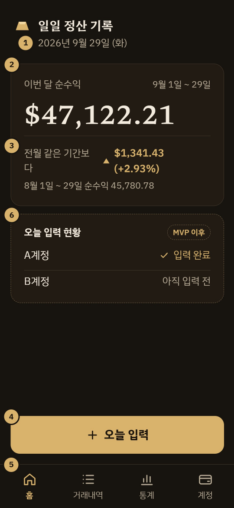</p>

| 항목 | 내용 |
| --- | --- |
| 경로 | `/` |
| 주요 API | `GET /api/session`<br>`GET /api/stats/home` |
| 진입 | 홈 화면 아이콘으로 실행, 하단 탭, 저장 후 복귀 |
| 요구사항 | FR-501, FR-312 (MVP 이후), NFR-102, DI-03 |

| 번호 | 항목 | 설명 | 근거 |
| --- | --- | --- | --- |
| 1 | 오늘 날짜 | /api/session이 준 today를 그대로 보입니다. 기기 시계로 계산하지 않고, 앱이 다시 보일 때(visibilitychange) 새로 받습니다. | CON-11, 설계서 7.1 |
| 2 | 이번 달 순수익 | 이번 달 1일부터 오늘까지의 순수익 합계입니다. 기간을 오른쪽 위에 함께 적어 어느 구간의 합인지 보이게 합니다. | FR-501, CAL-05 |
| 3 | 전월 같은 기간 대비 | 전월 1일부터 같은 날짜까지(없으면 말일)와 비교합니다. 증감은 금액 차이로 보이고, 전월 합계가 0보다 클 때만 비율을 함께 보입니다. 증가는 ▲와 골드, 감소는 ▼와 파랑입니다. 아래 줄에 비교 구간과 그 합계를 적습니다. | FR-501, DI-03, 설계서 7.3 |
| 4 | [오늘 입력] | 일괄 입력(SCR-03)으로 이동합니다. 엄지가 닿는 화면 아래쪽에 고정합니다. 이 버튼과 저장, 두 번의 탭으로 아침 입력이 끝납니다. | NFR-102, 설계서 10 |
| 5 | 하단 탭 | 홈, 거래내역, 통계, 계정. 입력은 탭에 두지 않고 홈의 버튼으로만 들어갑니다. 탭마다 터치 영역은 90×68px입니다. | 기획서 4.2, NFR-104 |
| 6 | 오늘 입력 현황 (MVP 이후) | 오늘 기록이 없는 활성 계정을 보입니다. 요일 예외 없이 매일 판정합니다. /api/stats/home 응답에 목록을 더해 붙입니다. | FR-312, CON-10, 설계서 9.5 |

#### 상태와 예외

이번 달 기록이 없으면 $0.00과 함께 "이번 달 기록이 아직 없습니다"를 보입니다. 전월 합계가 0이면 비율 없이 금액 차이만 보입니다.

API 응답을 캐시하지 않으므로(AD-03) 연결에 실패하면 지난 금액 대신 연결 실패 안내를 보이고 [오늘 입력]은 그대로 둡니다.

### SCR-03 일일 일괄 입력

<p>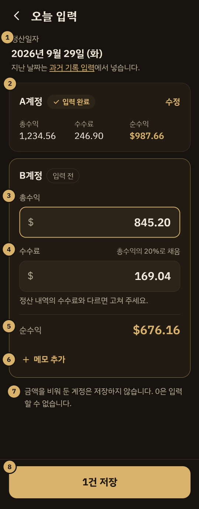</p>

| 항목 | 내용 |
| --- | --- |
| 경로 | `/entry` |
| 주요 API | `GET /api/daily-entry`<br>`POST /api/daily-entry` |
| 진입 | 홈 [오늘 입력] |
| 요구사항 | FR-301\~304, FR-309, FR-310, FR-310-1, DI-06, DI-09 |

| 번호 | 항목 | 설명 | 근거 |
| --- | --- | --- | --- |
| 1 | 정산일자 | 서버가 준 오늘로 고정하고 바꿀 수 없습니다. 이 화면에 들어올 때와 앱이 다시 보일 때 today를 새로 받아, 밤에 열어 둔 화면이 아침에 전날 날짜로 저장하지 않게 합니다. 지난 날짜는 과거 기록 입력(SCR-03-1)으로 보냅니다. | FR-302, FR-311, CON-11, 설계서 7.1 |
| 2 | 입력 완료 계정 | 오늘 기록이 이미 있는 계정(status DONE)은 저장된 값만 보이고 입력 대상에서 뺍니다. [수정]은 그 기록의 수정 화면으로 갑니다. | FR-310-1, 설계서 9.3 |
| 3 | 총수익 | type="text", inputmode="decimal". 입력하는 동안 천 단위 쉼표를 넣고, 소수 셋째 자리는 입력되지 않게 막습니다. 0 이하이면 입력란 아래에 안내합니다. | NFR-103, VAL-01, VAL-13, 설계서 10.3 |
| 4 | 수수료 제안 | 총수익을 넣으면 계정 기본 수수료율(20%)로 계산해 버림한 값을 채웁니다. 845.20이면 169.04. 사용자가 직접 고친 뒤에는 총수익을 바꿔도 덮어쓰지 않고, 입력란 아래에 [제안값으로 되돌리기]를 보입니다. 0 이상, 총수익 미만만 허용합니다. | FR-303, CAL-03, DI-09, VAL-02 |
| 5 | 순수익 미리보기 | 두 칸이 모두 유효할 때만 보입니다. 화면 계산은 정수 센트(BigInt)로 하고, 저장되는 값은 서버가 다시 계산합니다. | FR-303-1, AD-09 |
| 6 | [메모 추가] | 누르면 그 계정의 메모 입력란이 열립니다. 200자 이하, 선택 항목입니다. | FR-301, VAL-05 |
| 7 | 빈칸 안내 | 비워 둔 계정은 기록을 만들지 않습니다. 계정마다 정산 시각이 달라도 먼저 나온 계정만 저장하면 됩니다. 0은 건너뛰기가 아니라 검증 오류입니다. | FR-310, 기획서 S3 |
| 8 | [n건 저장] | 금액을 채운 계정 수를 버튼에 보이고, 0건이면 비활성입니다. 한 트랜잭션으로 모두 저장하거나 하나도 저장하지 않습니다. 응답 전까지 비활성으로 두고, 성공하면 홈으로 돌아가 "1건 저장했습니다"를 알립니다. | FR-309, DI-06, 설계서 9.4 |

#### 상태와 예외

검증 실패(400)는 서버의 fieldErrors를 해당 계정의 입력란 아래에 그대로 보입니다. 이때 어느 계정도 저장되지 않았다는 점이 화면에서 드러나야 합니다.

다른 기기에서 같은 계정이 먼저 저장되면(409) 화면 데이터를 다시 받아 그 계정을 입력 완료로 바꿉니다.

그 날짜에 적용되는 시드가 없는 계정(UNAVAILABLE)은 입력란 대신 "시드 적용 시작일 전이라 입력할 수 없습니다"를 보입니다. (VAL-10)

연결에 실패해도 입력한 값은 지우지 않습니다. (설계서 10.4)

수수료 이상치 경고(MVP 이후)는 제안값과 크게 다를 때 저장 전 확인 창을 띄우며, 저장을 막지 않습니다. (FR-303-2)

## 지난 기록 입력과 수정

### SCR-03-1 단건 입력과 수정

| 과거 기록 입력 | 기록 수정 |
| --- | --- |
| 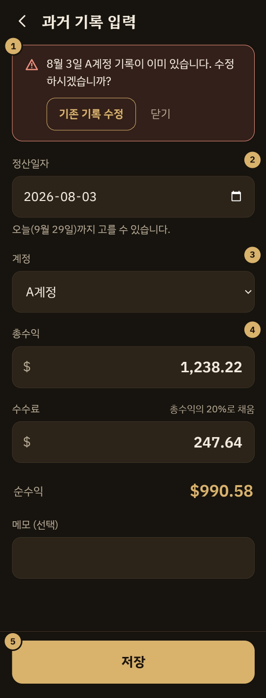 | 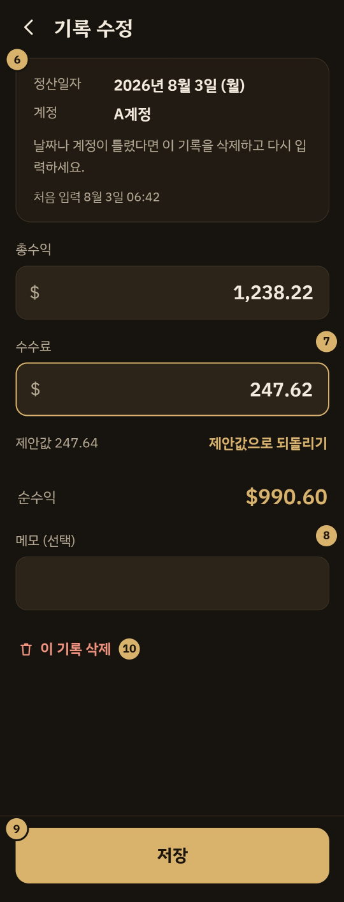 |

| 항목 | 내용 |
| --- | --- |
| 경로 | `/settlements/new`<br>`/settlements/:id` |
| 주요 API | `POST /api/settlements`<br>`GET, PUT, DELETE /api/settlements/{id}` |
| 진입 | 거래내역의 [과거 기록]과 목록 행, 일괄 입력의 [수정], 중복 안내의 [기존 기록 수정] |
| 요구사항 | FR-304\~308, FR-311, VAL-03, VAL-06, VAL-10, DI-07, DI-09 |

**과거 기록 입력**

| 번호 | 항목 | 설명 | 근거 |
| --- | --- | --- | --- |
| 1 | 중복 안내 | 저장이 409 SETTLEMENT_DUPLICATE로 돌아오면 message를 그대로 입력란 위에 보이고, details.settlementId로 [기존 기록 수정]을 연결합니다. 입력한 값은 지우지 않습니다. | FR-304, NFR-106, 설계서 9.3 |
| 2 | 정산일자 | type="date". 기본값과 max는 서버가 준 오늘입니다. 계정의 첫 시드 적용 시작일보다 이른 날짜는 저장할 때 409 SEED_NOT_APPLICABLE 문구로 안내합니다. | FR-302, FR-305, FR-306, VAL-03, VAL-10 |
| 3 | 계정 | 운용 중인 계정만 목록에 나옵니다. 계정이 하나뿐이어도 선택란은 그대로 둡니다. | VAL-06, CON-07 |
| 4 | 금액 | 총수익, 수수료 제안, 순수익 미리보기는 일괄 입력(SCR-03)의 3\~5번과 같은 규칙입니다. | FR-303, FR-303-1 |
| 5 | [저장] | 성공하면 거래내역으로 돌아가 "8월 3일 A계정 기록을 저장했습니다"를 알립니다. | FR-305, FR-311 |

**기록 수정**

| 번호 | 항목 | 설명 | 근거 |
| --- | --- | --- | --- |
| 6 | 고정 항목 | 정산일자와 계정은 입력란이 아니라 글자로 보여 바꿀 수 없음을 드러냅니다. 틀렸으면 삭제 후 다시 입력하도록 안내합니다. 처음 입력 시각은 한국 시간으로 표시합니다. | DI-07, 설계서 7.2 |
| 7 | 수수료와 [제안값으로 되돌리기] | 저장된 수수료가 제안값과 다를 때만 제안값과 되돌리기 버튼을 보입니다. 시안은 제안값 247.64 대신 정산 내역의 247.62를 넣은 기록입니다. | DI-09, CAL-03 |
| 8 | 메모 | 200자 이하. 비우면 메모를 지웁니다. | VAL-05 |
| 9 | [저장] | PUT으로 총수익, 수수료, 메모만 보냅니다. 바뀐 값이 없으면 비활성입니다. | FR-307, DI-07 |
| 10 | [이 기록 삭제] | 확인 창 "8월 3일 A계정 기록을 삭제할까요?"에 [취소]와 [삭제]를 둡니다(디자인 기준의 확인 창). 논리 삭제이므로 같은 날짜에 다시 입력할 수 있습니다. | FR-308, AD-05 |

#### 상태와 예외

삭제한 기록은 합계, 누적, 수익률 어디에도 반영하지 않습니다. 삭제 후에는 거래내역으로 돌아가 목록과 합계를 다시 받습니다. (설계서 6.3)

운용을 종료한 계정의 기록도 수정과 삭제는 할 수 있습니다. 새 기록만 막습니다. (VAL-06)

없는 기록 id로 들어오면(404) "기록을 찾을 수 없습니다"와 함께 거래내역으로 돌아가는 버튼을 보입니다.

## 조회와 통계

### SCR-04 거래내역

<p>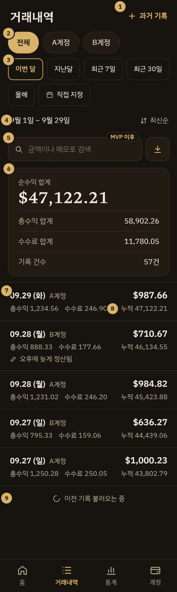</p>

| 항목 | 내용 |
| --- | --- |
| 경로 | `/transactions?from=&to=&accountId=&order=` |
| 주요 API | `GET /api/settlements`<br>`GET /api/settlements/summary` |
| 진입 | 하단 탭 거래내역, 단건 입력과 수정에서 복귀 |
| 요구사항 | FR-401\~408, FR-409\~411 (MVP 이후), AD-11 |

| 번호 | 항목 | 설명 | 근거 |
| --- | --- | --- | --- |
| 1 | [과거 기록] | 빠진 날을 채우는 단건 입력(SCR-03-1)으로 갑니다. | FR-305, FR-311 |
| 2 | 계정 선택 | 전체와 계정별 칩 중 하나를 고릅니다. 전체이면 목록 행에 계정명을 붙이고, 계정을 고르면 뺍니다. 운용을 종료한 계정도 지난 기록 조회를 위해 칩에 남깁니다. 계정이 늘면 다음 줄로 넘어갑니다. | FR-405, FR-406, FR-204, CON-07 |
| 3 | 기간 프리셋 | 이번 달(기본), 지난달, 최근 7일, 최근 30일, 올해. 경계는 /api/session의 presets를 그대로 씁니다. [직접 지정]은 시작일과 종료일 입력을 펼치며 종료일의 max는 오늘입니다. | FR-403, FR-404, DI-02 |
| 4 | 조회 기간과 정렬 | 지금 보고 있는 구간을 날짜로 적습니다. 정렬은 최신순(기본)과 오래된순을 오갑니다. 기간, 계정, 정렬은 URL 쿼리에 두어 기록을 고치고 돌아와도 유지됩니다. | FR-402, 설계서 10.1 |
| 5 | 검색과 CSV (MVP 이후) | 금액 범위와 메모로 검색하고, 지금 조건의 결과를 CSV로 내려받습니다. CSV는 UTF-8 BOM, YYYY-MM-DD, 쉼표 없는 소수 2자리입니다. | FR-409\~411, SRS 5.4 |
| 6 | 구간 합계 | 순수익 합계를 크게, 그 아래 총수익 합계, 수수료 합계, 기록 건수를 둡니다. 저장된 값의 단순 합이며 목록 금액을 더한 값과 항상 같습니다. | FR-407, CAL-05, CAL-13 |
| 7 | 목록 행 | 첫 줄은 정산일자, 계정명, 순수익. 둘째 줄은 총수익, 수수료, 누적 순수익. 메모가 있으면 셋째 줄에 보입니다. 행 전체가 누르는 영역이고 기록 수정(SCR-03-1)으로 갑니다. | FR-401, FR-307 |
| 8 | 누적 순수익 | 조회 구간 전체를 (정산일자, 계정 id) 오름차순으로 누적한 값입니다. 정렬이나 페이지가 바뀌어도 같은 기록은 같은 값을 가지며, 최신순 첫 행의 누적은 순수익 합계와 같습니다. | AD-11, 설계서 8.5 |
| 9 | 이어 불러오기 | 30건씩 받아 목록 끝에 닿으면 nextCursor로 다음 30건을 붙입니다. nextCursor가 없으면 이 줄을 숨깁니다. | FR-408, 설계서 9.1 |

#### 상태와 예외

기록이 없는 구간은 목록 자리에 "이 기간에는 기록이 없습니다"를 보이고, 합계는 0.00과 0건으로 둡니다.

계정을 하나 고르면 누적은 그 계정 기록만으로 계산되어 전체 조회의 누적과 다릅니다. 정상 동작입니다. (설계서 8.5)

목록과 합계는 따로 요청하므로, 둘 중 하나만 실패하면 실패한 쪽 자리에만 연결 실패 안내를 보입니다.

### SCR-05 통계

<p>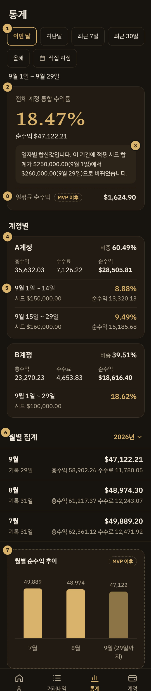</p>

| 항목 | 내용 |
| --- | --- |
| 경로 | `/stats` |
| 주요 API | `GET /api/stats/accounts?from=&to=`<br>`GET /api/stats/monthly?year=` |
| 진입 | 하단 탭 통계 |
| 요구사항 | FR-502, FR-503, FR-507\~509, FR-504와 FR-505 (MVP 이후) |

| 번호 | 항목 | 설명 | 근거 |
| --- | --- | --- | --- |
| 1 | 조회 기간 | 통합 수익률과 계정별 영역에 적용됩니다. 프리셋과 직접 지정은 거래내역과 같고 이번 달이 기본입니다. 월별 집계는 이 기간이 아니라 연도 선택을 따릅니다. | FR-403, FR-404 |
| 2 | 통합 수익률 | 날짜마다 (그날 순수익 합계 ÷ 그날 유효 시드 합계)를 구해 더한 값입니다. 계정별 수익률의 평균이 아닙니다. 소수 셋째 자리에서 반올림합니다. | FR-509, CAL-10, CAL-07 |
| 3 | 시드 기준 표시 | 응답의 seedBasis가 FIXED면 "적용 시드 합계 $250,000.00 기준"처럼 한 줄로, DAILY_SUM이면 시안처럼 일자별 합산값임을 밝히고 시작일과 종료일의 시드 합계를 함께 적습니다. | FR-507, 설계서 8.4 |
| 4 | 계정 카드 | 계정명, 전체 순수익 대비 비중, 총수익, 수수료, 순수익 합계. 비중은 계정마다 반올림한 값을 그대로 쓰고 합을 100.00%로 맞추지 않습니다. | FR-503, DI-10 |
| 5 | 시드 구간 행 | 조회 기간이 시드 변경일을 걸치면 구간마다 적용 기간, 적용 시드, 순수익, 수익률을 한 행씩 보입니다. A계정은 9월 15일 시드 변경으로 두 행입니다. 구간이 하나인 계정은 B계정처럼 순수익을 생략한 한 행으로 줄입니다. | FR-508, CAL-08, DI-05 |
| 6 | 월별 집계 | 연도를 고르면 기록이 있는 달만 최신순으로 보입니다. 행마다 순수익, 총수익, 수수료, 기록 일수. 기록 일수는 기록이 있는 서로 다른 날짜의 수이며, 계정이 둘이어도 하루는 1일로 셉니다. | FR-502, DI-04 |
| 7 | 월별 순수익 추이 (MVP 이후) | 월별 집계 응답을 그대로 막대로 그립니다. 진행 중인 달은 흐린 색으로 구분하고 라벨에 마지막 날짜를 붙입니다. | FR-505 |
| 8 | 일평균 순수익 (MVP 이후) | 구간 순수익을 달력 일수로 나눕니다. 종료일이 오늘보다 뒤면 오늘까지로 셉니다. 시안은 29일로 나눈 값입니다. | FR-504, CAL-12 |

#### 상태와 예외

전체 순수익이 0이면 비중을 표시하지 않습니다. (설계서 8.3)

유효 시드 합계가 0인 날은 통합 수익률 계산에서 뺍니다. (CAL-10)

운용을 종료한 계정은 비활성일자까지의 구간만 계산하고, 그 뒤 기간만 조회하면 카드에서 뺍니다. (DI-05)

## 계정과 시드

### SCR-06 계정 관리

<p>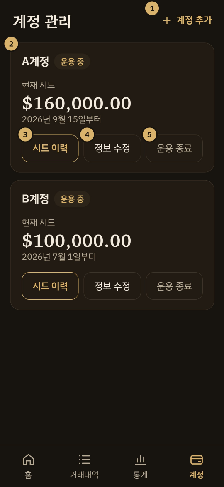</p>

| 항목 | 내용 |
| --- | --- |
| 경로 | `/accounts` |
| 주요 API | `GET, POST /api/accounts`<br>`PATCH /api/accounts/{id}`<br>`POST /api/accounts/{id}/deactivate` |
| 진입 | 하단 탭 계정 |
| 요구사항 | FR-201\~206, VAL-04, DI-08. 초기 계정은 시드 데이터로 넣으므로 화면 완성도는 후순위 |

| 번호 | 항목 | 설명 | 근거 |
| --- | --- | --- | --- |
| 1 | [계정 추가] | 전체 화면 입력으로 계정명(1\~30자), 최초 시드, 시드 적용 시작일(기본 오늘), 메모(선택)를 받습니다. 수수료율은 입력받지 않고 20%로 만듭니다. | FR-201, FR-206, VAL-04, VAL-07 |
| 2 | 계정 카드 | 계정명, 상태, 오늘 적용되는 시드와 그 적용 시작일. 상태는 화면에서 활성을 "운용 중", 비활성을 "운용 종료"로 씁니다. | FR-202, CAL-06 |
| 3 | [시드 이력] | 그 계정의 시드 이력(SCR-06-1)으로 갑니다. | FR-209 |
| 4 | [정보 수정] | 계정명과 메모를 고칩니다. 계정명을 바꾸면 지난 기록의 표시 이름도 함께 바뀝니다. 이미 쓰는 이름이면 409 ACCOUNT_NAME_DUPLICATE 문구를 입력란 아래에 보입니다. 운용을 종료한 계정도 고칠 수 있습니다. | FR-203, Q-01 |
| 5 | [운용 종료] | 비활성 처리의 화면 이름입니다. 확인 창 "A계정 운용을 종료할까요?"에 "오늘부터 새 기록을 입력할 수 없고 되돌릴 수 없습니다. 지난 기록은 그대로 조회됩니다."를 붙이고 [취소]와 [운용 종료]를 둡니다. 비활성일자는 서버의 오늘입니다. | FR-204 |

#### 상태와 예외

운용을 종료한 계정은 목록 맨 아래로 내려 흐리게 보이고, [운용 종료]를 빼고 [시드 이력]과 [정보 수정]을 남깁니다. 카드에 종료일을 적습니다. [정보 수정]은 옛 이름을 새 계정에 다시 쓸 때 이 계정의 이름을 먼저 바꾸는 데 씁니다. (Q-01)

[삭제]는 기록이 한 건도 없는 계정(삭제한 기록 포함)에만 보입니다. 서버는 기록이 있으면 409 ACCOUNT_HAS_SETTLEMENTS로 막습니다. 화면은 계정 목록 응답의 deletable로 판단합니다. (FR-205, DI-08)

설정(SCR-07)은 MVP에서 빠집니다. 기기 로그아웃과 전체 CSV가 들어올 때 이 탭 아래에 붙입니다. (CHK-04)

### SCR-06-1 시드 이력

<p>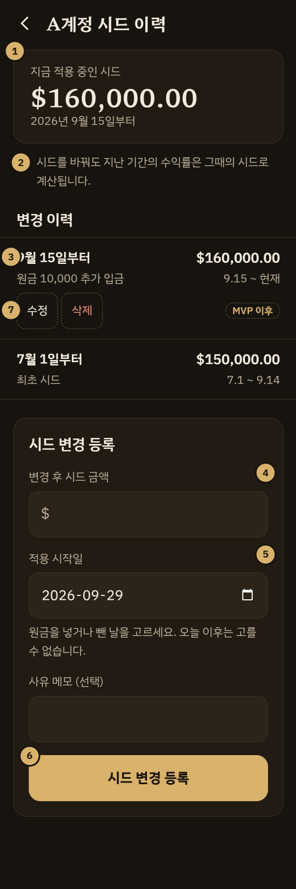</p>

| 항목 | 내용 |
| --- | --- |
| 경로 | `/accounts/:id/seeds` |
| 주요 API | `GET, POST /api/accounts/{id}/seeds`<br>`PATCH, DELETE /api/accounts/{id}/seeds/{seedId}` |
| 진입 | 계정 관리 [시드 이력] |
| 요구사항 | FR-207\~209, FR-210 (MVP 이후), VAL-07, VAL-09\~12, CAL-06 |

| 번호 | 항목 | 설명 | 근거 |
| --- | --- | --- | --- |
| 1 | 지금 적용 중인 시드 | 적용 시작일이 오늘 이전인 이력 중 가장 늦은 것입니다. | CAL-06 |
| 2 | 수익률 안내 | 시드 변경이 지난 수익률을 바꾸지 않는다는 점을 등록 전에 알립니다. | FR-208, CAL-11 |
| 3 | 변경 이력 | 적용 시작일 최신순. 행마다 시작일, 시드 금액, 사유 메모, 적용 기간. 적용 기간의 끝은 저장하지 않고 다음 이력의 시작일 전날이며, API가 endDate로 계산해 줍니다. | FR-209, SRS 4.1 |
| 4 | 변경 후 시드 금액 | 추가 입금액이 아니라 바뀐 뒤의 총 시드를 넣습니다. 0보다 큰 금액, 소수 2자리까지. 입력 방식은 금액 입력란 공통 규칙을 따릅니다. | FR-207, VAL-07, VAL-13 |
| 5 | 적용 시작일 | 기본값과 max는 서버가 준 오늘이고, 운용을 종료한 계정은 비활성일자입니다. 같은 날짜의 이력이 이미 있으면 409 SEED_DUPLICATE 문구를 입력란 아래에 보입니다. | FR-207, VAL-09, VAL-12 |
| 6 | [시드 변경 등록] | 기존 이력을 덮어쓰지 않고 새 이력을 더합니다. 성공하면 입력란을 비우고 이력 목록과 현재 시드를 다시 받습니다. | FR-208 |
| 7 | 수정과 삭제 (MVP 이후) | 이력이 1건만 남으면 삭제 버튼을 숨깁니다. 첫 이력의 시작일을 기존 기록보다 늦게 바꾸거나 첫 이력을 지우면 409 SEED_NOT_APPLICABLE로 막습니다. | FR-210, VAL-10, VAL-11 |

#### 상태와 예외

운용을 종료한 계정도 등록 영역을 보입니다. 적용 시작일의 기본값과 max를 비활성일자로 두어 운용하던 기간의 시드 변경만 등록하게 합니다. (FR-207, VAL-12, DB 설계서 DQ-01)

MVP에서 이력을 잘못 넣었다면 운영자가 DB에서 고칩니다. 이 제약은 운영 문서에 적습니다.
