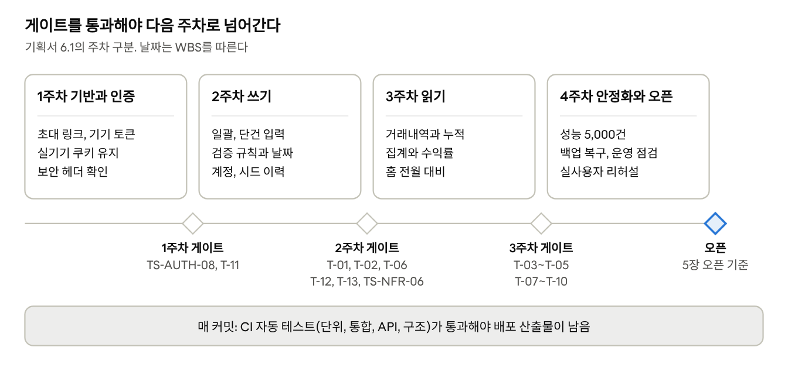

# 금 투자 수익 정산 기록 서비스 테스트 계획 및 시나리오

Oct 8, 2026 / @최승혁

## 1. 개요

MVP(요구사항명세서의 우선순위 M 항목 전체)를 오픈 전에 검증한다. 금액 계산, 날짜 판정, 기기 토큰 인증은 기준 시각을 고정한 자동 테스트로 확인하고, 실사용자 리허설을 통과해야 오픈한다.

기대 결과는 요구사항명세서(이하 SRS)를 기준으로 쓴다. 이 문서와 SRS가 어긋나면 SRS를 따르고 이 문서를 고친다. 시스템 아키텍처 설계서는 설계서, 프로젝트 기획서는 기획서로 줄여 쓴다.

| 기준 문서 | 버전 | 이 계획에서 쓰는 내용 |
| --- | --- | --- |
| 요구사항명세서 | v1.3 (2026-10-06) | 기대 결과의 기준. 기능(FR), 무결성(VAL), 계산(CAL), 비기능(NFR) 요구사항과 4.2 계산 예시 |
| 프로젝트 기획서 | v0.8 (2026-10-06) | 주차별 완료 기준(6.1), 이용 시나리오 S1\~S7(3.2), 리스크 R-01\~R-08 |
| 시스템 아키텍처 설계서 | v0.6 (2026-10-06) | 테스트 계층과 필수 검증 사례 T-01\~T-13(14장), 기준 시각 주입 방식, 배포 구성 |
| DB 설계서 | v0.2 (2026-10-06) | 유일 제약, 인덱스, 기록 삭제 방식 |
| API 명세서 | v0.3 (2026-10-06) | 엔드포인트별 요청, 응답, 오류 코드 |
| 화면 설계서 | v0.2 (2026-10-06) | MVP 화면 8개의 화면 단위 동작 |

## 2. 테스트 범위

M 항목 전부와 무결성(VAL), 계산(CAL) 규칙, MVP에 해당하는 비기능 요구사항을 검증한다. S, C 항목은 이번 범위에서 빼고, 오픈 이후 구현할 때 해당 영역에 시나리오를 더한다(기획서 7.4).

| 영역 | 대상 요구사항 | 화면 |
| --- | --- | --- |
| 인증 | FR-101\~111, NFR-302, NFR-303, NFR-305 | SCR-01 |
| 계정과 시드 이력 | FR-201\~209, VAL-04, VAL-07, VAL-09, VAL-11, VAL-12 | SCR-06, SCR-06-1 |
| 정산 입력 | FR-301\~311(FR-303-2 제외), VAL-01\~03, VAL-05, VAL-06, VAL-10, VAL-13, CAL-01\~04 | SCR-03, SCR-03-1 |
| 조회 | FR-401\~408, CAL-05, CAL-13, VAL-08 | SCR-04 |
| 집계와 수익률 | FR-501\~503, FR-507\~509, CAL-06\~11 | SCR-02, SCR-05 |
| 날짜 기준 | CON-11과 이를 따르는 모든 날짜 판정 | 전 화면 |
| 비기능 | NFR-101\~106, NFR-201\~203, NFR-301\~306, NFR-401, NFR-402, NFR-404, NFR-501\~503 | 전 화면, 운영 환경 |

| 제외 항목 | 사유 |
| --- | --- |
| FR-112, FR-210, FR-303-2, FR-312, FR-409\~411, FR-504, FR-505, FR-510 | 우선순위 S. 기획서 7.4의 순서대로 붙일 때 검증한다 |
| FR-313, FR-506 | 우선순위 C |
| NFR-403 전체 데이터 CSV, SCR-07 설정 | MVP 제외(CHK-04). 스프레드시트 기록을 중단하기 전에 제공하며 그때 검증한다 |
| SRS 7장 범위 외 항목 | 외부 연동, 다중 사용자, 다중 업체처럼 기능 자체가 없다 |

VAL-10 가운데 첫 시드 적용 시작일을 늦추는 경우는 시드 이력 수정(FR-210, S)이 생겨야 발생하므로 MVP에서는 기록 입력 쪽만 검증한다.

## 3. 테스트 전략

계산, 날짜, 인증 규칙은 CI 자동 테스트로 커밋마다 고정하고, 쿠키 유지와 화면처럼 기기에 달린 동작은 실기기로 확인한다. 아키텍처 설계서 14장의 테스트 계층과 필수 검증 사례 T-01\~T-13을 그대로 쓰고, 8장 시나리오가 그 위에 요구사항별 사례를 더한다.

| 레벨 | 도구와 환경 | 대상 | 실행 시점 |
| --- | --- | --- | --- |
| 단위 | JUnit, Vitest. 서버와 클라이언트가 shared-test-vectors/money.json을 함께 읽음 | 금액과 수익률 순수 함수, 시드 구간 분할, 통합 수익률, 기간 프리셋, 금액 입력 서식 | 커밋마다 |
| 통합 | Spring Boot Test, Testcontainers(PostgreSQL) | 제약, 부분 유일 인덱스, 윈도 함수, 트랜잭션과 잠금, 동시 요청 | 커밋마다 |
| API | MockMvc | 상태 코드, 오류 본문(code, message, fieldErrors, details), 쿠키 속성, 요청 형식 | 커밋마다 |
| 구조 | ArchUnit | 시간대 금지 규칙, 의존 방향 | 커밋마다 |
| 화면 | 배포 환경의 모바일 브라우저, 수동 | 화면 흐름, 입력 동작, 오류 문구 위치 | 주차 게이트 전 |
| 실기기 | 실사용자 안드로이드 휴대폰, 삼성 인터넷과 크롬 | 초대 링크, 쿠키 유지, PWA 설치, 키패드, 360px | 1주차, 4주차 |
| 성능 | 5,000건 데이터, 운영과 같은 사양의 VM | 목록, 합계, 수익률, 일괄 저장 응답 시간 | 4주차 |
| 운영 | 배포 환경, 수동 | 백업과 복구, 배포 시간 차단, 알림, 로그 | 4주차 |
| 인수 | 실사용자 리허설 | 기획서 이용 시나리오 S1\~S7 | 4주차 |

CI는 단위, 통합, API, 구조 테스트를 모두 통과한 커밋만 jar로 남기므로(설계서 12.2) 자동 테스트 실패는 곧 배포 차단이다.

모든 레벨에 공통으로 적용하는 원칙은 다음과 같다.

1. 날짜가 걸린 테스트는 Clock을 2026-09-29(화) 06:30 KST(UTC 전날 21:30)에 고정하고, 테스트 JVM은 TZ=UTC로 띄운다. 기준 시간대를 빠뜨린 코드는 이 시각에 하루 밀려 실패한다(T-06).
2. 기대값은 SRS 4.2 예시와 공유 벡터처럼 손으로 계산해 둔 값을 쓴다. 구현 코드로 기대값을 만들면 같은 오류가 양쪽에 들어가 테스트가 통과해 버린다.
3. 조회와 집계 테스트의 준비 데이터에는 삭제된 기록을 항상 섞는다(T-08).
4. 경계값은 허용되는 마지막 값과 거부되는 첫 값을 함께 넣는다. 예: 메모 200자와 201자.
5. 오류 시나리오는 상태 코드만이 아니라 code, message 문구, fieldErrors 위치까지 확인한다(NFR-106).
6. 동시성 규칙은 같은 요청 두 개를 실제로 동시에 보내 확인한다(T-11, T-12).

## 4. 테스트 환경과 테스트 데이터

자동 테스트는 CI의 PostgreSQL 컨테이너에서 돌리고, 화면, 실기기, 운영 점검은 오픈 전의 배포 환경에서 한다. 배포 환경에 넣은 시험 기록은 실사용자 리허설 전에 DB를 새로 만들어 지운다.

| 환경 | 구성 | 용도 |
| --- | --- | --- |
| CI | GitHub Actions, Java 25, Testcontainers PostgreSQL, TZ=UTC | 단위, 통합, API, 구조 테스트 |
| 배포 환경 | Oracle Cloud A1 VM(호스트 UTC), caddy, app, db 컨테이너, 무료 서브도메인 HTTPS | 화면, 실기기, 보안 헤더, 배포 스크립트, 백업 복구 |
| 성능 측정 DB | 배포 환경 VM에 임시로 띄운 별도 DB에 D5 적재 | 응답 시간 측정 후 삭제 |
| 실기기 | 실사용자 안드로이드 휴대폰(또는 같은 OS와 브라우저), 삼성 인터넷, 크롬, 문자 앱, 카카오톡 | 초대 링크, 쿠키 유지, PWA, 키패드, 화면 폭 |

| 세트 | 내용 | 기준 시각(KST) | 쓰는 곳 |
| --- | --- | --- | --- |
| D1 기본 | A계정 시드 10,000.00, B계정 시드 5,000.00, 적용 시작일 모두 2026-07-01, 수수료율 0.2000. 2026-07-01\~09-28 매일 두 계정 기록(9월 14일 B계정만 비움), 오늘 기록 없음 | 2026-09-29 06:30 | 별도 표기가 없는 모든 시나리오 |
| D2 시드 변경 | 계정 1개. 시드 2026-01-01 5,000,000.00, 2026-07-01 10,000,000.00. 상반기와 하반기 순수익 합계 각 500,000.00 | 2027-01-05 06:30 | T-03 |
| D3 운용 종료 | A 시드 10,000.00, B 시드 5,000.00, 적용 시작일 모두 2026-01-01. B는 2026-03-31 운용 종료. 순수익 A 1\~3월 1,100.00과 4월 300.00, B 1\~3월 400.00 | 2026-05-01 06:30 | T-04 |
| D4 삭제 혼합 | D1에 삭제된 기록을 섞고, 그 가운데 일부는 같은 계정과 날짜로 다시 입력. 삭제된 기록 금액은 99,999.99처럼 눈에 띄는 값 | 2026-09-29 06:30 | T-08 |
| D5 대량 | 계정 2개 × 2,500일(약 5,000건), 시드 변경 몇 건, 삭제된 기록 일부 | 측정 시각 | 성능 |
| R 무작위 | 계정 1\~5개, 계정마다 시드 이력 1\~4건, 비활성일자 유무, 기록 수백 건. 난수 시드를 로그에 남겨 실패를 재현 | 임의 | T-05 |

계정명 A계정, B계정은 초기 데이터(CHK-05)가 정해지기 전까지 쓰는 시험용 이름이다. 리허설 전에 DB를 새로 만든 뒤 V1 마이그레이션과 초기 데이터 적재(DB 설계서 8.2)를 다시 실행하고, 리허설부터 들어간 기록은 실제 기록으로 남긴다.

## 5. 진입 기준과 종료 기준

오픈은 시나리오가 모두 통과하고 치명, 높음 결함이 0건일 때만 한다. 주차별 게이트는 7장 일정에 표시하며, 게이트를 넘지 못하면 다음 주차 범위로 넘어가지 않는다.

**진입 기준**

- 해당 범위의 기능이 main에 병합되고 CI 자동 테스트가 통과했다.
- 화면과 실기기 시나리오는 그 커밋이 배포 환경에 올라가 있다.
- 시나리오가 쓰는 데이터 세트와 Clock 고정 장치가 준비됐다.

**중단과 재개 기준**

- 치명 결함이 나오면 그 영역의 수동 테스트를 멈추고, 고친 뒤 그 영역 시나리오를 처음부터 다시 돈다.
- 1주차 실기기 쿠키 유지 점검(TS-AUTH-08)이 실패하면 2주차 범위로 넘어가지 않고 인증 흐름 변경(설계서 Q-03)부터 정한다. 흐름을 바꾸면 SRS FR-107, FR-111을 고친 뒤 TS-AUTH 시나리오를 다시 쓴다.
- 배포 환경 장애로 실기기 점검을 못 하면 자동 테스트만 진행하고 실기기 시나리오는 보류로 표시한다.

**오픈 기준**

| 항목 | 기준 | 근거 |
| --- | --- | --- |
| 시나리오 | TS-UAT-08(오픈 후 병행 대조)을 뺀 8장 시나리오가 모두 통과. 낮음 등급 결함은 처리 날짜를 정해 남길 수 있다 | 6장 |
| 계산 | T-01\~T-05가 통과하고, 화면의 개별 금액 합과 표시된 합계가 일치 | 기획서 1.3, CAL-13 |
| 성능 | D5 기준 목록, 합계, 수익률, 일괄 저장이 각각 1초 이내 | NFR-201, NFR-202 |
| 백업 | 자동 백업본으로 새 DB 복구를 1회 성공하고 건수와 합계가 일치 | NFR-401, 기획서 7.1 |
| 실사용자 | 실사용자가 운영자 도움 없이 당일 입력과 기간 조회를 마침 | 기획서 1.3, 6.1 |
| 배포 | 06\~09시를 피해 배포하고 다음 날 아침 첫 입력을 함께 확인 | NFR-501, 기획서 7.1 |

## 6. 결함 관리

결함은 네 등급으로 나누고 치명과 높음은 오픈 전에 반드시 고친다. 계산과 날짜 결함은 고치기 전에 재현 사례부터 실패하는 자동 테스트로 옮긴다.

| 등급 | 기준 | 예 | 처리 |
| --- | --- | --- | --- |
| 치명 | 금액, 합계, 수익률이 틀리거나, 기록이 사라지거나, 인증 없이 데이터에 접근된다 | 통합 수익률 18.00%, 삭제된 기록이 합계에 포함, 쿠키 없는 요청에 200 | 즉시 수정, 오픈 차단 |
| 높음 | 매일 입력을 마칠 수 없거나 잘못된 날짜로 저장된다 | 06:30에 정산일자 기본값이 전날, 일괄 저장이 계속 실패 | 오픈 전 수정 |
| 보통 | 우회 수단이 있는 기능 오류, 원인과 다음 행동을 알려 주지 않는 문구 | 중복 안내에 \[기존 기록 수정\] 연결이 없음 | 오픈 전 수정이 원칙. 남기면 처리 날짜를 정함 |
| 낮음 | 결과에 영향이 없는 표시와 배치 문제 | 쉼표 입력 뒤 커서 위치, 정렬 표시 | 오픈 후 처리 가능 |

1. GitHub 저장소 이슈로 남기고 등급을 라벨로 붙인다. 시나리오 ID, 기준 시각, 데이터 세트, 입력값, 기대 결과, 실제 결과를 적는다.
2. 계산과 날짜 결함은 재현 사례를 실패하는 자동 테스트로 먼저 옮기고, 계산 결함이면 shared-test-vectors에도 더한다.
3. 고친 뒤 그 테스트와 같은 영역의 시나리오를 다시 통과하면 닫는다.
4. 리허설이나 병행 기간에 실제 금액으로 찾은 결함은 금액을 시험용 값으로 바꿔 적는다. 저장소에 실제 금액을 남기지 않는다.

## 7. 테스트 일정

검증은 기획서 6.1의 주차 구분을 따르고, 주차가 끝날 때 게이트의 사례가 모두 통과해야 다음 주차 범위로 넘어간다. 날짜는 WBS(구글 스프레드시트)를 기준으로 한다.

*주차별 검증 범위와 게이트*

게이트의 T-xx는 9장 두 번째 표에서 해당 시나리오를 찾는다. 1주차 게이트(TS-AUTH-08)가 실패하면 인증 흐름부터 다시 정하고(5장), 일정이 밀려 쓰기를 먼저 오픈하면(기획서 6.2) 2주차 게이트에 자동 백업과 복구(TS-NFR-16, TS-NFR-17), 인수 TS-UAT-01\~03을 더해 오픈 조건으로 삼는다.

## 8. 테스트 시나리오

시나리오는 8개 영역 119건이다. 8.1\~8.7은 개발 중에 주차 범위에 맞춰 수행하고, 8.8은 4주차 실사용자 리허설과 오픈 후 병행 기간에 수행한다. 별도 표기가 없으면 기준 시각은 2026-09-29(화) 06:30 KST, 데이터는 D1이고, 요청은 유효한 기기 토큰 쿠키와 올바른 Origin을 가진다.

ID는 TS-영역-번호다. 근거의 T-xx는 아키텍처 설계서 14.2, DI-xx는 설계서 15.1, AD-xx는 설계서 2장, SD-xx는 API 명세서 7.1, DB-xx는 DB 설계서 1.2, R-xx는 기획서 8장, Q-xx는 설계서 15.2의 항목이다. 결과 열은 실행하면서 고른다.

### 8.1 인증 (TS-AUTH)

초대 토큰은 등록 버튼을 누를 때 한 번만 쓰이고, 유효한 기기 토큰이 없는 요청은 모든 데이터 API에서 401로 막힌다. TS-AUTH-08이 1주차 게이트다.

| ID | 시나리오 | 조건과 절차 | 기대 결과 | 근거 | 레벨 | 결과 |
| --- | --- | --- | --- | --- | --- | --- |
| TS-AUTH-01 | 초대 링크 발급 | 운영자 시크릿을 넣어 `POST /admin/invites` 호출 | 201. inviteUrl은 `https://{도메인}/invite#{43자 토큰}`, expiresAt은 발급 1시간 뒤(+09:00). `invite_token`에는 소문자 16진수 64자 해시만 있고 원문은 없음 | FR-103, FR-104, NFR-302 | API | 미수행 |
| TS-AUTH-02 | 운영자 인증 실패와 잠금 | 시크릿 없이, 틀린 시크릿으로 호출. 같은 IP에서 5회 연속 실패한 뒤 올바른 시크릿으로 호출하고, 15분 뒤 다시 호출 | 실패는 401 ADMIN\_UNAUTHORIZED. 5회 연속 실패 뒤에는 올바른 시크릿도 429 ADMIN\_LOCKED와 Retry-After. 15분 뒤에는 201 | FR-103, 설계서 5.4 | API | 미수행 |
| TS-AUTH-03 | 링크를 열기만 하면 토큰을 쓰지 않음 | 링크를 문자로 보내 미리보기가 생기게 한 뒤, 링크를 열고 등록하지 않은 채 닫음. 다시 열어 등록 | 등록 전까지 `used_at`이 비어 있고 다시 연 뒤 등록 성공. 무료 서브도메인 링크가 차단이나 경고 없이 열림 | FR-106, FR-107, DI-01, R-02 | 화면, 실기기 | 미수행 |
| TS-AUTH-04 | 등록 버튼으로 교환 | 기본 브라우저에서 링크를 열고 \[이 휴대폰 등록\] | 204와 `__Host-dt` 쿠키(HttpOnly, Secure, SameSite=Lax, Path=/, Max-Age=7776000). 응답 전까지 버튼 비활성. 성공 화면에서 주소의 # 뒤 토큰이 지워지고 홈 화면 추가 안내가 보임 | FR-107, FR-111, NFR-305 | API, 화면 | 미수행 |
| TS-AUTH-05 | 쓸 수 없는 초대 토큰 | 이미 쓴 토큰, 발급 1시간 1초 뒤의 토큰, 임의의 43자, 길이가 다른 문자열로 교환. 경계로 발급 59분 59초 뒤의 새 토큰 교환 | 앞의 넷은 모두 401 INVITE\_INVALID와 같은 문구. 원인은 토큰 값 없이 서버 로그에만 남음. 59분 59초는 204 | FR-105, FR-110, T-11 | API | 미수행 |
| TS-AUTH-06 | 같은 토큰 동시 교환 | 같은 토큰으로 교환 요청 2건을 동시에 보냄 | 1건만 204, 나머지는 401 INVITE\_INVALID. `device_token`은 1행만 생김 | FR-105, T-11 | 통합 | 미수행 |
| TS-AUTH-07 | 인앱 브라우저 안내 | 카카오톡 안에서 링크를 엶(User-Agent에 KAKAOTALK). \[기본 브라우저로 열기\] | 등록 버튼 대신 기본 브라우저 안내. 토큰을 쓰지 않고 # 뒤도 남아, 기본 브라우저에서 같은 링크로 등록 성공 | FR-111, R-02 | 화면, 실기기 | 미수행 |
| TS-AUTH-08 | 홈 화면 앱의 쿠키 유지 | 실사용자 기기에서 교환, 홈 화면에 추가, 아이콘으로 실행, 앱 완전 종료 뒤 재실행, 다음 날 아침 재실행 | 모든 단계에서 권한 없음 안내 없이 홈이 뜸. 등록한 브라우저와 홈 화면에 추가한 브라우저가 같음. 실패하면 Q-03에 따라 흐름 변경 결정 | FR-108, R-03, 설계서 5.5 | 실기기 | 미수행 |
| TS-AUTH-09 | 미인증 요청 차단 | 쿠키 없이 `/api` 아래 모든 엔드포인트를 목록으로 반복 호출 | 세션 조회는 200 `{"authenticated": false}`. 인증 예외(세션 조회, 초대 교환)를 뺀 나머지는 모두 401 DEVICE\_UNAUTHORIZED. 헬스 체크는 인증 없이 200과 상태만 | FR-101, NFR-303 | API | 미수행 |
| TS-AUTH-10 | 만료되거나 폐기된 기기 토큰 | 만료 시각이 지난 토큰, 운영자가 폐기한 토큰으로 API 호출과 앱 실행 | API는 401 DEVICE\_UNAUTHORIZED. 화면은 전체 화면으로 “접속 권한이 없습니다. 운영자에게 연락해 새 링크를 받으세요.” | FR-108, FR-109, FR-110 | API, 화면 | 미수행 |
| TS-AUTH-11 | 기기 토큰 갱신 | 마지막 갱신 23시간 59분 뒤와 24시간 1분 뒤에 요청 | 앞은 만료 시각 그대로이고 Set-Cookie 없음. 뒤는 만료 시각이 그 시점부터 90일 뒤로 늘고, 같은 토큰 값의 쿠키가 새 Max-Age로 내려옴 | FR-108, 설계서 5.3 | 통합 | 미수행 |
| TS-AUTH-12 | 운영자 기기 목록과 폐기 | 기기 2대 등록 뒤 `GET /admin/devices`. 한 대를 폐기하고 같은 요청을 한 번 더, 없는 id로 폐기 | 목록은 등록 최신순, deviceLabel은 OS와 브라우저 이름(예: Android / Samsung Internet). 폐기는 204, 다시 보내도 204, 없는 id는 404. 폐기한 기기의 다음 요청부터 401 | FR-109, SD-14 | API | 미수행 |
| TS-AUTH-13 | 등록된 기기로 링크 재방문 | 유효한 쿠키가 있는 브라우저에서 `/invite`를 엶 | 홈(`/`)으로 이동 | FR-108, 설계서 5.2 | 화면 | 미수행 |
| TS-AUTH-14 | 연결 실패와 권한 없음 구분 | 일괄 입력에서 네트워크를 끊고 저장. 서버가 500을 내게 한 뒤 저장 | 둘 다 “서버에 연결할 수 없습니다. 잠시 후 다시 시도해 주세요.”이고 입력값 유지. 권한 없음 화면으로 가지 않음 | FR-110, 설계서 10.4 | 화면 | 미수행 |
| TS-AUTH-15 | 쓰기 요청의 Origin 검사 | POST, PUT, PATCH, DELETE를 Origin 없이, 다른 출처로 보냄. GET은 Origin 없이 보냄 | 쓰기는 403 ORIGIN\_REJECTED, GET은 정상 응답 | NFR-305, 설계서 5.3 | API | 미수행 |
| TS-AUTH-16 | 사용자 1건, 로그인 기능 없음 | 빈 DB에 마이그레이션을 적용하고 확인. 회원가입, 로그인 경로 호출 | `app_user`는 1행. 회원가입, 로그인, 비밀번호 API가 없고 화면 경로는 앱 셸만 내려줌 | FR-102 | 통합 | 미수행 |

### 8.2 계정과 시드 이력 (TS-ACCT)

계정과 첫 시드는 한 트랜잭션으로 생기고, 시드 변경은 덮어쓰지 않고 이력으로 쌓인다. 운용 종료는 되돌릴 수 없으며, 기록이 한 번이라도 있었던 계정은 삭제할 수 없다.

| ID | 시나리오 | 조건과 절차 | 기대 결과 | 근거 | 레벨 | 결과 |
| --- | --- | --- | --- | --- | --- | --- |
| TS-ACCT-01 | 계정 등록 | 계정명 C계정, 최초 시드 50,000.00, 적용 시작일 2026-09-29, 메모 없이 등록 | 201과 Location. 계정과 시드 1건이 한 트랜잭션으로 생기고 defaultFeeRate 0.2000, active true. 등록 화면에 수수료율 입력란이 없음 | FR-201, FR-206, VAL-11 | API, 화면 | 미수행 |
| TS-ACCT-02 | 계정명 길이와 공백 | 빈 문자열, 공백만, 앞뒤 공백이 붙은 “ C계정 ”, 1자, 30자, 31자, 이모지를 섞은 30자 | 빈 문자열, 공백만, 31자는 400 VALIDATION\_FAILED(field name). 앞뒤 공백은 지운 “C계정”으로 저장. 1자, 30자, 이모지 30자는 허용(코드 포인트 기준) | VAL-04, SD-03, DB-03 | API | 미수행 |
| TS-ACCT-03 | 계정명 중복 | 운용 중인 A계정 이름으로 등록, 운용 종료한 계정 이름으로 등록, 같은 새 이름으로 등록 요청 2건을 동시에 보냄 | 409 ACCOUNT\_NAME\_DUPLICATE. 운용 종료 계정이면 details.active가 false이고 그 계정 이름을 먼저 바꾸라는 문구. 동시 요청은 1건만 201 | VAL-04, Q-01 | API, 통합 | 미수행 |
| TS-ACCT-04 | 계정명 변경의 반영 | 기록이 있는 A계정 이름을 A1로 바꾼 뒤 거래내역, 통계, 일괄 입력을 엶 | 지난 기록을 포함해 모든 화면에 A1로 표시. 정산 기록에 계정명을 따로 저장하지 않음 | FR-203 | 통합, 화면 | 미수행 |
| TS-ACCT-05 | 계정 부분 수정 | PATCH로 memo 생략, memo null, memo 빈 문자열, 정의되지 않은 필드(defaultFeeRate)를 보냄 | 생략과 null은 변경 없음, 빈 문자열은 메모 삭제(null 저장), 정의되지 않은 필드는 400 | FR-203, SD-02, SD-03 | API | 미수행 |
| TS-ACCT-06 | 계정 목록과 현재 시드 | 운용 중 2개와 운용 종료 1개가 있을 때 기본 조회와 status=all 조회 | 기본은 운용 중만. all은 운용 중 먼저, 같은 상태는 id 오름차순. 계정마다 currentSeed(오늘 적용되는 시드와 시작일)와 deletable. 화면에서 운용 종료 계정은 맨 아래 흐리게, \[운용 종료\] 없음 | FR-202, SD-06, CAL-06 | API, 화면 | 미수행 |
| TS-ACCT-07 | 운용 종료 | A계정 \[운용 종료\] 뒤 확인 창에서 \[운용 종료\]. 같은 계정에 다시 요청 | 200, active false, deactivatedOn 2026-09-29(서버 오늘). 확인 창에 되돌릴 수 없다는 안내. 다시 요청하면 409 ACCOUNT\_INACTIVE. 다시 활성화하는 수단 없음 | FR-204 | API, 화면 | 미수행 |
| TS-ACCT-08 | 운용 종료 계정의 범위 | 운용 종료한 B계정으로 일괄 입력, 단건 입력, 거래내역 조회, 기존 기록 수정을 시도 | 일괄 입력 목록과 단건 계정 선택에 없음. 신규 기록 POST는 409 ACCOUNT\_INACTIVE(details에 deactivatedOn). 거래내역 계정 칩과 지난 기록 조회, 기존 기록 수정은 가능 | FR-204, VAL-06 | API, 화면 | 미수행 |
| TS-ACCT-09 | 운용 종료와 입력 경합 | 같은 계정에 운용 종료와 기록 등록을 동시에 여러 번 보냄 | 종료가 먼저 끝나면 등록은 409 ACCOUNT\_INACTIVE, 등록이 먼저 끝나면 저장 뒤 종료. 종료 이후에 만들어진 기록이 없음 | VAL-06, 설계서 6.4 | 통합 | 미수행 |
| TS-ACCT-10 | 계정 삭제 | 기록 0건인 계정, 기록이 있는 계정, 기록을 모두 삭제한 계정을 삭제 | 0건은 204이고 시드 이력도 함께 사라짐. 나머지 둘은 409 ACCOUNT\_HAS\_SETTLEMENTS(삭제된 기록도 셈). 목록의 deletable도 같은 결과 | FR-205, DI-08 | 통합 | 미수행 |
| TS-ACCT-11 | 계정 삭제와 기록 등록 경합 | 기록 0건인 계정에 삭제와 기록 등록을 동시에 보냄 | 삭제가 먼저면 등록은 404, 등록이 먼저면 삭제는 409 ACCOUNT\_HAS\_SETTLEMENTS. 어느 쪽도 500이 아님 | FR-205, API 명세서 3.5 | 통합 | 미수행 |
| TS-ACCT-12 | 시드 변경 등록 | A계정(10,000.00, 2026-07-01)에 12,000.00, 적용 시작일 2026-09-15, 메모 “원금 추가 입금” 등록 | 201. 기존 이력은 그대로이고 목록은 최신순 2건. 9월 15일 이력의 endDate는 null, 7월 1일 이력은 2026-09-14. 화면은 입력란을 비우고 현재 시드를 12,000.00(9월 15일부터)으로 갱신 | FR-207, FR-208, FR-209, SD-08 | API, 화면 | 미수행 |
| TS-ACCT-13 | 시드 금액 검증 | 0, -1, 10.001, JSON 숫자 10000, 0.01로 등록 | 0.01만 201, 나머지는 400 VALIDATION\_FAILED | VAL-07, VAL-13 | API | 미수행 |
| TS-ACCT-14 | 시드 적용 시작일 상한 | 운용 중 계정에 2026-09-29와 09-30, 2026-09-20에 운용 종료한 계정에 09-20과 09-21로 등록. startDate를 빼고 등록 | 09-29와 09-20은 201, 09-30과 09-21은 400. startDate 누락도 400. 화면의 날짜 기본값과 상한은 운용 중 계정이 오늘, 운용 종료 계정이 비활성일자 | FR-207, VAL-12, DB-07, SD-07 | API, 화면 | 미수행 |
| TS-ACCT-15 | 같은 적용 시작일 | 이미 있는 2026-07-01로 다시 등록. 같은 날짜로 등록 요청 2건을 동시에 보냄 | 409 SEED\_DUPLICATE(details에 seedId, startDate). 동시 요청은 1건만 201 | VAL-09 | API, 통합 | 미수행 |
| TS-ACCT-16 | 첫 시드보다 이른 시드 추가 | 첫 시드가 2026-07-01인 A계정에 2026-06-01 시드를 추가한 뒤 2026-06-15 기록을 소급 입력 | 시드 등록 201. 추가 전에는 409였던 06-15 입력이 201이 되고, 그 기록은 06-01 시드 구간으로 계산됨 | VAL-10, CAL-06 | 통합 | 미수행 |

### 8.3 정산 입력 (TS-ENTRY)

수수료 제안값은 버림으로 계산하지만 저장되는 수수료는 사용자가 확정한 값이고, 일괄 저장은 전부 저장되거나 하나도 저장되지 않는다. 금액은 소수 2자리 문자열로만 받는다.

| ID | 시나리오 | 조건과 절차 | 기대 결과 | 근거 | 레벨 | 결과 |
| --- | --- | --- | --- | --- | --- | --- |
| TS-ENTRY-01 | 수수료 제안값 | 공유 벡터의 총수익 1234.56, 5.80, 0.35, 0.01을 서버와 클라이언트 함수에 넣음 | 246.91, 1.16, 0.07, 0.00이 양쪽에서 같음. 1.15나 0.06이 나오면 부동소수점 오류 | FR-303, CAL-03, CAL-04, T-01, T-02 | 단위 | 미수행 |
| TS-ENTRY-02 | 순수익 미리보기와 저장 | 총수익 1,234.56 입력 뒤 제안값 246.91을 246.90으로 고쳐 저장 | 저장 전 순수익 $987.66 표시. 저장된 fee는 246.90(제안값 아님), netProfit은 987.66. 두 칸 중 하나라도 비었거나 틀리면 미리보기 없음 | FR-303-1, CAL-01, CAL-02, SRS 4.2 | API, 화면 | 미수행 |
| TS-ENTRY-03 | 총수익 경계 | 총수익 0, -1.00, 0.01로 저장 | 0과 음수는 400(field grossProfit)과 “총수익은 0보다 커야 합니다. 이 계정을 건너뛰려면 칸을 비워 두세요.” 0.01은 허용 | VAL-01, FR-310 | API | 미수행 |
| TS-ENTRY-04 | 수수료 경계 | 총수익 100.00에 수수료 0.00, 99.99, 100.00, 100.01, -0.01 | 0.00과 99.99는 허용. 100.00과 100.01은 400과 “수수료는 총수익보다 작아야 합니다. 정산 내역의 수수료를 다시 확인해 주세요.” -0.01도 400 | VAL-02 | API | 미수행 |
| TS-ENTRY-05 | 금액 형식 | 금액에 “1234.567”, JSON 숫자 1234.56, “1,234.56”, “1E3”, 정수부 14자리, 정수부 13자리, “1234.5”를 보냄 | 앞의 다섯은 400 VALIDATION\_FAILED(셋째 자리는 “금액은 소수 둘째 자리까지 입력할 수 있습니다.”). 13자리는 허용. “1234.5”는 1234.50으로 저장되고 응답도 “1234.50” | VAL-13, 설계서 8.1, T-13 | API | 미수행 |
| TS-ENTRY-06 | 메모 길이 | 메모 200자, 201자, 공백만 있는 메모 | 200자 허용, 201자 400(코드 포인트 기준), 공백만은 null로 저장 | VAL-05, SD-03 | API | 미수행 |
| TS-ENTRY-07 | 일괄 입력 화면 | 오늘 기록이 없는 상태에서 홈 \[오늘 입력\] | 운용 중 계정 전체가 id 순으로 OPEN 상태. 정산일자는 2026년 9월 29일 (화)로 고정되어 바꿀 수 없음 | FR-302, FR-309, FR-311 | API, 화면 | 미수행 |
| TS-ENTRY-08 | 전 계정 일괄 저장 | A, B에 금액 입력 뒤 \[2건 저장\] | 201, created 2건. 응답 전까지 저장 버튼 비활성. 홈으로 돌아가 “2건 저장했습니다” 표시 | FR-301, FR-309 | API, 화면 | 미수행 |
| TS-ENTRY-09 | 부분 입력 | A만 입력하고 B는 빈칸으로 저장. 모든 칸을 비움. API로 entries 빈 배열, 같은 accountId 2개를 보냄 | 버튼은 \[1건 저장\]이고 B 기록은 생기지 않음. 모두 비우면 버튼 비활성. 빈 배열과 같은 계정 2개는 400 | FR-310, SD-09 | API, 화면 | 미수행 |
| TS-ENTRY-10 | 0은 건너뛰기가 아님 | A는 정상, B 총수익에 0을 넣고 저장 | 400, fieldErrors는 `entries[1].grossProfit`. A도 저장되지 않음 | FR-310, DI-06 | API | 미수행 |
| TS-ENTRY-11 | 일괄 저장 원자성 | A는 정상, B는 수수료가 총수익 이상인 값으로 저장 | 400, 아무 기록도 생기지 않음. 화면은 B 입력란 아래에 문구를 보이고 A, B 입력값을 지우지 않음 | DI-06, T-12, NFR-106 | 통합, 화면 | 미수행 |
| TS-ENTRY-12 | 당일 재진입 | A만 저장한 뒤 다시 \[오늘 입력\] | A는 입력 완료와 저장값, \[수정\]만 보이고 입력 대상에서 빠짐. \[수정\]은 그 기록의 수정 화면으로 감. B만 입력 가능 | FR-310-1 | API, 화면 | 미수행 |
| TS-ENTRY-13 | 다른 탭에서 먼저 저장 | 일괄 입력 화면을 연 채 다른 탭에서 A를 저장한 뒤 이 화면에서 A를 저장 | 409 SETTLEMENT\_DUPLICATE. 화면은 일괄 입력 데이터를 다시 받아 A를 입력 완료로 바꿈 | FR-304, 설계서 9.4 | 화면 | 미수행 |
| TS-ENTRY-14 | 같은 계정과 날짜 동시 저장 | A의 2026-09-29 일괄 저장 2건을 동시에 보냄 | 1건 201, 1건 409 SETTLEMENT\_DUPLICATE. 기록은 1건 | FR-304, T-12 | 통합 | 미수행 |
| TS-ENTRY-15 | 수수료 제안의 덮어쓰기 | 총수익 845.20 입력, 수수료를 169.00으로 고침, 총수익을 900.00으로 바꿈, \[제안값으로 되돌리기\] | 처음 제안은 169.04. 고친 뒤에는 총수익을 바꿔도 169.00이 유지되고 되돌리기 버튼이 보임. 누르면 180.00 | FR-303, DI-09 | 단위, 화면 | 미수행 |
| TS-ENTRY-16 | 소급 입력 | \[과거 기록\]에서 B계정, 2026-09-14, 총수익 792.40, 수수료 158.48로 저장(D1에서 비어 있는 날) | 201, netProfit 633.92. 거래내역으로 돌아가 “9월 14일 B계정 기록을 저장했습니다” 표시 | FR-305, FR-311 | API, 화면 | 미수행 |
| TS-ENTRY-17 | 미래 날짜 | 정산일자 2026-09-30과 2026-09-29로 단건 저장. 화면에서 날짜 선택 | 09-30은 400과 “오늘(9월 29일) 이후 날짜는 입력할 수 없습니다.” 09-29는 허용. 날짜 입력의 max가 2026-09-29라 내일을 고를 수 없음 | FR-306, VAL-03 | API, 화면 | 미수행 |
| TS-ENTRY-18 | 중복 입력 안내 | 이미 있는 2026-08-03 A계정 기록을 단건으로 다시 저장 | 409 SETTLEMENT\_DUPLICATE와 “8월 3일 A계정 기록이 이미 있습니다. 수정하시겠습니까?”가 입력란 위에 보임. \[기존 기록 수정\]은 details.settlementId의 수정 화면으로 감. 입력값 유지 | FR-304, NFR-106 | API, 화면 | 미수행 |
| TS-ENTRY-19 | 첫 시드 이전 날짜 | 첫 시드가 2026-09-01인 C계정에 2026-08-31과 09-01 기록 입력. `GET /api/daily-entry?date=2026-08-31` 호출 | 08-31은 409 SEED\_NOT\_APPLICABLE(details.earliestSeedStartDate 2026-09-01)과 시드 이력을 먼저 고치라는 문구, 09-01은 201. 일괄 입력 데이터에서 C의 상태는 UNAVAILABLE | VAL-10 | API | 미수행 |
| TS-ENTRY-20 | 단건 입력의 계정 선택 | 계정 선택 목록을 엶. 없는 계정 id로 저장 | 운용 중 계정만 나오고 계정이 하나여도 선택란 유지. 없는 계정은 404 NOT\_FOUND | FR-301, VAL-06 | API, 화면 | 미수행 |
| TS-ENTRY-21 | 기록 수정 | 총수익 1,234.56, 수수료 246.90인 기록을 수수료 246.91, 메모 “수수료 정정”으로 수정 | 200, netProfit 987.65, updatedAt 갱신, createdAt 유지. 정산일자와 계정은 글자로만 보임. 값을 바꾸지 않으면 \[저장\] 비활성 | FR-307, DI-07 | API, 화면 | 미수행 |
| TS-ENTRY-22 | 수정 범위 밖의 필드 | PUT 본문에 settlementDate나 accountId를 넣음. memo를 빼고 PUT | 앞은 400(정의되지 않은 필드). memo를 빼면 메모가 지워짐(PUT 전체 교체) | DI-07, SD-02 | API | 미수행 |
| TS-ENTRY-23 | 수정 화면의 제안값 | 총수익 1,238.22, 수수료 247.62인 기록과, 수수료가 제안값과 같은 기록을 엶 | 앞은 제안값 247.64와 \[제안값으로 되돌리기\]가 보이고 뒤는 보이지 않음 | DI-09, SD-08 | 화면 | 미수행 |
| TS-ENTRY-24 | 기록 삭제 | \[이 기록 삭제\] 뒤 확인 창에서 \[취소\], 다시 \[삭제\]. 같은 기록을 한 번 더 DELETE | 취소하면 변화 없음. 삭제는 204이고 행은 `deleted_at`만 채워져 남음. 이후 단건 조회와 재삭제는 404, 목록과 합계에서 빠짐 | FR-308, NFR-404, AD-05 | API, 화면 | 미수행 |
| TS-ENTRY-25 | 삭제한 날짜에 다시 입력 | 2026-08-03 A 기록을 삭제한 뒤 같은 계정과 날짜로 입력 | 201. 삭제된 행과 새 행이 함께 있어도 유일 제약에 걸리지 않음 | FR-304, 설계서 6.3 | 통합 | 미수행 |

### 8.4 거래내역 조회 (TS-LIST)

누적 순수익은 조회 구간 전체를 (정산일자, 계정 id) 순으로 누적한 값이라 정렬과 페이지가 바뀌어도 같은 기록은 같은 값을 가진다. 합계는 저장된 값의 단순 합이며 목록 금액의 합과 센트까지 같아야 한다.

| ID | 시나리오 | 조건과 절차 | 기대 결과 | 근거 | 레벨 | 결과 |
| --- | --- | --- | --- | --- | --- | --- |
| TS-LIST-01 | 기본 목록 | 거래내역 탭에 들어감 | 이번 달(09-01\~09-29), 전체 계정, 최신순. 행마다 정산일자, 계정명, 순수익, 총수익, 수수료, 누적 순수익, 메모(있을 때). 행을 누르면 기록 수정 화면 | FR-401, FR-402, FR-406 | API, 화면 | 미수행 |
| TS-LIST-02 | 정렬 전환 | 최신순과 오래된순을 오감 | 정산일자와 계정 id 두 열 모두 그 방향으로 정렬. 같은 기록의 누적 순수익은 정렬과 관계없이 같음 | FR-402, AD-11 | API | 미수행 |
| TS-LIST-03 | 누적 순수익과 분할 조회 | 2026-09-01\~09-14 통합 조회를 size 1, 2, 3과 오름차순, 내림차순 조합으로 끝까지 받음 | 모든 조합에서 같은 기록은 같은 누적값. 내림차순 첫 행과 오름차순 마지막 행의 누적값이 같은 조건의 netProfitSum과 같음 | FR-408, AD-11, T-09 | 통합 | 미수행 |
| TS-LIST-04 | 계정 선택 | A계정 칩, 운용 종료한 계정 칩을 고름. 없는 accountId로 API 호출 | A 기록만 나오고 행에 계정명이 빠짐. 누적은 A 기록만으로 계산되어 통합 조회와 다름. 운용 종료 계정도 지난 기록 조회 가능. 없는 계정은 404 | FR-405, FR-406, SD-10 | API, 화면 | 미수행 |
| TS-LIST-05 | 기간 직접 지정 | 2026-08-10\~08-20 조회. from과 to를 뒤바꿈, from을 뺌, to를 2026-10-31로 | 지정 구간만 조회. 역전과 누락은 400. 오늘 이후의 to는 허용. 화면의 종료일 max는 오늘 | FR-403, SD-10 | API, 화면 | 미수행 |
| TS-LIST-06 | 기간 프리셋 경계 | 오늘을 2026-09-29, 2026-03-01, 2026-01-01로 고정하고 `/api/session`의 presets 확인 | 09-29: 이번 달 09-01\~09-29, 지난달 08-01\~08-31, 최근 7일 09-23\~09-29, 최근 30일 08-31\~09-29, 올해 01-01\~09-29. 03-01: 지난달 02-01\~02-28, 최근 30일 01-31\~03-01. 01-01: 지난달 2025-12-01\~12-31, 올해 01-01\~01-01. 화면은 presets를 그대로 씀 | FR-404, DI-02 | 단위, API | 미수행 |
| TS-LIST-07 | 구간 합계 | 이번 달 조회 뒤 목록을 끝까지 불러 금액을 더함. 기록이 없는 구간도 조회 | count, grossProfitSum, feeSum, netProfitSum이 목록 합과 센트까지 같음. 기록이 없으면 0건과 0.00, “이 기간에는 기록이 없습니다.” | FR-407, CAL-05, CAL-13, T-10 | 통합, 화면 | 미수행 |
| TS-LIST-08 | 삭제된 기록 제외 | D4로 목록, 합계, 누적 조회 | 99,999.99 같은 삭제 기록의 금액이 목록, 누적, 합계, 건수 어디에도 없음 | AD-05, T-08 | 통합 | 미수행 |
| TS-LIST-09 | 이어 불러오기 | 기본 크기로 목록 끝까지 스크롤. API로 size 0, 101, 잘못된 cursor | 30건씩 붙고 nextCursor가 null이면 더 부르지 않음. size 범위 밖과 잘못된 커서는 400(field size, cursor). 조건을 바꾸면 커서 없이 첫 페이지부터 | FR-408 | API, 화면 | 미수행 |
| TS-LIST-10 | 조회 조건 유지 | 지난달, B계정, 오래된순으로 바꾼 뒤 행을 눌러 수정하고 돌아옴 | 기간, 계정, 정렬이 URL 쿼리에 남아 그대로 유지 | 설계서 10.1 | 화면 | 미수행 |
| TS-LIST-11 | 저장값 기준 조회 | DB에서 A계정 기본 수수료율을 0.2500으로 바꾼 뒤 지난 기록 조회와 새 입력 | 지난 기록의 수수료, 순수익, 합계가 그대로. 새 입력의 제안값만 25%로 계산 | VAL-08, CAL-05 | 통합 | 미수행 |
| TS-LIST-12 | 금액과 날짜 표기 | 거래내역, 홈, 통계의 금액과 날짜 표시 확인 | 대표 금액은 $와 쉼표, 소수 2자리, 보조 금액은 $ 없이 소수 2자리. 목록 날짜는 09.29 (화) 형식, 시각은 한국 시간 | CON-04, CAL-13 | 화면 | 미수행 |

### 8.5 집계와 수익률 (TS-STAT)

수익률은 정산일자에 유효했던 시드로 조회할 때 계산한다. 계정별은 시드 구간마다 행을 나누고, 통합은 일자별 합산 한 값으로 보인다. SRS 4.2의 두 예시(TS-STAT-07, TS-STAT-09)가 3주차 게이트다.

| ID | 시나리오 | 조건과 절차 | 기대 결과 | 근거 | 레벨 | 결과 |
| --- | --- | --- | --- | --- | --- | --- |
| TS-STAT-01 | 홈 이번 달 순수익 | 홈에 들어감 | 9월 1일\~29일 순수익 합계와 그 기간 표기. 거래내역 이번 달 netProfitSum과 같음 | FR-501, CAL-05 | API, 화면 | 미수행 |
| TS-STAT-02 | 전월 같은 기간 대비 | 이번 달 47,122.21, 전월 08-01\~08-29 45,780.78인 데이터. 전월이 더 큰 데이터. 전월 기록이 없는 데이터 | change 1,341.43, rate 2.93, 화면 “▲ $1,341.43 (+2.93%)”. 감소는 음수 금액과 ▼. 전월 합계가 0이면 rate null이고 금액만 표시 | FR-501, DI-03 | API, 화면 | 미수행 |
| TS-STAT-03 | 전월 동기 구간 경계 | 오늘을 2026-03-31, 2028-03-31, 2026-01-15로 고정 | 비교 구간은 2026-02-01\~02-28, 2028-02-01\~02-29, 2025-12-01\~12-15 | DI-03, T-07 | 단위 | 미수행 |
| TS-STAT-04 | 월별 집계 | year=2026으로 조회. year를 빼고 조회 | 기록이 있는 달만 최신순. 행마다 총수익, 수수료, 순수익, 기록 일수. 진행 중인 9월은 to가 2026-09-29. year 누락은 400 | FR-502, SD-11 | API | 미수행 |
| TS-STAT-05 | 기록 일수 | D1의 9월(9월 14일은 A만 기록)을 월별 집계 | 9월 기록 일수 28일. 같은 날 두 계정의 기록은 1일로 셈 | FR-502, DI-04 | 통합 | 미수행 |
| TS-STAT-06 | 계정별 집계와 비중 | 이번 달 계정별 집계. 순수익이 같은 계정 3개. 전체 순수익이 0인 구간 | 계정 행에 총수익, 수수료, 순수익 합계와 비중. 같은 순수익 3개는 33.33%씩(합 99.99%, 보정 없음). 전체 0이면 비중 null | FR-503, DI-10 | 단위, API | 미수행 |
| TS-STAT-07 | 시드 구간 분할 | D2를 2026-01-01\~12-31로 조회 | 두 행. 01-01\~06-30 시드 5,000,000.00 순수익 500,000.00 수익률 10.00%, 07-01\~12-31 시드 10,000,000.00 순수익 500,000.00 수익률 5.00%. 한 값으로 합쳐 나오면 실패 | FR-508, CAL-07, CAL-08, T-03 | 통합 | 미수행 |
| TS-STAT-08 | 구간 행의 적용 기간 | D2를 2026-03-10\~08-20으로, D3의 B를 2026-01-01\~04-30으로 조회 | D2는 03-10\~06-30, 07-01\~08-20 두 행. D3의 B는 01-01\~03-31에서 끝남. 화면은 구간이 하나인 계정을 한 줄로 합침 | FR-508, DI-05 | 통합, 화면 | 미수행 |
| TS-STAT-09 | 통합 수익률 | D3를 2026-01-01\~04-30으로 조회 | 13.00%, seedBasis는 DAILY\_SUM 15,000.00에서 10,000.00. 18.00%(현재 운용 시드 기준)나 11.00%(계정별 평균)면 실패. 화면은 일자별 합산값임과 시작일, 종료일의 시드 합계를 표시 | FR-507, FR-509, CAL-09, CAL-10, T-04 | 통합, 화면 | 미수행 |
| TS-STAT-10 | 통합 수익률 속성 검사 | R로 만든 데이터 수백 벌 | 구간 방식(CombinedRateCalculator)과 날짜마다 계산하는 참조 구현이 모든 경우 같은 값 | CAL-09, CAL-10, T-05 | 단위 | 미수행 |
| TS-STAT-11 | 시드 기준 고정 표시 | D1을 2026-08-01\~08-31로 조회 | seedBasis FIXED 15,000.00, 화면 “적용 시드 합계 $15,000.00 기준” | FR-507 | API, 화면 | 미수행 |
| TS-STAT-12 | 시드가 없는 날 | 첫 시드가 2026-09-01인 C계정을 더해 2026-08-01\~09-29 조회. 모든 계정의 첫 시드 이전인 2026-06-01\~06-30 조회 | 8월에는 C를 분모에서 빼고 9월부터 더함. 6월 조회는 combinedProfitRate와 seedBasis가 null이고, 겹치는 시드 구간이 없는 계정은 accounts에서 빠짐 | CAL-10, SD-12 | 통합 | 미수행 |
| TS-STAT-13 | 수익률 반올림 | 순수익 0.01, 시드 8.00의 수익률. 시드가 3.00(1월)에서 6.00(2월)으로 바뀐 계정에 1월 순수익 1.00, 2월 2.00을 넣고 1\~2월 통합 수익률 | 0.13%(0.12%면 반올림 모드 오류). 통합 수익률 66.67%(구간마다 반올림해 더한 66.66%면 실패). 계정별 구간 행은 33.33%씩 | CAL-07, 설계서 8.2 | 단위 | 미수행 |
| TS-STAT-14 | 시드 추가 뒤 지난 수익률 | D2에서 07-01 이력을 넣기 전과 넣은 뒤에 2026-01-01\~06-30 조회 | 두 번 모두 10.00% | FR-208, CAL-11 | 통합 | 미수행 |
| TS-STAT-15 | 소급 입력에 적용되는 시드 | 시드가 2026-01-01 1,000.00, 07-01 2,000.00인 계정에 2026-06-20 기록(총수익 12.50, 수수료 2.50)을 나중에 소급 입력하고 01-01\~09-29 조회 | 순수익 10.00이 1,000.00 구간에 들어가 그 구간 수익률 1.00%. 2,000.00 구간은 0.00% | CAL-06 | 통합 | 미수행 |
| TS-STAT-16 | 통계 화면의 기간 | 통계 탭에서 프리셋 변경, 직접 지정, 연도 선택 | 기본은 이번 달. 기간은 통합 수익률과 계정별 영역에만, 월별 집계는 연도 선택에만 적용. 역전된 기간은 화면에서 막히고 API는 400 | FR-403, FR-404, SD-10 | 화면 | 미수행 |

### 8.6 날짜 기준 (TS-DATE)

업무상 오늘은 서버의 Asia/Seoul Clock 한 곳에서만 나오며, 서버, DB, JVM, 기기의 시간대가 무엇이든 결과가 같아야 한다. TS-DATE-01이 2주차 게이트다.

| ID | 시나리오 | 조건과 절차 | 기대 결과 | 근거 | 레벨 | 결과 |
| --- | --- | --- | --- | --- | --- | --- |
| TS-DATE-01 | 새벽 날짜 판정 | Clock 2026-09-29 06:30 KST(UTC 09-28 21:30), JVM TZ=UTC | `/api/session`의 today 2026-09-29, 일괄 입력 date 2026-09-29, 09-29 단건 입력 허용, 09-30 거부. 하나라도 09-28 기준이면 실패 | CON-11, FR-302, FR-306, R-01, T-06 | 통합 | 미수행 |
| TS-DATE-02 | 자정 경계 | Clock을 2026-09-28 23:59:59와 09-29 00:00:00 KST로 고정 | 앞은 today 09-28, 뒤는 09-29. UTC 날짜가 바뀌는 09:00 KST 전후로는 today가 바뀌지 않음 | CON-11 | 단위 | 미수행 |
| TS-DATE-03 | DB 시간대와 무관 | PostgreSQL timezone을 UTC와 America/Los\_Angeles로 바꿔 TS-DATE-01 반복 | 결과가 같음. 쿼리에 CURRENT\_DATE나 now()::date가 없음 | AD-08, 설계서 7.1 | 통합 | 미수행 |
| TS-DATE-04 | 시간대 금지 규칙 | 인자 없는 LocalDate.now() 호출을 일부러 넣고 빌드 | ArchUnit 규칙으로 빌드 실패 | 설계서 7.4 | 구조 | 미수행 |
| TS-DATE-05 | 밤에 열어 둔 화면 | 실제 시각 23시 50분에 일괄 입력을 열어 둔 채 자정을 넘긴 뒤 앱으로 돌아와 저장 | 앱이 다시 보일 때 정산일자가 다음 날로 바뀌고 그 날짜로 저장 | CON-11, 설계서 7.1 | 실기기 | 미수행 |
| TS-DATE-06 | 시각 표시 | createdAt이 2026-08-03T06:42:10+09:00인 기록을 기기 시간대를 UTC로 바꾼 휴대폰에서 엶 | “처음 입력 8월 3일 06:42”로 표시. 기기 시간대로 바꾸지 않음 | 설계서 7.2 | 화면 | 미수행 |
| TS-DATE-07 | 날짜 값 왕복 | 정산일자, 적용 시작일, 비활성일자를 저장한 뒤 조회 | API와 DB 모두 YYYY-MM-DD 그대로이고 하루 밀리지 않음 | CON-11 | API | 미수행 |

### 8.7 비기능 (TS-NFR)

사용성은 실사용자 기기에서, 성능은 운영과 같은 사양에서, 보안과 운영은 배포 환경에서 확인한다. 4주차 게이트는 TS-NFR-08(응답 시간)과 TS-NFR-17(백업 복구)이다.

| ID | 시나리오 | 조건과 절차 | 기대 결과 | 근거 | 레벨 | 결과 |
| --- | --- | --- | --- | --- | --- | --- |
| TS-NFR-01 | 360px 화면 폭 | 360px 폭 기기 또는 에뮬레이션에서 MVP 화면 8개 확인 | 가로 스크롤 없음. 입력란에 초점이 가도 화면이 확대되지 않음 | NFR-101, NFR-104 | 실기기 | 미수행 |
| TS-NFR-02 | 아침 입력 조작 수 | 홈 화면 아이콘으로 실행한 뒤 전 계정 입력 | 금액 입력을 빼면 \[오늘 입력\], \[저장\] 두 번으로 끝남 | NFR-102 | 실기기 | 미수행 |
| TS-NFR-03 | 금액 입력란 | 총수익에 1234567.89 입력, 셋째 자리 입력, 규칙에 어긋난 값 붙여넣기 | 소수점이 있는 숫자 키패드. 1,234,567.89로 쉼표가 자동으로 들어가고 커서는 입력하던 자리. 셋째 자리는 입력되지 않고 붙여넣기 오류는 입력란 아래 안내 | NFR-103, VAL-13, 설계서 10.3 | 단위, 실기기 | 미수행 |
| TS-NFR-04 | 글자 크기와 터치 영역 | 개발자 도구로 본문, 입력란, 주요 버튼, 하단 탭 측정 | 본문과 입력란 16px 이상, 주요 버튼 44×44px 이상, 하단 탭 90×68px | NFR-104 | 화면 | 미수행 |
| TS-NFR-05 | PWA 설치와 실행 | 홈 화면에 추가한 뒤 아이콘으로 실행. 매니페스트 확인 | 주소창 없이 실행(standalone). 192px, 512px, maskable 아이콘 있음 | NFR-105 | 실기기 | 미수행 |
| TS-NFR-06 | 오류 문구 | API 명세서 3.4의 문구 예를 일으키는 입력을 모두 시도 | 서버 message가 해당 입력란 옆에 그대로 보이고, 원인과 다음 행동이 한국어 평문으로 적힘 | NFR-106 | 화면 | 미수행 |
| TS-NFR-07 | 오프라인과 캐시 | 비행기 모드에서 앱 실행. 온라인에서 기록을 고친 뒤 앱 재실행 | 오프라인 안내 페이지가 뜸. HTML과 API 응답을 캐시하지 않아 지난 금액이나 지난 화면이 보이지 않음 | 설계서 10.2 | 실기기 | 미수행 |
| TS-NFR-08 | 응답 시간 | 운영과 같은 사양의 VM과 D5에서 요청마다 여러 번 재고 가장 느린 값으로 판정 | 목록 첫 페이지와 마지막 페이지, 합계, 계정별 수익률과 통합 수익률, 일괄 저장이 모두 1초 이내 | NFR-201, NFR-202, 설계서 14.3 | 성능 | 미수행 |
| TS-NFR-09 | 재시작 직후 첫 요청 | 앱 컨테이너를 재시작한 직후 첫 목록 조회 | 1초 이내(시작 직후 예열 조회가 동작) | NFR-201, 설계서 14.3 | 성능 | 미수행 |
| TS-NFR-10 | 인덱스 사용 | 목록과 합계 SQL의 실행 계획 확인 | 정산일자와 계정 id 인덱스를 씀 | NFR-203 | 통합 | 미수행 |
| TS-NFR-11 | HTTPS와 보안 헤더 | `http://` 주소로 접속. 응답 헤더 확인. CSP를 켠 채 전 화면 사용 | HTTPS로 전환되고 HSTS, Content-Security-Policy, Referrer-Policy no-referrer, X-Content-Type-Options nosniff가 붙음. CSP 때문에 깨지는 화면 없음 | NFR-301, 설계서 13 | 운영 | 미수행 |
| TS-NFR-12 | 토큰 해시 저장 | 교환 뒤 `invite_token`, `device_token` 조회. 대문자 해시를 직접 INSERT | 원문 없이 소문자 16진수 64자만 있음. 대문자 해시는 CHECK 위반으로 거부 | NFR-302, DB-02 | 통합 | 미수행 |
| TS-NFR-13 | 쿠키와 브라우저 저장소 | 등록된 기기의 개발자 도구에서 document.cookie, localStorage, sessionStorage, IndexedDB 확인 | `__Host-dt`가 스크립트로 읽히지 않고 어느 저장소에도 토큰이 없음 | NFR-305 | 화면 | 미수행 |
| TS-NFR-14 | 로그에 금액 없음 | 정상 저장, 400, 409, 동시 요청의 제약 위반, 강제 500을 일으킨 뒤 앱 로그와 알림 확인 | 금액, 토큰, 쿼리 문자열이 없음. 제약 위반은 제약 이름과 SQLSTATE만. 접근 로그는 메서드, 경로, 상태 코드, 처리 시간만 | NFR-304, 설계서 12.4, DB 설계서 6.3 | 통합, 운영 | 미수행 |
| TS-NFR-15 | 비밀값 미커밋 | 저장소 파일과 커밋 이력 검색 | `.env`가 없고 `.env.example`만 있음. ADMIN\_SECRET 같은 실제 값이 없음 | NFR-306 | 운영 | 미수행 |
| TS-NFR-16 | 자동 백업 | 03:00 KST 백업이 돈 뒤 확인 | 암호화된 덤프가 Object Storage에 올라가고 성공 알림이 옴. 버킷에 35일 수명 주기 규칙 | NFR-401, NFR-402 | 운영 | 미수행 |
| TS-NFR-17 | 백업 복구 | 최신 백업을 새 DB에 복구 | 기록 건수와 합계가 원본과 같음 | NFR-401, 기획서 7.1 | 운영 | 미수행 |
| TS-NFR-18 | 배포 시간 차단과 되돌리기 | deploy.sh의 시각 판정에 05:59, 06:00, 08:59, 09:00 KST를 넣어 실행. health가 정상이 되지 않는 이미지를 배포 | 06:00과 08:59는 거부, 05:59와 09:00은 진행하고 직전 덤프를 만듦. health 실패면 이전 태그로 되돌림 | NFR-501, 설계서 12.2 | 운영 | 미수행 |
| TS-NFR-19 | 오류 알림과 가용성 점검 | 강제 500을 일으킴. 앱을 멈춰 health를 실패시킴 | 10분 안에 메신저로 오류 코드와 경로 알림(금액 없음). 5분 안에 가용성 실패 알림 | NFR-503, 설계서 12.4 | 운영 | 미수행 |

### 8.8 인수 (TS-UAT)

실사용자가 자기 휴대폰으로 운영자 도움 없이 기획서의 이용 시나리오 S1\~S7을 마치면 오픈한다. 리허설은 DB를 새로 만든 뒤에 하므로 이때 넣은 기록은 실제 기록으로 남고, TS-UAT-08은 오픈 후 병행 기간에 한다.

| ID | 시나리오 | 조건과 절차 | 기대 결과 | 근거 | 레벨 | 결과 |
| --- | --- | --- | --- | --- | --- | --- |
| TS-UAT-01 | S1 처음 접속 | 운영자가 초대 링크를 발급해 실제 전달 수단으로 보냄 | 실사용자가 기본 브라우저로 등록하고 홈 화면에 추가함 | FR-103\~111, 기획서 S1 | 인수 | 미수행 |
| TS-UAT-02 | S2 매일 아침 입력 | 정산을 확인한 뒤 홈 화면 아이콘으로 실행해 전 계정 입력 | 미리 채워진 수수료를 정산 내역과 비교해 고치고, 순수익을 확인한 뒤 저장함 | FR-303, FR-309, NFR-102, 기획서 S2 | 인수 | 미수행 |
| TS-UAT-03 | S3 정산 시각이 다른 날 | 먼저 나온 계정만 입력하고, 나중에 다시 들어와 나머지를 입력 | 입력한 계정은 완료로 보이고 남은 계정만 입력함 | FR-310, FR-310-1, 기획서 S3 | 인수 | 미수행 |
| TS-UAT-04 | S4 지난 기록 고치기와 빠진 날 채우기 | 거래내역에서 기록을 눌러 수정하고, \[과거 기록\]으로 빠진 날을 입력 | 수정과 소급 입력이 목록과 합계에 반영됨 | FR-305, FR-307, FR-311, 기획서 S4 | 인수 | 미수행 |
| TS-UAT-05 | S5 지난 기간 돌아보기 | 거래내역에서 지난달 프리셋과 계정을 고르고 통계를 엶 | 화면만 보고 지난달 순수익, 누적 순수익, 계정별 수익률, 통합 수익률을 말할 수 있음 | FR-401\~408, FR-502, FR-503, FR-507\~509, 기획서 S5 | 인수 | 미수행 |
| TS-UAT-06 | S6 원금을 넣거나 뺀 날 | 시드 이력에 바뀐 뒤의 시드와 입금일을 등록 | 이후 수익률은 새 시드로 계산되고 이전 구간 수익률은 그대로 | FR-207\~209, 기획서 S6 | 인수 | 미수행 |
| TS-UAT-07 | S7 휴대폰 분실 | 운영자가 등록된 기기를 폐기하고 새 링크를 발급해 다시 등록(같은 휴대폰으로 대신해도 됨) | 폐기 직후 권한 없음 안내가 뜨고, 새 링크로 등록하면 정상 사용 | FR-109, FR-110, 기획서 S7 | 인수 | 미수행 |
| TS-UAT-08 | 스프레드시트 병행 대조(오픈 후) | 병행 기간 같은 구간의 합계를 스프레드시트와 비교 | 총수익, 수수료, 순수익 합계가 일치. 다르면 수수료부터 비교 | CAL-05, 기획서 7.2 | 인수 | 미수행 |

## 9. 요구사항 추적 매트릭스

범위 안의 요구사항은 NFR-502를 빼고 모두 시나리오 하나 이상에 연결된다. 아키텍처 설계서의 필수 검증 사례 T-01\~T-13은 두 번째 표의 시나리오로 옮겼다.

| 요구사항 | 시나리오 |
| --- | --- |
| FR-101 | TS-AUTH-09 |
| FR-102 | TS-AUTH-16 |
| FR-103 | TS-AUTH-01, TS-AUTH-02, TS-UAT-01 |
| FR-104 | TS-AUTH-01, TS-UAT-01 |
| FR-105 | TS-AUTH-05, TS-AUTH-06, TS-UAT-01 |
| FR-106 | TS-AUTH-03, TS-UAT-01 |
| FR-107 | TS-AUTH-03, TS-AUTH-04, TS-UAT-01 |
| FR-108 | TS-AUTH-08, TS-AUTH-10, TS-AUTH-11, TS-AUTH-13, TS-UAT-01 |
| FR-109 | TS-AUTH-10, TS-AUTH-12, TS-UAT-07 |
| FR-110 | TS-AUTH-05, TS-AUTH-10, TS-AUTH-14, TS-UAT-07 |
| FR-111 | TS-AUTH-04, TS-AUTH-07, TS-UAT-01 |
| FR-201 | TS-ACCT-01 |
| FR-202 | TS-ACCT-06 |
| FR-203 | TS-ACCT-04, TS-ACCT-05 |
| FR-204 | TS-ACCT-07, TS-ACCT-08 |
| FR-205 | TS-ACCT-10, TS-ACCT-11 |
| FR-206 | TS-ACCT-01 |
| FR-207 | TS-ACCT-12, TS-ACCT-14, TS-UAT-06 |
| FR-208 | TS-ACCT-12, TS-STAT-14, TS-UAT-06 |
| FR-209 | TS-ACCT-12, TS-UAT-06 |
| FR-301 | TS-ENTRY-08, TS-ENTRY-20 |
| FR-302 | TS-ENTRY-07, TS-DATE-01 |
| FR-303 | TS-ENTRY-01, TS-ENTRY-15, TS-ENTRY-23, TS-UAT-02 |
| FR-303-1 | TS-ENTRY-02 |
| FR-304 | TS-ENTRY-13, TS-ENTRY-14, TS-ENTRY-18, TS-ENTRY-25 |
| FR-305 | TS-ENTRY-16, TS-UAT-04 |
| FR-306 | TS-ENTRY-17, TS-DATE-01 |
| FR-307 | TS-ENTRY-21, TS-ENTRY-22, TS-UAT-04 |
| FR-308 | TS-ENTRY-24, TS-LIST-08 |
| FR-309 | TS-ENTRY-07, TS-ENTRY-08, TS-UAT-02 |
| FR-310 | TS-ENTRY-03, TS-ENTRY-09, TS-ENTRY-10, TS-UAT-03 |
| FR-310-1 | TS-ENTRY-12, TS-UAT-03 |
| FR-311 | TS-ENTRY-07, TS-ENTRY-16, TS-UAT-04 |
| FR-401 | TS-LIST-01, TS-UAT-05 |
| FR-402 | TS-LIST-01, TS-LIST-02, TS-UAT-05 |
| FR-403 | TS-LIST-05, TS-STAT-16, TS-UAT-05 |
| FR-404 | TS-LIST-06, TS-STAT-16, TS-UAT-05 |
| FR-405 | TS-LIST-04, TS-UAT-05 |
| FR-406 | TS-LIST-01, TS-LIST-04, TS-UAT-05 |
| FR-407 | TS-LIST-07, TS-UAT-05 |
| FR-408 | TS-LIST-03, TS-LIST-09, TS-UAT-05 |
| FR-501 | TS-STAT-01, TS-STAT-02, TS-STAT-03 |
| FR-502 | TS-STAT-04, TS-STAT-05, TS-UAT-05 |
| FR-503 | TS-STAT-06, TS-UAT-05 |
| FR-507 | TS-STAT-09, TS-STAT-11, TS-UAT-05 |
| FR-508 | TS-STAT-07, TS-STAT-08, TS-UAT-05 |
| FR-509 | TS-STAT-09, TS-UAT-05 |
| VAL-01 | TS-ENTRY-03 |
| VAL-02 | TS-ENTRY-04 |
| VAL-03 | TS-ENTRY-17, TS-DATE-01 |
| VAL-04 | TS-ACCT-02, TS-ACCT-03 |
| VAL-05 | TS-ENTRY-06 |
| VAL-06 | TS-ACCT-08, TS-ACCT-09, TS-ENTRY-20 |
| VAL-07 | TS-ACCT-13 |
| VAL-08 | TS-LIST-11 |
| VAL-09 | TS-ACCT-15 |
| VAL-10 | TS-ACCT-16, TS-ENTRY-19 |
| VAL-11 | TS-ACCT-01 |
| VAL-12 | TS-ACCT-14 |
| VAL-13 | TS-ACCT-13, TS-ENTRY-05, TS-NFR-03 |
| CAL-01 | TS-ENTRY-02 |
| CAL-02 | TS-ENTRY-02 |
| CAL-03 | TS-ENTRY-01 |
| CAL-04 | TS-ENTRY-01 |
| CAL-05 | TS-LIST-07, TS-LIST-08, TS-LIST-11, TS-STAT-01, TS-UAT-08 |
| CAL-06 | TS-ACCT-06, TS-ACCT-16, TS-STAT-15 |
| CAL-07 | TS-STAT-07, TS-STAT-13 |
| CAL-08 | TS-STAT-07 |
| CAL-09 | TS-STAT-09, TS-STAT-10 |
| CAL-10 | TS-STAT-09, TS-STAT-10, TS-STAT-12 |
| CAL-11 | TS-STAT-14 |
| CAL-13 | TS-LIST-07, TS-LIST-12 |
| CON-11 | TS-DATE-01\~TS-DATE-07 |
| NFR-101 | TS-NFR-01 |
| NFR-102 | TS-NFR-02, TS-UAT-02 |
| NFR-103 | TS-NFR-03 |
| NFR-104 | TS-NFR-01, TS-NFR-04 |
| NFR-105 | TS-NFR-05 |
| NFR-106 | TS-ENTRY-11, TS-ENTRY-18, TS-NFR-06 |
| NFR-201 | TS-NFR-08, TS-NFR-09 |
| NFR-202 | TS-NFR-08 |
| NFR-203 | TS-NFR-10 |
| NFR-301 | TS-NFR-11 |
| NFR-302 | TS-AUTH-01, TS-NFR-12 |
| NFR-303 | TS-AUTH-09 |
| NFR-304 | TS-NFR-14 |
| NFR-305 | TS-AUTH-04, TS-AUTH-15, TS-NFR-13 |
| NFR-306 | TS-NFR-15 |
| NFR-401 | TS-NFR-16, TS-NFR-17 |
| NFR-402 | TS-NFR-16 |
| NFR-404 | TS-ENTRY-24 |
| NFR-501 | TS-NFR-18 |
| NFR-502 | 검증 대상 아님. 무중단 배포를 요구하지 않는 완화 조건 |
| NFR-503 | TS-NFR-19 |

| 필수 검증 사례 | 시나리오 |
| --- | --- |
| T-01, T-02 | TS-ENTRY-01 |
| T-03 | TS-STAT-07 |
| T-04 | TS-STAT-09 |
| T-05 | TS-STAT-10 |
| T-06 | TS-DATE-01 |
| T-07 | TS-STAT-03 |
| T-08 | TS-LIST-08 |
| T-09 | TS-LIST-03 |
| T-10 | TS-LIST-07 |
| T-11 | TS-AUTH-05, TS-AUTH-06 |
| T-12 | TS-ENTRY-11, TS-ENTRY-14 |
| T-13 | TS-ENTRY-05 |
