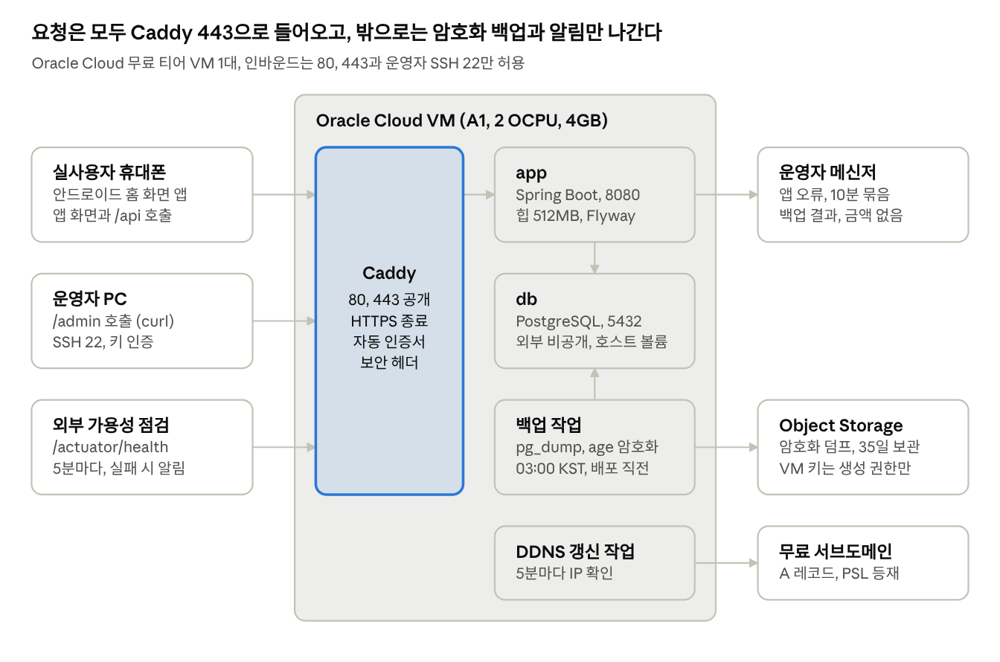
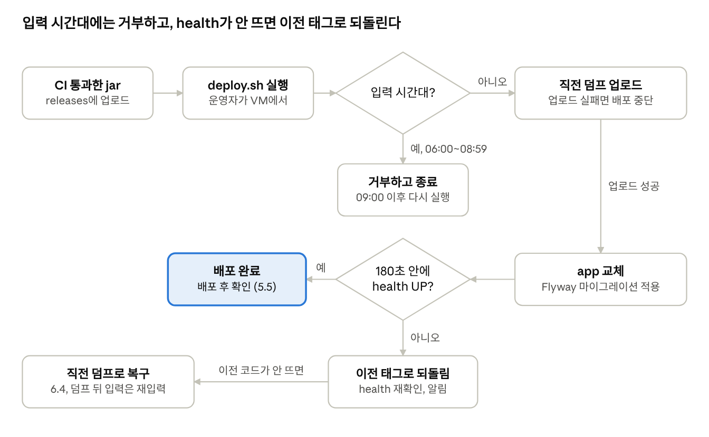

# 배포 및 운영 문서

Oct 8, 2026 / @최승혁

## 1. 문서 개요

운영은 Oracle Cloud 무료 티어 VM 1대, 월 비용 0원, 운영자 1명을 전제로 한다. 정산 입력이 몰리는 KST 06:00\~08:59에는 계획된 작업을 하지 않고, 데이터는 매일 VM 밖에 암호화 백업한다(NFR-501, AD-12, AD-13).

> **문서의 역할** — 기획서 5.1의 운영 절차서(초대 링크 발급, 기기 토큰 폐기, 백업 복구)를 넓혀, 설계서 12장의 배포와 운영 구성을 운영자가 그대로 따라 할 수 있는 절차로 옮긴다. 무엇으로 구성할지는 설계서가 정하며, 문서끼리 어긋나면 SRS, 기획서, 설계서, 이 문서 순으로 따르고 이 문서를 고친다.

> **표기** — 근거는 요구사항(FR, NFR), 설계 결정(AD), 시험 시나리오(TS) ID로 붙인다. 설계 문서에 없는 값을 이 문서가 새로 정한 곳은 (제안)으로 표시하고, 첫 적용 때 실제 값으로 확정한다.

| 항목 | 내용 |
| --- | --- |
| 문서명 | 배포 및 운영 문서 |
| 버전 | v0.2 |
| 작성일 | 2026-10-08 |
| 기준 문서 | 아래 '기준 문서' 표 |
| 대상 시스템 | 금 투자 수익 정산 기록 서비스 (React PWA, Spring Boot, PostgreSQL) |
| 실사용자 | 1명. 안드로이드 휴대폰에 홈 화면 앱으로 설치해 매일 아침 입력 |
| 운영자 | 1명. 배포, 백업, 초대 링크 발급, 기기 토큰 폐기, 장애 대응 전담 |
| 운영 환경 | Oracle Cloud 무료 티어 VM 1대(서울 홈 리전, 제안), 같은 계정의 Object Storage, DuckDNS 무료 서브도메인 |
| 적용 시점 | 1주차 배포 환경 구성부터. 오픈 전에 이 문서의 절차로 운영 시험(TS-NFR-11, 14\~19)을 수행 |
| 보관 위치 | 저장소 docs/ (설계서 11.1의 운영 절차서 위치) |
| 범위 밖 | 기능, 계산 규칙, 화면, API 상세 (각 설계 문서) |

### 운영 원칙

| 원칙 | 기준 | 근거 |
| --- | --- | --- |
| 입력 시간대 보호 | KST 06:00\~08:59에는 배포, 설정 변경, OS 업데이트, 복구 리허설을 하지 않는다. 장애 복구(재시작, 되돌리기)만 예외다 | NFR-501, R-06 |
| 서버보다 데이터 | 서버는 다시 만들 수 있지만 정산 기록은 다시 만들 수 없다. 복구 계획은 VM 밖 백업을 중심으로 세운다 | NFR-401, AD-13 |
| 비용 0원 | 무료 한도 안의 자원만 만든다. 과금 가능성이 있는 구성은 도입 전에 이 문서에 먼저 반영한다 | 기획서 7.3 |
| 금액은 밖으로 내보내지 않는다 | 로그, 알림, 결함 기록에 금액과 토큰 원문을 남기지 않는다 | NFR-304, AD-14 |
| 혼자 재현할 수 있는 절차 | 절차는 명령어 단위로 적고, 운영 방식을 바꾸면 이 문서를 함께 고친다 | CON-06 |

### 기준 문서

| 문서 | 버전 | 이 문서에서 쓰는 내용 |
| --- | --- | --- |
| 요구사항명세서 | v1.3 (2026-10-06) | 보안 NFR-301\~306, 데이터 NFR-401\~404, 운영 NFR-501\~503 |
| 프로젝트 기획서 | v0.8 (2026-10-06) | 오픈 준비(7.1), 운영 항목(7.3), 리스크 R-06\~R-08, 시나리오 S1, S7 |
| 시스템 아키텍처 설계서 | v0.6 (2026-10-06) | 인증과 운영자 API(5장), 배포와 운영(12장), 보안 헤더(13장) |
| DB 설계서 | v0.2 (2026-10-06) | DB 생성 옵션(2.1), 초기 데이터 적재(8.2), 마이그레이션 규칙(8.4) |
| API 명세서 | v0.3 (2026-10-06) | 운영자 API와 헬스 체크(5.8) |
| 테스트 계획 및 시나리오 | 2026-10-08 | 운영 시험 TS-NFR-11, 14\~19, 인수 시험 TS-UAT |

## 2. 운영 환경 구성

운영 환경은 VM 1대 안의 컨테이너 3개(caddy, app, db)와 호스트 타이머 작업 2개(백업, DDNS 갱신)로 이뤄진다. 인바운드는 80, 443과 운영자 SSH 22만 열고, VM 밖으로 나가는 것은 암호화 백업과 금액 없는 알림뿐이다(AD-12, 설계서 12.1).



*운영 구성도, VM 안 5개와 VM 밖 6개 구성 요소*

실사용자, 운영자, 외부 점검의 요청은 모두 Caddy를 거쳐 app으로 가고, db는 VM 밖에 포트를 열지 않는다. VM 밖으로 나가는 것은 암호화 덤프, 금액 없는 알림, DDNS 갱신뿐이다.

### 2.1 구성 요소

| 구성 요소 | 실행 위치 | 포트와 저장소 | 운영 설정 |
| --- | --- | --- | --- |
| caddy | 컨테이너 | 80, 443 공개. 인증서는 caddy\_data 볼륨 | HTTP를 HTTPS로 전환, HSTS와 보안 헤더 3종(설계서 13장). 접근 로그는 끈다 |
| app | 컨테이너 | 내부 8080 | JVM 최대 힙 512MB. 시작할 때 Flyway 적용 뒤 예열 조회 실행(설계서 14.3) |
| db | 컨테이너 | 내부 5432, 외부 비공개. 데이터는 호스트 볼륨 | POSTGRES\_INITDB\_ARGS="--encoding=UTF8 --locale=C" (DB 설계서 2.1) |
| 백업 작업 | 호스트 systemd 타이머 | Object Storage로 업로드 | OnCalendar=*-*-\* 03:00:00 Asia/Seoul, 배포 직전 1회 |
| DDNS 갱신 작업 | 호스트 systemd 타이머 | 무료 서브도메인 A 레코드 | 5분마다 DuckDNS 갱신 주소를 호출하고, 응답이 OK가 아니면 알림 (제안) |
| 외부 가용성 점검 | 외부 서비스 | /actuator/health 호출 | UptimeRobot 무료 키워드 모니터, 5분 간격. 실패하면 이메일과 Discord로 알림 (제안) |

caddy\_data 볼륨은 지우지 않는다. 컨테이너를 새로 만들 때마다 인증서를 다시 받으면 발급 기관의 발급 횟수 제한에 걸릴 수 있다.

### 2.2 서버 사양과 기본값

| 항목 | 값 | 근거 |
| --- | --- | --- |
| 셰이프 | VM.Standard.A1.Flex, 2 OCPU, 메모리 4GB | 설계서 12.1 |
| 홈 리전 | 서울 (제안). 가입할 때 정하며 바꿀 수 없다. 춘천은 2.3 참고 | 설계서 12.1 |
| 부트 볼륨 | 기본값 50GB, 추가 블록 볼륨 없음 (제안) | 무료 블록 볼륨 200GB 이내 |
| OS | Ubuntu LTS aarch64, Always Free 표시 이미지 (제안) | — |
| 호스트 시간대 | UTC 그대로 둔다. 시각 판정은 코드와 타이머가 Asia/Seoul을 명시한다 | 설계서 7.4, 12.2 |
| 도메인 | DuckDNS 서브도메인 1개({이름}.duckdns.org). duckdns.org는 공개 접미사 목록(PSL)에 있다 (제안) | 설계서 12.1 |
| 재시작 정책 | 세 컨테이너 모두 restart: unless-stopped. VM이 재부팅되면 자동으로 뜬다 (제안) | NFR-501 |
| 로그 순환 | Docker json-file 드라이버, max-size 10m, max-file 5 (제안) | 설계서 12.4 |

### 2.3 무료 티어 유지 조건

무료 티어는 과금 자원을 만들지 않는 것과 유휴 회수에 걸리지 않는 것, 두 가지로 유지한다. 이 서비스는 CPU와 네트워크 사용률이 늘 20% 미만이므로 회수를 막는 값은 메모리 사용률 하나다.

| 조건 | 공식 기준 | 운영 방법 |
| --- | --- | --- |
| A1 무료 한도 | 월 1,500 OCPU시간과 9,000GB시간, 2 OCPU와 12GB에 해당 (2026-08-18부터 적용된 한도) | 2 OCPU, 4GB를 유지한다. 셰이프를 바꿀 일이 생기면 한도부터 다시 확인 |
| 블록 볼륨 | 부트와 블록 볼륨 합계 200GB | 부트 볼륨 하나만 쓴다 |
| Object Storage | 종량제 계정은 Standard 10GB, API 요청 월 50,000건 | 덤프는 하루 1\~2개라 한도에 비해 매우 작다. 월간 점검에서 버킷 용량 확인 |
| 유휴 회수 | 7일간 CPU 95백분위, 네트워크, 메모리(A1만) 사용률이 모두 20% 미만이면 회수 대상 | 메모리 사용률을 20% 위로 유지하고 알람으로 감시(8장). 종량제 전환은 설계서 12.1대로 한다 |
| 과금 방지 | 종량제로 바꿔도 무료 한도를 넘는 사용분만 과금 | 예산 1달러 알림과 컴파트먼트 할당량으로 무료 한도 밖 자원 생성을 막는다 |
| 춘천 리전 | A1 생성 위치 설명에 South Korea North(춘천)가 예외로 적혀 있고, 한도 축소 뒤 춘천의 인스턴스 생성 화면에 A1이 없다는 사용자 보고가 있다 | 홈 리전은 서울로 한다. 이미 춘천으로 가입했다면 생성 화면에 A1이 있는지부터 보고, 없으면 OQ-05로 호스팅을 다시 정한다 |

출처: [Oracle Always Free Resources](https://docs.oracle.com/en-us/iaas/Content/FreeTier/freetier_topic-Always_Free_Resources.htm), [춘천 A1 사용자 보고](https://community.oracle.com/customerconnect/discussion/972539/cannot-change-ampere-a1-compute-resource-allocation) (2026-10-08 확인). 한도는 바뀔 수 있으므로 월간 점검(11장)에서 다시 본다.

## 3. 환경과 설정 관리

환경은 로컬, CI, 운영 3개이며 별도 스테이징은 두지 않는다. 오픈 전에는 운영 VM이 배포 환경을 겸하고, 실사용자 리허설 전에 DB를 새로 만들어 시험 기록을 지운다(테스트 계획 4장).

### 3.1 환경 구분

| 환경 | 구성 | 데이터 | 용도 |
| --- | --- | --- | --- |
| 로컬 | 개발자 PC, Docker Compose의 PostgreSQL (제안) | 시험용 값만 | 개발, 수동 확인 |
| CI | GitHub Actions, Java 25, Testcontainers PostgreSQL, TZ=UTC | 테스트가 만든 값 | 단위, 통합, API, 구조 테스트. 통과한 커밋의 jar를 산출물로 보관 |
| 운영 | Oracle Cloud A1 VM, caddy, app, db | 오픈 전 시험 기록, 리허설부터 실제 기록 | 화면, 실기기, 운영 시험, 실서비스 |
| 성능 측정 DB | 운영 VM에 임시로 띄운 별도 DB 컨테이너 | 5,000건 적재 데이터 | 응답 시간 측정(TS-NFR-08) 후 삭제 |

리허설부터는 운영 DB에 시험 데이터를 넣지 않는다. 결함을 기록할 때 실제 금액은 시험용 값으로 바꿔 적는다(테스트 계획 6장).

### 3.2 VM 디렉터리 (제안)

```text
/opt/settlement/           저장소 클론. deploy/ 만 사용
└── deploy/
    ├── compose.yaml, Caddyfile, deploy.sh, backup.sh, .env.example
    └── .env               비밀값. 권한 600, git 추적 안 함
/srv/settlement/
├── releases/              배포한 jar. 커밋 해시 이름, 최근 5개 보관
├── pgdata/                db 데이터 (호스트 볼륨)
└── backup-tmp/            덤프 임시 위치. 업로드 직후 삭제
```

compose.yaml, Caddyfile, 스크립트를 바꿀 때는 저장소에서 고쳐 병합한 뒤, VM에서 git pull과 docker compose up -d로 반영한다. VM에서 파일을 직접 고치지 않는다.

### 3.3 환경변수와 비밀값

| 변수 | 용도 | 값 만드는 법 | 교체 시점 |
| --- | --- | --- | --- |
| ADMIN\_SECRET | 운영자 API 인증 | openssl rand -base64 32 | 유출 의심 시 즉시, 그 외 연 1회 (제안) |
| DB\_URL, DB\_USER, DB\_PASSWORD | DB 접속 | DB 이름과 사용자는 settlement (제안), 비밀번호는 openssl rand -base64 24 | 유출 의심 시 |
| APP\_BASE\_URL | 초대 URL 생성, Origin 검사 기준 | https://{서브도메인} | 도메인이 바뀔 때만. 바뀌면 기기를 초대부터 다시 등록(R-08) |
| ALERT\_WEBHOOK\_URL | 운영자 메신저 알림 | Discord 알림 채널의 웹후크 URL (제안, 8.4) | 유출 의심 시 |
| BACKUP\_ENDPOINT, BACKUP\_BUCKET, BACKUP\_ACCESS\_KEY, BACKUP\_SECRET\_KEY | 백업 업로드 | 객체 생성 권한만 가진 사용자의 고객 비밀 키(S3 호환) | 유출 의심 시, 연 1회 (제안) |
| BACKUP\_ENCRYPTION\_PUBLIC\_KEY | 백업 암호화 | age 공개키 한 줄 | 개인키를 잃었거나 유출됐을 때 |
| DDNS\_TOKEN | A 레코드 갱신 | DuckDNS 계정 토큰. 계정 페이지에서 확인 | 유출 의심 시 |

- .env는 권한 600으로 VM에만 두고, 저장소에는 .env.example만 커밋한다(NFR-306, TS-NFR-15).
- 비밀값 원본은 운영자의 비밀번호 관리자에 보관하고 메신저, 이슈, 커밋에 붙여 넣지 않는다 (제안).
- .env를 고친 뒤에는 docker compose up -d로 컨테이너를 다시 만든다. restart는 바뀐 값을 읽지 않는다.
- DB\_PASSWORD는 db 볼륨을 처음 만들 때만 적용된다. 바꾸려면 ALTER ROLE로 먼저 바꾸고 .env를 고친다.
- 백업 암호화는 age로 정한다 (제안). 설계서 12.3은 age와 gpg를 모두 허용하며, age는 공개키가 한 줄이라 환경변수 하나에 들어간다.

## 4. 서버 초기 구축 절차

서버는 계정, 네트워크와 인스턴스, OS, 백업 저장소, 도메인과 첫 기동 순서로 한 번에 만든다. VM을 잃었을 때 다시 만드는 절차도 같으며, 마지막에 백업 복구(6.4)만 더한다.

### 4.1 Oracle Cloud 계정

1. 홈 리전은 서울로 정한다 (제안). 가입 뒤에는 바꿀 수 없고, 춘천에서는 무료 A1을 만들 수 없다는 보고가 있다(2.3). 이미 춘천으로 가입했다면 인스턴스 생성 화면에 A1이 있는지부터 보고, 없으면 OQ-05로 넘긴다.
2. 계정을 종량제로 전환한다. 체험 기간에도 Always Free 표시가 있는 자원만 만든다(설계서 12.1).
3. 예산 1달러와 실제 비용 경보를 만들고, 경보 메일이 운영자 메일함에 오는지 확인한다.
4. 서비스용 컴파트먼트 settlement를 만들고 (제안), 할당량으로 무료 한도 밖의 셰이프와 용량을 막는다.

### 4.2 네트워크와 인스턴스

1. VCN 마법사(인터넷 연결 포함)로 VCN과 공개 서브넷을 만든다.
2. 보안 목록의 인그레스 규칙은 TCP 22, 80, 443 세 개만 둔다.
3. 인스턴스를 만든다: VM.Standard.A1.Flex, 2 OCPU, 4GB, Ubuntu LTS aarch64, 공개 IP 할당, 운영자 SSH 공개키 등록.
4. out of host capacity 오류는 무료 셰이프 재고가 일시적으로 없다는 뜻이다. 시간을 두고 다시 시도한다.
5. 인스턴스의 Oracle Cloud Agent에서 Compute Instance Monitoring 플러그인이 켜져 있는지 본다. 메모리 사용률 알람(8.1)에 필요하다.

### 4.3 OS 기본 설정 (Ubuntu 기준)

1. 패키지를 갱신하고 도구를 설치한다. 호스트 시간대는 UTC 그대로 둔다.

```bash
sudo apt update && sudo apt -y upgrade
sudo apt -y install age unattended-upgrades
timedatectl        # Time zone: Etc/UTC 확인. 바꾸지 않는다
```

2. SSH는 키 인증만 허용한다. /etc/ssh/sshd\_config.d/ 아래 파일에 PasswordAuthentication no, PermitRootLogin no를 두고 sshd를 다시 읽는다.
3. OCI의 Ubuntu 이미지는 호스트 iptables가 22번 외 인바운드를 거부한다. Docker 설치 전에 80, 443 허용 규칙을 REJECT 줄 앞에 넣고 저장한다. Docker를 띄운 뒤 저장하면 Docker가 만든 규칙까지 파일에 섞인다.

```bash
sudo iptables -L INPUT --line-numbers      # REJECT 줄 번호 확인 (아래는 5번일 때)
sudo iptables -I INPUT 5 -p tcp -m state --state NEW --dport 80 -j ACCEPT
sudo iptables -I INPUT 5 -p tcp -m state --state NEW --dport 443 -j ACCEPT
sudo netfilter-persistent save
```

4. Docker Engine과 compose 플러그인을 Docker 공식 apt 저장소 방식으로 설치하고, 운영 사용자를 docker 그룹에 넣는다.

### 4.4 백업 저장소

1. settlement 컴파트먼트에 비공개 버킷 settlement-backup을 만든다 (제안).
2. 수명 주기 규칙으로 35일 지난 객체를 삭제한다(NFR-402, AD-13). 규칙이 동작하려면 Object Storage 서비스에 권한을 주는 정책이 따로 필요하다([Using Object Lifecycle Policies](https://docs.oracle.com/iaas/Content/Object/Tasks/usinglifecyclepolicies.htm#permissions)).

```text
Allow service objectstorage-ap-seoul-1 to manage object-family in compartment settlement
```

춘천 홈 리전이면 ap-chuncheon-1로 바꾼다.

3. 백업 전용 사용자와 그룹 backup-writers를 만들고 객체 생성과 목록 조회 권한만 준다. 읽기, 삭제, 덮어쓰기 권한이 없어 VM이 털려도 백업을 열거나 지우거나 바꿀 수 없다(설계서 12.3).

```text
Allow group backup-writers to manage objects in compartment settlement where all {target.bucket.name='settlement-backup', any {request.permission='OBJECT_CREATE', request.permission='OBJECT_INSPECT'}}
```

4. 이 사용자의 고객 비밀 키를 만들어 BACKUP\_ACCESS\_KEY, BACKUP\_SECRET\_KEY에 넣는다. BACKUP\_ENDPOINT는 https://{네임스페이스}.compat.objectstorage.{리전 식별자}.oraclecloud.com이다.
5. 덤프는 이름에 시각을 넣어 매번 새 이름으로, 단일 PUT으로 올린다. 이 정책에서는 같은 이름 덮어쓰기와 멀티파트 업로드가 거부된다([Object Storage 정책 상세](https://docs.oracle.com/iaas/Content/Identity/Reference/objectstoragepolicyreference.htm)).
6. age 키 쌍은 운영자 PC에서 만든다. 공개키(age1로 시작)만 .env에 넣고 개인키는 VM에 두지 않는다.

```bash
age-keygen -o settlement-backup.key     # 출력되는 Public key 를 BACKUP_ENCRYPTION_PUBLIC_KEY 에
```

7. 개인키는 비밀번호 관리자와 오프라인 저장 장치 두 곳에 둔다 (제안). 개인키를 잃으면 모든 백업을 열 수 없다.

### 4.5 도메인과 첫 기동

1. DuckDNS에 Google이나 GitHub 계정으로 로그인해 서브도메인을 만든다 (제안, 12.3). 로그인 계정이 곧 복구 수단이므로 오래 쓸 계정으로 가입한다.
2. 저장소를 /opt/settlement에 클론하고 deploy/.env를 만든다(3.2, 3.3).
3. DDNS 타이머를 켜고 A 레코드가 VM 공인 IP를 가리키는지 확인한다. 타이머가 부르는 주소는 https://www.duckdns.org/update?domains={이름}&token={DDNS\_TOKEN}&ip= 이며, ip를 비우면 호출한 VM의 공인 IP로 맞춘다.

```bash
sudo systemctl enable --now settlement-ddns.timer
dig +short {서브도메인}          # VM 공인 IP와 같아야 한다
```

4. db와 caddy를 띄운 뒤 첫 배포를 한다(5장). app이 뜨면서 Flyway가 V1을 적용한다.

```bash
cd /opt/settlement/deploy
docker compose up -d db caddy
./deploy.sh <커밋 해시>
```

5. 초기 데이터를 적재한다(DB 설계서 8.2). CHK-05 값을 채운 스크립트는 저장소 밖에 두고 한 번만 실행한 뒤 VM에서 지운다.

```bash
docker compose exec -T db psql -U settlement -d settlement -v ON_ERROR_STOP=1 < load_initial_accounts.sql
# 마지막 SELECT: 계정 2건, 계정마다 시드 1건, 기본 수수료율 0.2000, 활성
shred -u load_initial_accounts.sql
```

6. HTTPS와 보안 헤더를 확인한다(TS-NFR-11). http 주소는 https로 전환되고, 응답에 strict-transport-security, content-security-policy, referrer-policy, x-content-type-options가 있어야 한다.

```bash
curl -sI http://{서브도메인}
curl -sI https://{서브도메인}
```

7. 백업 타이머를 켜고 한 번 수동으로 돌려 업로드와 성공 알림을 확인한다(TS-NFR-16). systemctl list-timers는 호스트 시간(UTC)으로 보이므로 03:00 KST가 전날 18:00으로 나오면 정상이다.

```bash
sudo systemctl enable --now settlement-backup.timer
sudo systemctl start settlement-backup.service
systemctl list-timers settlement-*
```

8. Discord 알림 채널과 웹후크를 만들어 ALERT\_WEBHOOK\_URL에 넣는다(8.4). UptimeRobot 무료 계정에 https://{서브도메인}/actuator/health 키워드 모니터(키워드 UP, 5분 간격)를 만들고 알림 연락처로 이메일과 Discord를 건다 (제안, OQ-02). app을 잠시 멈춰 두 경로로 알림이 오는지 확인한다(TS-NFR-19).

## 5. 빌드와 배포 절차

배포는 CI를 통과한 커밋의 jar만 쓰고, 운영자가 VM에서 deploy.sh로 직접 실행한다. 스크립트는 KST 06:00\~08:59에 실행을 거부하고, 직전 덤프를 남긴 뒤 app을 교체하며, health가 정상이 되지 않으면 이전 태그로 되돌린다(설계서 12.2, TS-NFR-18).



*deploy.sh 흐름, 판정 2개와 멈추는 곳 3개*

deploy.sh는 입력 시간대, 직전 덤프 업로드 실패, health 판정 실패 세 곳에서 멈춘다. 마지막 경우에만 이전 태그로 되돌리고, 이전 코드가 새 스키마에서 뜨지 않으면 직전 덤프로 복구한다.

### 5.1 배포 시점

| 구분 | 허용 시간 (KST) | 기준 |
| --- | --- | --- |
| 정기 배포 | 09:00\~05:59. 저녁 이른 시간 권장, 02:30\~03:30은 백업과 겹치지 않게 피한다 (제안) | NFR-501 |
| 오픈 배포 | 정기 배포와 같고, 다음 날 아침 첫 입력을 실사용자와 함께 확인 | 기획서 7.1 |
| 장애 중 되돌리기 | 시간 제한 없음. 이미 운영하던 이전 태그로 돌아가는 것이라 새 코드를 들이지 않는다 (제안) | NFR-501 |
| 06:00\~08:59 수정 배포 | 하지 않는다. 되돌리기로 복구하고 수정본은 09:00 이후 배포 | NFR-501 |

### 5.2 배포 준비

1. main 병합 뒤 CI가 통과했는지 확인한다. 실패한 커밋은 배포하지 않는다.
2. CI 산출물 jar를 운영자 PC로 받아 VM의 /srv/settlement/releases/{커밋 해시}.jar로 올린다. VM에 GitHub 토큰을 두지 않기 위해서다 (제안).

```bash
gh run download <run-id> -n app-jar                       # 운영자 PC
scp app.jar vm:/srv/settlement/releases/<커밋 해시>.jar
```

3. 이번 배포에 새 Flyway 파일이 있으면 5.4의 규칙을 먼저 확인한다.

### 5.3 deploy.sh 동작

1. **시각 확인**: TZ=Asia/Seoul 기준 06:00\~08:59이면 거부하고 끝낸다. 05:59와 09:00은 진행한다.
2. **직전 덤프**: backup.sh를 배포 직전 표시로 실행한다. 업로드가 실패하면 배포하지 않는다.
3. **이미지 빌드**: releases의 jar를 멀티 아키텍처 JRE 이미지에 복사해 app:{커밋 해시}로 빌드한다. 레지스트리는 쓰지 않는다.
4. **교체**: app만 새 태그로 다시 만든다. 시작할 때 Flyway가 마이그레이션을 적용한다. 무중단은 요구하지 않으므로 수십 초 끊길 수 있다(NFR-502).
5. **판정**: /actuator/health를 5초 간격으로 확인해 180초 안에 UP이면 성공이다 (제안. 첫 배포의 실제 기동 시간을 재서 조정).
6. **실패 처리**: 이전 태그로 app을 되돌리고 health를 다시 확인한 뒤 운영자 메신저로 알린다. 새 마이그레이션 때문에 이전 코드가 뜨지 않으면 2의 덤프로 복구한다(6.4).
7. **기록과 정리**: 성공하면 현재 태그와 이전 태그를 releases/CURRENT, releases/PREVIOUS에 적고, jar와 이미지는 최근 5개만 남긴다 (제안).

### 5.4 스키마 변경이 있는 배포

- Flyway 파일은 V{번호}\_\_{설명}.sql로 내고, 이미 적용된 파일은 고치지 않는다. 운영 DB에 손으로 DDL을 실행하지 않는다(DB 설계서 8.4).
- 열 이름 변경이나 삭제처럼 호환되지 않는 변경은 두 번에 나눈다. 1차에 새 구조를 더하고 코드를 옮기며, 2차에 옛 구조를 지운다(설계서 12.2).
- 1차 배포 뒤에는 이전 태그로 되돌려도 동작해야 한다. 2차 배포는 되돌릴 수 없어 직전 덤프 복구가 유일한 복구 수단이다.
- 그래서 2차 배포는 직전 덤프 업로드 성공을 확인한 뒤, 문제를 고칠 시간이 남는 저녁 이른 시간에 한다.

### 5.5 배포 후 확인

1. health가 200, {"status":"UP"}이다.
2. https://{서브도메인}/ 이 200으로 앱 화면을 주고, 보안 헤더가 그대로다(TS-NFR-11).
3. 기기 토큰 없이 GET /api/session이 200으로 미인증 상태를 준다. 권한 없음 화면이 아니라 서버 오류가 나면 실패다.
4. GET /admin/devices가 운영자 시크릿으로 200을 준다(7.2).
5. 10분 동안 오류 알림이 오지 않는다.
6. 다음 날 아침 실사용자의 첫 입력이 저장됐는지 확인한다. 화면 반영은 HTML을 캐시하지 않아 앱을 다시 열 때 자동으로 된다(설계서 10.2).

### 5.6 되돌리기

- 배포 직후 실패는 deploy.sh가 자동으로 되돌린다(5.3의 6).
- 배포 뒤에 문제가 드러나면 rollback.sh로 releases/PREVIOUS의 태그로 돌아간다 (제안). 시각 제한이 없어 06:00\~08:59에도 실행할 수 있다.
- 마이그레이션 때문에 이전 코드가 뜨지 않으면 직전 덤프로 복구한다(6.4). 덤프 뒤에 입력된 기록은 사라지므로, 실사용자에게 해당 날짜를 단건 소급 입력으로 다시 넣어 달라고 요청한다(FR-305).

## 6. 데이터베이스 운영

DB는 매일 03:00 KST와 배포 직전에 전체 덤프를 암호화해 VM 밖에 35일 보관하고, 매월 운영자 PC에 사본을 하나 받는다. 복구는 새 DB에 받아 건수와 합계를 원본과 대조하는 것까지가 한 절차다(NFR-401, NFR-402, 설계서 12.3).

### 6.1 백업 구성

| 항목 | 내용 | 근거 |
| --- | --- | --- |
| 대상 | settlement DB 전체, pg\_dump -Fc | NFR-401 |
| 주기 | 매일 03:00 KST, 배포 직전 | 설계서 12.3 |
| 객체 이름 | daily/ 또는 predeploy/ 아래 settlement-{YYYYMMDD-HHMM}.dump.age (KST 기준, 제안) | 4.4의 덮어쓰기 금지 |
| 암호화 | age 공개키로 암호화해 올리고, 평문 덤프는 바로 지운다 | 설계서 12.3 |
| 보관 | 버킷 수명 주기 규칙으로 35일 | NFR-402 |
| 외부 사본 | 매월 첫 주말, 최신 daily 백업 1개를 운영자 PC로 받아 3개월치 보관 (제안) | 설계서 12.3 |
| 알림 | 성공과 실패 모두 메신저로. 내용은 객체 이름과 파일 크기만 | NFR-503, NFR-304 |

backup.sh는 app에 의존하지 않고 db 컨테이너만 있으면 돈다. 순서는 덤프, 암호화, 평문 삭제, 업로드, 임시 파일 삭제, 알림이다.

### 6.2 백업 실패 대응

아침에 전날 03:00 성공 알림이 없으면 그날 안에 처리한다. 수동으로 한 번 돌려 결과를 보고, 실패 원인별 대응은 10.2를 따른다.

```bash
sudo systemctl start settlement-backup.service
journalctl -u settlement-backup.service -n 50 --no-pager
```

### 6.3 월간 외부 사본

1. 콘솔의 Object Storage에서 settlement-backup 버킷의 최신 daily 객체를 내려받는다. 백업 전용 사용자가 아니라 운영자 계정으로 받는다.
2. 암호화된 상태(.dump.age) 그대로 운영자 PC의 백업 폴더에 둔다. 풀지 않는다.
3. 3개월이 지난 사본은 지운다 (제안).

Oracle 계정이 막혀 VM과 버킷을 함께 잃었을 때 쓸 수 있는 유일한 사본이다(R-08).

### 6.4 복구 절차

같은 VM의 DB가 손상됐거나 되돌릴 수 없는 배포를 무를 때, 그리고 VM을 잃었을 때 쓴다. VM을 잃었으면 4장을 4.5의 3까지 진행하고 db와 caddy만 띄운 뒤 여기서 이어 간다.

1. 쓸 백업을 고른다. 사고 직전의 daily, 배포 문제면 그 배포의 predeploy 백업이다.
2. 운영자 PC에서 객체를 내려받아 개인키로 풀면서 VM으로 바로 보낸다. 평문 덤프를 PC 디스크에 남기지 않는다.

```bash
age -d -i settlement-backup.key settlement-20261020-0300.dump.age | ssh vm 'cat > /srv/settlement/backup-tmp/restore.dump'
```

3. 입력을 막기 위해 app을 멈춘다. 손상된 DB는 이름만 바꿔 두고 새 DB를 만든다.

```bash
cd /opt/settlement/deploy
docker compose stop app
docker compose exec -T db psql -U settlement -d postgres -c 'ALTER DATABASE settlement RENAME TO settlement_broken'
docker compose exec -T db psql -U settlement -d postgres -c 'CREATE DATABASE settlement'
docker compose exec -T db pg_restore -U settlement -d settlement --no-owner < /srv/settlement/backup-tmp/restore.dump
```

4. 건수와 합계를 대조한다. 기준값은 사고 전 앱의 전체 기간 합계, 또는 병행 기간이면 스프레드시트다.

```sql
SELECT COUNT(*) FILTER (WHERE deleted_at IS NULL)              AS rows_active,
       COUNT(*)                                                AS rows_all,
       SUM(gross_profit) FILTER (WHERE deleted_at IS NULL)     AS gross_sum,
       SUM(fee) FILTER (WHERE deleted_at IS NULL)              AS fee_sum,
       SUM(net_profit) FILTER (WHERE deleted_at IS NULL)       AS net_sum,
       MAX(settlement_date)                                    AS last_date
FROM settlement;
SELECT (SELECT COUNT(*) FROM trading_account) AS accounts,
       (SELECT COUNT(*) FROM account_seed)    AS seeds;
```

5. 같은 VM이면 docker compose start app, 새 VM이면 마지막으로 배포한 커밋으로 deploy.sh를 실행한다. 마지막 배포 커밋은 메신저의 배포 성공 알림에서 찾는다. 덤프에 이력이 있어 Flyway는 그 뒤의 마이그레이션만 적용한다.
6. 5.5의 배포 후 확인을 하고, restore.dump를 지운다. settlement\_broken은 1주일 뒤 지운다 (제안).
7. 백업 시각 이후에 입력된 날짜를 실사용자에게 알려 단건 소급 입력으로 다시 넣게 한다(FR-305).

대조 결과에는 금액이 나오므로 터미널에서만 보고 메신저나 이슈에 옮기지 않는다(NFR-304).

### 6.5 복구 리허설

오픈 전 1회(TS-NFR-17, 기획서 7.1), 이후 분기마다 1회 한다(설계서 12.3). 최신 daily 백업을 같은 VM의 임시 DB settlement\_rehearsal에 6.4의 2\~4 방식으로 복구하고, 운영 DB와 건수, 합계가 같은지 본 뒤 임시 DB를 지운다. 걸린 시간을 재서 10.3의 복구 목표와 비교한다.

### 6.6 데이터 변경 작업

정산 기록, 계정, 시드는 앱 화면으로만 고친다. SQL로 직접 고치면 검증 규칙을 거치지 않고, 정산 기록은 물리 삭제하지 않는다(NFR-404). 예외는 아래 세 작업뿐이며 모두 KST 06:00\~08:59를 피한다.

| 작업 | 절차 | 근거 |
| --- | --- | --- |
| 초기 데이터 적재 | 4.5의 5. 리허설 전에 DB를 새로 만들 때 다시 실행 | DB 설계서 8.2 |
| 리허설 전 DB 재생성 | app 중지, 기록 건수 확인, docker compose down, /srv/settlement/pgdata 삭제, db 기동, deploy.sh로 V1 적용, 초기 데이터 적재 | 테스트 계획 4장 |
| 기본 수수료율 변경 | 수동 백업 후 아래 SQL. 지난 기록의 수수료와 순수익은 바뀌지 않는다 | 기획서 7.3, VAL-08 |

```sql
BEGIN;
UPDATE trading_account SET default_fee_rate = <새 요율, 예 0.1800>, updated_at = now();
SELECT id, name, default_fee_rate FROM trading_account ORDER BY id;
COMMIT;
```

새로 등록하는 계정은 여전히 0.2000으로 만들어진다(FR-206). 요율이 바뀐 뒤 계정을 추가하면 그 계정에도 같은 UPDATE를 실행하고, 영구 변경이면 기본값을 바꾸는 코드 변경을 따로 계획한다(OQ-04).

## 7. 사용자와 접속 관리

접속 권한은 운영자가 발급한 초대 링크를 실사용자가 기본 브라우저에서 등록할 때만 생긴다. 새 기기는 초대 링크를 새로 발급하고, 잃어버린 기기는 기기 토큰을 바로 폐기한다(FR-103\~111, 기획서 S1, S7).

### 7.1 운영자 API 호출 준비

운영자 API는 화면이 없고 운영자 PC에서 curl로 부른다(API 명세서 5.8). 시크릿은 셸 기록에 남지 않게 입력받아 환경변수로만 쓴다.

```bash
read -rs ADMIN_SECRET && export ADMIN_SECRET
BASE=https://{서브도메인}
```

같은 IP에서 5회 연속 실패하면 15분간 429 ADMIN\_LOCKED가 온다. 시크릿 값을 확인하고 15분 뒤 다시 한다.

### 7.2 초대 링크 발급 (처음 등록, 새 기기)

1. 실사용자가 바로 열 수 있는 시간을 미리 맞춘다. 링크는 발급 후 1시간, 1회만 유효하다(FR-105, 기획서 7.1).
2. 링크를 발급한다. 응답의 원문은 다시 조회할 수 없다.

```bash
curl -sS -X POST "$BASE/admin/invites" -H "Authorization: Bearer $ADMIN_SECRET"
# 201 {"inviteUrl": "https://{서브도메인}/invite#<토큰>", "expiresAt": "..."}
```

3. inviteUrl을 문자로 보낸다(FR-106). 메신저로 보내면 인앱 브라우저에서 열려 기본 브라우저로 다시 열라는 안내가 뜬다(FR-111).
4. 함께 보낼 안내: "링크를 누르고 \[이 휴대폰 등록\]을 누른 뒤, 화면 안내대로 홈 화면에 추가해 주세요. 링크는 1시간 안에 한 번만 쓸 수 있어요."
5. GET /admin/devices에서 새 기기가 ACTIVE인지 보고, 실사용자에게 홈 화면 아이콘으로 다시 열어 홈이 뜨는지 확인받는다(설계서 5.5).
6. 1시간 안에 쓰지 못했으면 새로 발급한다. 지난 링크는 저절로 만료된다.

### 7.3 기기 목록과 폐기

```bash
curl -sS "$BASE/admin/devices" -H "Authorization: Bearer $ADMIN_SECRET"
curl -sS -o /dev/null -w '%{http_code}\n' -X POST "$BASE/admin/devices/<id>/revoke" -H "Authorization: Bearer $ADMIN_SECRET"   # 204
```

- 기기는 deviceLabel(OS, 브라우저)과 등록 시각으로 찾는다. lastUsedAt은 하루 1회만 갱신되어 실제 사용과 최대 하루 차이 난다.
- 분실 연락을 받으면 시간대와 관계없이 즉시 폐기한다. 폐기한 기기는 다음 요청부터 401이다(R-07).
- 휴대폰을 바꿀 때는 새 기기 등록을 마친 뒤 옛 기기를 폐기해, 실사용자가 쓸 수 없는 공백을 만들지 않는다.

### 7.4 접속 권한 없음 문의 대응

| 원인 | 확인 | 조치 |
| --- | --- | --- |
| 90일 넘게 쓰지 않아 만료 | 기기 목록 status가 EXPIRED | 새 초대 링크 발급 |
| 폐기된 기기 | status가 REVOKED | 본인 기기인지 확인한 뒤 새 초대 링크 발급 |
| 브라우저 데이터 삭제나 앱 초기화로 쿠키가 지워짐 | status는 ACTIVE인데 권한 없음 화면 | 새 초대 링크 발급, 옛 기기 폐기 |
| 등록한 브라우저와 홈 화면 앱의 브라우저가 다름 | 등록 브라우저와 아이콘을 만든 브라우저 비교(Q-03) | 같은 브라우저에서 다시 등록하고 그 브라우저로 홈 화면에 추가 |
| 실제로는 서버 장애 | 장애면 권한 없음이 아니라 연결 실패 문구가 뜬다(설계서 10.4) | 10장 장애 대응 |

## 8. 모니터링과 로깅

감시는 가용성 점검, 앱 오류, 백업 결과, 메모리 사용률 네 가지이며 모두 운영자에게 알림으로 온다. 로그와 알림에는 금액, 토큰, 쿼리 문자열을 남기지 않는다(NFR-503, NFR-304, AD-14).

### 8.1 감시 항목

| 대상 | 방법 | 주기 | 알림 경로 | 대응 |
| --- | --- | --- | --- | --- |
| 서비스 응답 | UptimeRobot 키워드 모니터가 /actuator/health 응답에 UP이 있는지 확인 (제안) | 5분 | 이메일, Discord | 10.2 |
| 앱 오류 | ERROR 로그를 묶어 웹후크로 전송. 오류 코드와 경로만 | 10분 단위 | Discord 알림 채널 | 8.3으로 로그 확인 |
| 백업 | backup.sh 성공과 실패 | 매일 03:00, 배포 직전 | Discord 알림 채널 | 6.2 |
| DDNS 갱신 | 갱신 응답이 3회 연속 OK가 아니면 1회 알림 (제안) | 5분 | Discord 알림 채널 | 10.2 |
| 유휴 회수 위험 | OCI Monitoring 알람. MemoryUtilization이 25% 아래로 내려가면 (제안) | 상시 | OCI Notifications 이메일 | 10.2 |
| 비용 | OCI 예산 경보 1달러 | 상시 | 이메일 | 과금 자원을 찾아 삭제 |
| 디스크 | df -h로 사용률 확인. 80%를 넘으면 정리 (제안) | 주 1회 | 없음 | 10.2 |

HTTPS 인증서는 Caddy가 갱신하며, 갱신이 실패해 접속이 깨지면 가용성 점검이 잡는다. OCI Monitoring과 Notifications는 무료 한도 안에서 쓴다(2.3 출처).

### 8.2 로그 정책

| 로그 | 남기는 것 | 남기지 않는 것 |
| --- | --- | --- |
| 앱 접근 로그 | 메서드, 경로(쿼리 문자열 제외), 상태 코드, 처리 시간 | 요청과 응답 본문, 쿼리 문자열, 쿠키 |
| 앱 오류 로그 | 오류 코드, 예외 종류, DB 제약 이름과 SQLSTATE | 금액, SQL 파라미터, 제약 위반 DETAIL |
| 인증 이벤트 | 초대 발급, 교환 성공과 실패 원인, 기기 폐기, 운영자 인증 실패 | 토큰 값 |
| Caddy | 오류 로그 | 접근 로그(끔) |
| 백업, DDNS 작업 | 성공과 실패, 객체 이름, 파일 크기 | 덤프 내용 |

컨테이너 로그는 2.2의 순환 설정으로 컨테이너마다 최대 50MB를 넘지 않는다. 로그 형식을 바꾸는 배포 뒤에는 TS-NFR-14(로그에 금액 없음)를 다시 확인한다.

### 8.3 로그 보는 법

```bash
cd /opt/settlement/deploy
docker compose ps
docker compose logs -t --since 1h app | grep -E 'ERROR|WARN'
docker compose logs -t --since 24h caddy
journalctl -u settlement-backup.service --since yesterday --no-pager
```

컨테이너 로그 시각은 UTC다. KST 06:30의 오류는 전날 21:30Z로 찍히므로 9시간을 더해 읽는다.

### 8.4 알림 채널 (제안)

운영 알림은 운영자만 있는 Discord 서버의 채널 하나로 모은다. 웹후크 URL 하나에 메시지를 POST하면 되어 ALERT\_WEBHOOK\_URL 하나로 끝나고, UptimeRobot의 기본 연동 목록에도 Discord가 있다([UptimeRobot 요금제](https://uptimerobot.com/pricing/)).

1. Discord에 운영자만 있는 서버를 만들고 알림 채널을 하나 둔다.
2. 채널 편집의 연동 메뉴에서 웹후크를 두 개 만든다. 하나는 VM용(ALERT\_WEBHOOK\_URL), 하나는 UptimeRobot용이다. 하나가 유출돼도 그것만 바꾸면 된다.
3. 웹후크 URL을 아는 사람은 누구나 채널에 글을 쓸 수 있으므로 비밀값으로 다룬다(3.3).
4. 운영자 휴대폰의 Discord 앱에서 이 채널 알림을 모든 메시지로 켠다. 아침 알림을 놓치지 않기 위해서다.
5. 연결을 확인한다. 정상이면 204가 돌아온다.

```bash
curl -sS -o /dev/null -w '%{http_code}\n' -H 'Content-Type: application/json' -d '{"content":"알림 시험"}' "$ALERT_WEBHOOK_URL"
```

메시지 한 건은 2,000자를 넘을 수 없다. 10분 묶음 오류 알림은 오류 코드별 건수로 줄이고 넘치는 부분은 자른다. 금액과 토큰은 넣지 않는다(NFR-304).

## 9. 보안 운영

외부에서 닿는 곳은 HTTPS 443, SSH 22, 운영자 API 세 곳이다. SSH는 키 인증만, 운영자 API는 시크릿과 실패 잠금으로 막고, OS 보안 패치는 자동으로, 이미지와 의존성은 월 1회 갱신한다(NFR-301\~306, 설계서 13장).

### 9.1 접근 통제

| 대상 | 통제 | 점검 |
| --- | --- | --- |
| SSH 22 | 키 인증만 허용, 비밀번호와 root 로그인 금지. 개인키는 운영자 PC에만 두고 암호 구문을 건다 (제안) | 월간 점검에서 sshd 설정 확인 |
| 운영자 API /admin/\*\* | Bearer 시크릿, 같은 IP 5회 실패 시 15분 잠금(설계서 5.4) | 주간 점검에서 운영자 인증 실패 이벤트 확인 |
| DB 5432 | 컨테이너 내부망에서만 접근. 호스트와 인터넷에 포트를 열지 않는다 | 배포 때 compose.yaml의 db에 ports 항목이 없는지 확인 |
| Oracle 콘솔 | 운영자 계정에 다단계 인증 설정 (제안) | 분기 점검 |
| 백업 버킷 | 백업 전용 사용자는 객체 생성과 목록 조회만 가능, 콘솔 로그인 없음 | 분기 점검에서 정책 문구 확인 |
| 저장소 | .env와 실제 금액을 커밋하지 않는다 | TS-NFR-15, 결함 기록 규칙(3.1) |

### 9.2 패치와 갱신

| 대상 | 방법 | 주기 |
| --- | --- | --- |
| OS 보안 패치 | unattended-upgrades로 자동 설치, 자동 재부팅은 끈다 (제안) | 매일 자동 |
| 재부팅 | /var/run/reboot-required가 있으면 KST 06:00\~08:59를 피해 재부팅하고 docker compose ps와 health 확인 | 주간 점검 |
| 컨테이너 이미지 | caddy, postgres, JRE 이미지는 태그를 고정하고, 같은 메이저 안의 새 태그로 바꾸는 일반 배포로 반영 | 월 1회 |
| 앱 의존성 | 저장소의 의존성 보안 알림을 보고 일반 배포로 반영 | 월 1회 |
| PostgreSQL 메이저 업그레이드 | 평소에는 하지 않는다. 필요하면 덤프 후 새 버전에 복구하는 별도 작업으로 계획 | 필요할 때 |

apt 자동 업데이트 타이머는 호스트 시간 06시 무렵(KST 15시 무렵)에 돈다. 입력 시간대와 겹치지 않으므로 그대로 두고, systemctl list-timers apt-daily-upgrade.timer로 확인만 한다.

### 9.3 비밀값 유출 대응

| 유출된 것 | 조치 |
| --- | --- |
| ADMIN\_SECRET | 새 값을 만들어 .env를 고치고 docker compose up -d app. 이전 값으로 401이 나오는지 확인 |
| 기기 토큰 (휴대폰 분실 등) | 7.3대로 즉시 폐기하고 새 기기에 초대 링크 발급 |
| 초대 링크 (다른 사람에게 전송) | 초대 토큰을 폐기하는 API는 없다. 1시간 동안 기기 목록을 보고 모르는 기기가 생기면 폐기 |
| 백업 키 (BACKUP\_\*) | 콘솔에서 고객 비밀 키를 지우고 다시 발급해 .env 교체. 이 키로는 읽기와 삭제가 안 되어 기존 백업은 안전 |
| age 개인키 | 새 키 쌍을 만들어 공개키 교체 후 수동 백업 1회. 운영자 PC의 옛 사본도 새 키 백업으로 바꾼다 |
| DB 비밀번호 | ALTER ROLE로 바꾸고 .env 수정 후 app 재생성. 외부 포트가 없어 위험은 낮다 |
| SSH 개인키 | VM의 authorized\_keys에서 해당 키를 지우고 새 키 등록 |
| ALERT\_WEBHOOK\_URL, DDNS\_TOKEN | Discord에서 웹후크를 지우고 새로 만들거나, DuckDNS 계정 페이지에서 토큰을 다시 만든 뒤 .env 교체 |

Caddyfile을 바꾼 배포 뒤에는 보안 헤더와 HTTPS 전환(TS-NFR-11)을 다시 확인한다.

## 10. 장애 대응

장애 등급은 시간대와 데이터 위험으로 정한다. KST 06:00\~08:59의 입력 불가와 데이터 유실 위험이 1등급이며, 이때는 원인 분석보다 재시작과 되돌리기로 먼저 살린다(NFR-501, R-06).

### 10.1 장애 등급

| 등급 | 기준 | 대응 목표 (제안) | 예 |
| --- | --- | --- | --- |
| 1 긴급 | 06:00\~08:59 서비스 불가, 또는 데이터 유실 위험 | 알림 확인 즉시 실사용자 안내, 30분 안에 재시작이나 되돌리기 | 아침 health 실패, DB 볼륨 손상, VM 회수 |
| 2 높음 | 그 밖의 시간대 서비스 불가, 저장 실패, 백업 실패 | 당일 안에 복구 | 저녁 배포 실패, 백업 업로드 실패 |
| 3 보통 | 우회할 수 있는 기능 오류, 알림 경로 고장 | 다음 정기 배포 | 일부 화면 오류, 웹훅 실패 |

### 10.2 증상별 대응

| 증상 | 먼저 확인 | 조치 |
| --- | --- | --- |
| 가용성 점검 실패 | docker compose ps, app 최근 30분 로그 | app만 멈췄으면 docker compose up -d app. 배포 직후면 rollback.sh. 컨테이너가 모두 멈췄으면 VM 상태 확인 |
| health가 503 DOWN | app 로그의 DB 연결 오류 | db 컨테이너 상태와 디스크 공간을 확인하고 docker compose up -d db app |
| SSH 접속 불가 | OCI 콘솔의 인스턴스 상태 | 정지됐으면 콘솔에서 시작. 용량 부족으로 시작이 안 되면 잠시 뒤 재시도. 종료됐거나 계속 안 되면 4장으로 새 VM을 만들고 6.4로 복구 |
| 도메인으로만 접속 불가 | dig 결과와 VM 공인 IP 비교 | DDNS 작업 로그를 보고 수동 갱신. DuckDNS 자체 장애면 복구를 기다리며 실사용자에게 안내(10.4). 도메인 교체는 기기 전부를 다시 등록해야 하므로 마지막 수단(R-08) |
| HTTPS 인증서 오류 | caddy 로그의 인증서 오류 | 보안 목록과 iptables의 80, 443 개방을 확인하고 caddy 재시작. 발급 횟수 제한이면 풀릴 때까지 기다린다 |
| 저장 실패가 이어짐 (5xx) | 오류 알림의 오류 코드와 경로 | 배포 직후면 rollback.sh. 디스크가 찼으면 아래 행 |
| 디스크 80% 이상 | df -h, docker system df | docker image prune, 오래된 releases jar와 backup-tmp 정리, 로그 순환 설정 확인 |
| 백업 실패 알림 | backup 서비스의 journal | 업로드 인증 실패면 키, 암호화 실패면 공개키 값, 덤프 실패면 db 상태 확인. 고친 뒤 수동 백업 1회 |
| 메모리 사용률 알람 | OCI 지표, docker stats | 컨테이너가 멈춘 게 아닌지 먼저 본다. 정상인데 낮으면 OQ-03의 대응을 적용 |
| 비용 경보 | OCI 비용 분석 | 과금된 자원을 지우고 할당량을 보강 |
| Oracle 계정 정지 | 콘솔 로그인, 안내 메일 | Oracle에 문의하고, 운영자 PC의 월간 사본으로 다른 환경에 임시 복구할지 결정(6.3) |
| 실사용자의 권한 없음 문의 | 기기 목록 | 7.4 |

### 10.3 복구 목표 (제안)

| 상황 | 데이터 손실 한도 | 복구 시간 목표 |
| --- | --- | --- |
| app 장애, 잘못된 배포 | 없음 | 30분 (재시작, 되돌리기) |
| DB 손상, 되돌릴 수 없는 배포 | 마지막 백업 이후 입력분, 최대 1일 | 2시간 (6.4) |
| VM 분실, 유휴 회수 후 시작 불가 | 같음 | 당일 (4장과 6.4) |
| Oracle 계정 정지 | 마지막 월간 사본 이후, 최대 1개월 | 상황에 따라 결정 |

백업 뒤에 생긴 공백은 실사용자의 정산 원본으로 소급 입력해 메운다(FR-305). 복구 리허설(6.5)에서 잰 시간으로 목표를 고친다.

### 10.4 실사용자 안내

- 장애 중: "앱에 문제가 있어 고치고 있어요. 오늘 정산 내역은 그대로 두셨다가, 다시 된다고 연락드리면 입력해 주세요."
- 복구 뒤: "이제 다시 쓰실 수 있어요. {날짜} 기록은 단건 입력 화면에서 날짜를 골라 넣어 주세요."
- 권한 없음 화면이 뜨면 장애가 아니라 등록 문제이므로 7.4로 처리한다.

### 10.5 장애 기록

1, 2등급은 GitHub 이슈로 남긴다. 발생, 인지, 복구 시각(KST), 입력하지 못한 날짜, 원인, 조치, 재발 방지를 적고 금액은 적지 않는다(테스트 계획 6장). 재발 방지가 절차를 바꾸면 이 문서를 함께 고친다.

## 11. 정기 점검과 체크리스트

점검은 매일, 매주, 매월, 분기 단위로 나누고 모두 KST 06:00\~08:59를 피한다. 오픈은 11.5의 운영 준비를 모두 마친 뒤에 한다(기획서 7.1, 테스트 계획 8.7).

### 11.1 매일

- [ ] 전날 03:00 백업 성공 알림이 왔다 (없으면 6.2)
- [ ] 밤사이 오류 알림과 가용성 알림이 없다

### 11.2 매주

- [ ] 지난 7일 메모리 사용률이 20%보다 충분히 높다 (2.3)
- [ ] 디스크 사용률이 80% 미만이다
- [ ] /var/run/reboot-required가 있으면 재부팅했다 (9.2)
- [ ] 운영자 인증 실패나 반복되는 경고가 로그에 없다
- [ ] 기기 목록에 모르는 기기가 없다 (7.3)

### 11.3 매월

- [ ] 최신 daily 백업을 운영자 PC로 받았다 (6.3)
- [ ] 버킷의 daily 객체가 35개 안팎이고 가장 오래된 것이 35일 이내다 (수명 주기 동작)
- [ ] OCI 비용이 0원이고 예산 경보가 살아 있다
- [ ] 이미지와 앱 의존성의 보안 갱신을 확인했다 (9.2)
- [ ] DuckDNS 서브도메인이 VM 공인 IP를 가리키고, 로그인 계정에 들어갈 수 있다 (OQ-01)
- [ ] Always Free 한도와 유휴 회수 기준이 바뀌지 않았다 (2.3 출처)
- [ ] sshd 설정과 보안 목록 규칙이 그대로다 (9.1)

### 11.4 분기

- [ ] 복구 리허설을 하고 걸린 시간을 기록했다 (6.5)
- [ ] 백업 전용 사용자의 정책 문구와 콘솔 다단계 인증을 확인했다 (9.1)
- [ ] 이 문서와 실제 구성이 다른 곳을 고쳤다

### 11.5 오픈 전 운영 준비

- [ ] 4장 서버 초기 구축 완료
- [ ] HTTPS 전환과 보안 헤더 (TS-NFR-11)
- [ ] 로그에 금액 없음 (TS-NFR-14)
- [ ] 저장소에 비밀값 없음 (TS-NFR-15)
- [ ] 03:00 자동 백업과 성공 알림 (TS-NFR-16)
- [ ] 백업 복구 1회 성공, 건수와 합계 일치 (TS-NFR-17)
- [ ] 배포 시간 차단과 자동 되돌리기 (TS-NFR-18)
- [ ] 오류 알림 10분, 가용성 알림 5분 (TS-NFR-19)
- [ ] 메모리 사용률 알람과 예산 경보 설정 (8.1)
- [ ] 리허설 전 DB 재생성과 초기 데이터 적재 (6.6)
- [ ] 문자로 보낸 초대 링크로 등록, 홈 화면 아이콘 재진입까지 확인 (기획서 7.1)
- [ ] 실사용자 인수 시험 TS-UAT 통과
- [ ] 06\~09시를 피해 오픈 배포, 다음 날 아침 첫 입력을 함께 확인

### 11.6 배포 체크리스트

배포 전

- [ ] 지금이 KST 09:00\~05:59이고 02:30\~03:30이 아니다
- [ ] CI가 통과했고 jar를 releases에 올렸다
- [ ] 새 Flyway 파일이 있으면 5.4를 확인했다
- [ ] 가장 최근 백업이 성공했다

배포 후

- [ ] health UP, 앱 화면 200, 보안 헤더 유지
- [ ] /api/session 200, /admin/devices 200
- [ ] 10분 동안 오류 알림 없음
- [ ] 다음 날 아침 첫 입력이 저장됐다

### 11.7 스프레드시트 기록 중단 전

- [ ] 같은 기간의 총수익, 수수료, 순수익 합계가 스프레드시트와 맞다 (기획서 7.2)
- [ ] 전체 데이터 CSV 내보내기를 배포했다 (NFR-403)
- [ ] 최근 복구 리허설이 성공했다 (6.5)

## 12. 부록

### 12.1 자주 쓰는 명령어

```bash
# 상태
cd /opt/settlement/deploy && docker compose ps
curl -s https://{서브도메인}/actuator/health

# 로그 (시각은 UTC)
docker compose logs -t --since 1h app

# 재시작
docker compose restart app        # 설정을 바꾸지 않았을 때
docker compose up -d app          # .env 나 compose.yaml 을 바꿨을 때

# 배포와 되돌리기
./deploy.sh <커밋 해시>
./rollback.sh

# 백업
sudo systemctl start settlement-backup.service
journalctl -u settlement-backup.service -n 50 --no-pager
systemctl list-timers settlement-*

# DB 접속 (확인용)
docker compose exec db psql -U settlement -d settlement

# 디스크
df -h && docker system df
```

### 12.2 확인 필요 사항

| ID | 항목 | 현재 상태 | 영향 | 시점 |
| --- | --- | --- | --- | --- |
| OQ-01 | 무료 서브도메인 서비스 | DuckDNS로 제안(12.3). 남은 일은 서브도메인 이름과 가입 계정(Google 또는 GitHub) 정하기 | 4.5, 11.3, R-08 | 1주차 배포 환경 구성 전 |
| OQ-02 | 가용성 점검과 알림 채널 | UptimeRobot 무료와 Discord 웹후크로 제안(12.3). 가입 뒤 무료 요금제에서 Discord 알림 연락처를 만들 수 있는지 확인하고, 안 되면 UptimeRobot 알림은 이메일로 받는다 | 4.5, 8.1, 8.4 | 1주차 |
| OQ-03 | 메모리 사용률이 20%에 가까울 때 | 배포 후 1주 측정값을 보고 정한다. 후보는 JVM 힙을 시작할 때 미리 확보하는 설정, VM 메모리 축소(인스턴스 재시작 필요) | 2.3, 8.1, 10.2 | 첫 배포 1주 뒤 |
| OQ-04 | 기본 수수료율 영구 변경 | 새 계정 기본값 0.2000을 바꾸는 방법(Flyway의 DEFAULT 변경과 엔티티 기본값) | 6.6, FR-206 | 요율 변경이 생길 때 |
| OQ-05 | 홈 리전 | 가입 전이면 서울로 정한다. 이미 춘천이고 A1을 만들 수 없으면 설계서 12.1과 Q-02(호스팅)를 다시 연다. 무료 AMD 인스턴스는 메모리 1GB라 JVM 힙 512MB와 PostgreSQL을 함께 올리기 빠듯하다 | 2.3, 4.1, 설계서 12.1 | 착수 전 |

(제안) 표시 값은 1주차 배포 환경 구성 때 실제 값으로 확정하고, 확정하면 표시를 지운다.

### 12.3 서비스 선정 근거

무료 서브도메인은 DuckDNS, 가용성 점검은 UptimeRobot 무료, 알림 채널은 Discord 웹후크를 제안한다. 서브도메인 후보 네 곳은 모두 공개 접미사 목록(PSL)에 있어 설계서 12.1의 조건을 채우므로, 갱신 없이도 유지되는지로 골랐다. 서브도메인이 바뀌면 기기를 초대부터 다시 등록해야 하기 때문이다(R-08).

| 서브도메인 서비스 | 유지 조건 | 판단 |
| --- | --- | --- |
| DuckDNS (duckdns.org) | 갱신을 멈춰도 만료되지 않는다. 공식 FAQ에도 확인 메일이나 만료 조건이 없다 | 제안. 무료 운영이라 일시 장애 보고가 있어 가용성 점검으로 감시 |
| deSEC (dedyn.io) | 6개월간 DNS 변경이 없으면 경고 뒤 삭제. IP가 바뀌지 않는 용도는 서비스 목적 밖 | 제외 |
| No-IP (ddns.net 등) | 무료 호스트명은 30일마다 확인해야 유지 | 제외 |
| Dynu (freeddns.org 등) | 유지 조건을 공식 문서로 확인하지 못함 | 예비 후보 |

출처: [PSL 원본](https://github.com/publicsuffix/list/blob/main/public_suffix_list.dat), [DuckDNS FAQ](https://www.duckdns.org/faqs.jsp), [OpenWrt DuckDNS 안내](https://openwrt.org/docs/guide-user/services/ddns/duckdns), [deSEC 만료 정책 논의](https://talk.desec.io/t/3-expiration-of-inactive-dyndns-domains/212), [No-IP 호스트명 만료 안내](https://www.noip.com/support/?p=230) (2026-10-08 확인).

| 용도 | 제안 | 근거 |
| --- | --- | --- |
| 가용성 점검 | UptimeRobot 무료 | 모니터 50개, 5분 간격, 키워드 모니터를 무료로 준다. 무료 요금제는 취미와 비영리 용도로 안내된다 |
| 알림 채널 | Discord 웹후크 | URL 하나에 POST하면 되어 설정값이 하나다. UptimeRobot 기본 연동 목록에 있다(무료 포함 여부는 OQ-02) |

출처: [UptimeRobot 요금제](https://uptimerobot.com/pricing/) (2026-10-08 확인).

### 12.4 변경 이력

| 버전 | 일자 | 변경 내용 |
| --- | --- | --- |
| v0.1 | 2026-10-08 | 최초 작성. 요구사항명세서 v1.3, 기획서 v0.8, 설계서 v0.6, DB 설계서 v0.2, API 명세서 v0.3, 테스트 계획 및 시나리오(2026-10-08) 기준 |
| v0.2 | 2026-10-08 | OQ-01, OQ-02에 추천안 반영(DuckDNS, UptimeRobot 무료, Discord 웹후크). 알림 채널(8.4)과 서비스 선정 근거(12.3) 추가. 2026-08-18 Always Free 한도 변경과 춘천 리전 A1 제약을 반영해 홈 리전 서울을 제안하고 OQ-05 추가. 2026-10-13 1장 정보 표에 문서명, 버전, 작성일, 기준 문서를 더하고 3.1 CI의 Java를 빌드 설정과 같은 25로 정정(버전 유지) |
